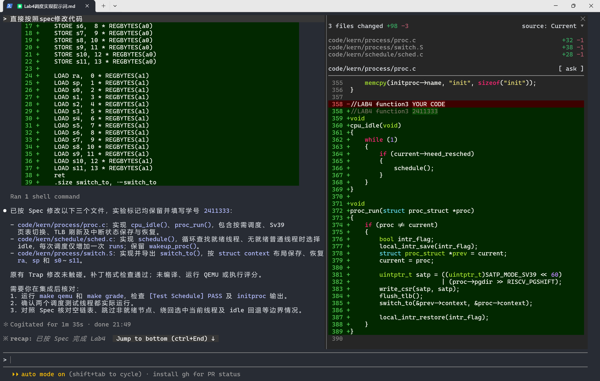

# Lab 4 提示词汇总

## 功能模块一：虚拟内存页操作

**负责人：** 2413497-姚嘉乐

### 一、Spec（设计依据）

**1. 输入与调用条件**

- 先根据 `pmm.c` 中的 `get_pte()` 和 `pmm.h` 的接口声明确定输入。`pgdir` 指向 Sv39 根页表，`la` 可以带页内偏移，两个函数操作的是该地址所在的 4 KiB 页。`page_insert()` 接收调用者已取得的物理页描述符和权限位。
- `get_pte()` 返回的是末级项的地址。查表路径缺失和末级项的 `PTE_V` 未置位是两种状态。插入时允许按需分配下级页表，删除时只查找已有路径。

**2. 输出与处理过程**

- 按末级项原来的状态列出插入的预期结果。空项新增一次引用，同页重映射只更新权限，异页替换把引用从旧页移到新页。分配所需的页表页失败时返回 `-E_NO_MEM`，传入数据页仍由调用者持有。
- 对有效映射执行删除时，先撤销映射并刷新该地址的 TLB，再归还引用归零的物理页。路径缺失、末级项为空和重复删除都直接返回。覆盖旧映射时按本次 `perm` 构造新项，以清除被撤销的权限位。

**3. 修改范围与验收**

- 修改范围是 `pmm.c` 中的 `LAB4 function1`。沿用现有页表遍历和物理页分配器，补齐 `page_insert()` 和 `page_remove()`。
- 整合使用make qemu和make grade做全面的检查，过程再重点核对同页重映射时空闲页数是否保持原值，以及重复删除是否只撤销一次引用。

### 二、最终提示词

按 Lab0.5 的四段式组织提示词。`[PROMPT]` 写明实现位置、修改范围和学号标记，`[RELY]` 列出查表、页号转换、引用计数和 TLB 接口，`[GUARANTEE]` 给出两个函数签名。`[SPECIFICATION]` 为两个函数分别写前置条件、后置条件和各个分支的预期结果。

```text
[PROMPT]
任务：
在code/kern/mm/pmm.c中实现 page_insert() 和 page_remove()，用于建立、替换和撤销 Sv39 的 4 KiB 页映射。

操作要求：
在工作区的实际源码中补全 //LAB4 function1 YOUR CODE 所在区域，将标记改为 //LAB4 function1 2413497。编辑范围限于该区域，沿用现有函数声明、页表查找逻辑和物理页分配器。需要共用的辅助函数可以定义为本文件的 static 函数。

输出要求：
直接进行文件操作，使用下面[RELY]、[GUARANTEE]、 [SPECIFICATION]部分的信息。积极合理的使用注释，维护代码的可读性。

[RELY]
请先阅读code/kern/mm/pmm.c和code/kern/mm/pmm.h。

- 查找页表项。get_pte(pgdir, la, 1) 可以创建缺少的下级页表，传 0 则只查找。
  返回 NULL 表示没找到末级项。返回指针时，用 *ptep & PTE_V 判断该项是否有效。
  只读查询也可以用 get_page()，它返回已映射的物理页描述符，并可通过ptep_store 输出末级页表项的地址。
- 读写映射。用 pte_create(page2ppn(page), perm) 构造新页表项，它会设置 PTE_V。用 pte2page(*ptep) 取得有效页表项对应的旧页。
- 管理物理页。page_ref_inc() 和 page_ref_dec() 更新引用计数。
  page_ref_dec() 返回减一后的计数，free_page() 将一页归还分配器。
- 修改末级页表项后，调用 tlb_invalidate(pgdir, la)。
- 常量。PTE_V 定义在 mmu.h，E_NO_MEM 定义在 error.h。

[GUARANTEE]

实现以下两个公开接口，签名与 pmm.h 一致。

int page_insert(pde_t *pgdir, struct Page *page, uintptr_t la, uint32_t perm);
void page_remove(pde_t *pgdir, uintptr_t la);

[SPECIFICATION]

实现单元一  page_insert()

Pre-Condition
物理内存管理已初始化。pgdir 指向有效的 Sv39 根页表。la 位于可使用末级页表项的 4 KiB 映射范围内。page 是已分配或已被其他地址映射的物理页。

Post-Condition
成功时返回 0。目标虚拟页指向 page，页表项按传入的 perm 构造。被撤销的旧映射及其引用计数得到正确处理。

Case 1  末级项原本为空
建立映射，目标物理页的引用计数增加一次。

Case 2  原映射指向同一物理页
更新页表项的权限。物理页号、引用计数和空闲页数保持原值。

Case 3  原映射指向另一物理页
新页增加一次引用，旧页减少一次引用。旧页仍有引用时继续保留，归零时归还分配器。

Case 4  无法分配所需的页表页
返回 -E_NO_MEM。目标数据页的映射和引用计数均未改变，调用者仍负责传入的 page。get_pte() 已挂接的上层页表沿用框架的管理方式。

Requirements
每次成功写入末级项后，同步该虚拟地址的 TLB。回收旧页前，确保旧页表项和旧翻译均已失效。权限按 perm 重新构造，旧权限中被撤销的位应清除。

实现单元二  page_remove()

Pre-Condition
pgdir 指向有效的 Sv39 根页表。la 位于可使用末级页表项的 4 KiB 映射范围内，目标映射可以存在或缺失。

Post-Condition
目标虚拟页的映射被撤销。其他虚拟页的映射和上层页表页继续有效。

Case 1  页表路径缺失或末级项无效
直接返回，页表、引用计数和空闲页数保持原值。对同一地址重复删除也应满足这个行为。

Case 2  末级项有效
先取得旧物理页，再清空末级项并同步该地址的 TLB。旧页引用减少一次，计数归零时调用 free_page()。
```

## 功能模块二：进程创建及初始化

**负责人：** 2410690-王睿瑜

### 一、Spec（设计依据）

**1. 输入与调用条件**

- 以小组仓库 `kylie-dot/OS2026_Labs` 的 Lab4 框架提交 `a211d8d` 为基线。目标文件中的 `LAB4 function2 YOUR CODE` 是 B 模块的实现位置。
- `proc_init()` 在内核启动阶段调用，依赖内存管理已初始化、启动页表和启动栈可用。普通线程由 `kernel_thread()` 提供初始 Trap 帧，再交给 `do_fork()`。
- 以本仓库的头文件和汇编为准。线程入口使用 `s0` 保存目标函数，`s1` 保存参数。`forkrets` 将传入的 Trap 帧地址装入 `sp`，再走既有 Trap 恢复路径。

**2. 输出与处理过程**

- 初始化 PCB、创建 `idleproc` 和 `initproc`，为新线程准备独立内核栈、Trap 帧与切换上下文。
- 创建成功时分配唯一 PID，登记到进程链表和 PID 哈希表，更新进程计数，再将线程设为就绪。失败时返回负错误码并释放此前取得的资源。
- 内核线程共享启动页表，当前阶段保留 `copy_mm()` 接口。线程创建与调度通过 PCB 中的状态、栈、Trap 帧和切换上下文衔接。

**3. 修改范围与禁止项**

仅编辑 `code/kern/process/proc.c` 的 B 模块，以及编译所需的头文件引用和外部符号声明。保留 C 模块的 `LAB4 function3 YOUR CODE`，沿用现有数据结构、辅助函数与公共接口。

### 二、最终提示词

```text
[PROMPT]
任务
你正在操作 kylie-dot/OS2026_Labs 的 RISC-V uCore 教学内核。请在当前工作区直接修改 code/kern/process/proc.c，一次完成 Lab4 功能模块二“进程创建及初始化”。工作区应基于小组的 Lab4 框架提交 a211d8d，目标文件应有 LAB4 function2 YOUR CODE 标记。先检查当前分支、工作区和文件内容。如果当前版本不是该框架、模块已经实现，或目标区域含有他人的改动，请说明情况并停下，保留已有工作。

操作要求
在 function2 标记下新增下列六个函数，将标记改为 //LAB4 function2 2410690。
仅编辑 proc.c 的 function2 区域及该文件必要的 include 和 extern 声明。保留 function3 标记、现有辅助函数、结构体、公共签名、Trap 与调度实现、测试和构建脚本。优先使用项目现有接口。

输出要求
直接编辑实际文件并审查 diff。完成后说明修改位置、线程首次运行路径、失败清理顺序以及仍需验证的项目。编译、QEMU、评分与截图由我完成。不要代为提交或推送 Git，也不要声称未经执行的测试通过。

[RELY]
从仓库根目录读取：
- code/kern/process/proc.c、proc.h、entry.S
- code/kern/trap/trap.h、trapentry.S
- code/kern/schedule/sched.c、sched.h，及 switch_to 的实际汇编实现或待实现位置
- code/kern/mm/pmm.h、memlayout.h、kmalloc.h
- code/kern/sync/sync.h、code/libs/riscv.h、list.h、error.h
- code/kern/init/init.c、entry.S 和 code/tools/test_lab4.c

以实际声明核对 bootstack、boot_pgdir_pa、KSTACKSIZE、CLONE_VM、MAX_PROCESS、错误码和中断保存/恢复接口。使用已有的 setup_kstack、put_kstack、get_pid、hash_proc、find_proc、wakeup_proc 与 forkret。核对 entry.S 中 move a0, s1 和 jalr s0，以及 forkrets 将传入指针交给 __trapret 的约定。需要读取 sstatus 时显式引入声明 read_csr 和 SSTATUS 位的头文件。

[GUARANTEE]
实现以下函数并保留给定接口：
static struct proc_struct *alloc_proc(void);
int kernel_thread(int (*fn)(void *), void *arg, uint32_t clone_flags);
static void copy_thread(struct proc_struct *proc, uintptr_t stack, struct trapframe *tf);
static int copy_mm(uint32_t clone_flags, struct proc_struct *proc);
int do_fork(uint32_t clone_flags, uintptr_t stack, struct trapframe *tf);
void proc_init(void);

[SPECIFICATION]
实现单元：alloc_proc
Pre-Condition：kmalloc 与启动页表已就绪。
Post-Condition：分配失败返回 NULL。成功时初始化全部 PCB 字段，设置 state=PROC_UNINIT、pid=-1、pgdir=boot_pgdir_pa，mm、parent、tf 等指针为空。运行次数、栈地址、调度标记、flags、名称和 context 清零。分别初始化 list_link 与 hash_link，PCB 此时未登记到全局结构。

实现单元：kernel_thread
Pre-Condition：fn 是有效的内核线程入口，调用方已建立 current。
Post-Condition：创建并清零临时 Trap 帧，s0 存 fn、s1 存 arg，epc 指向 kernel_thread_entry。根据当前 sstatus 设置 SPP 和 SPIE、清除 SIE，使 sret 回到 S 模式。调用 do_fork(clone_flags | CLONE_VM, 0, &tf)，返回其结果。

实现单元：copy_thread
Pre-Condition：新 PCB 的内核栈已由 setup_kstack 分配，tf 指向有效模板。
Post-Condition：在新内核栈顶部预留并复制完整 Trap 帧，令 proc->tf 指向副本。将副本的 a0 置为 0。stack 为 0 时，将副本的 gpr.sp 设为帧地址；否则使用 stack。context.ra 指向 forkret，context.sp 指向帧地址。首次切换应能走 forkret → forkrets → __trapret → sret → kernel_thread_entry。

实现单元：copy_mm
Pre-Condition：当前实验创建内核线程，PCB 已完成默认初始化。
Post-Condition：保留接口并返回 0，内核线程继续共享启动页表，mm 保持 NULL。避免新增用户地址空间复制逻辑。

实现单元：do_fork
Pre-Condition：current、进程链表和 PID 哈希桶已经初始化，tf 指向有效模板。
Post-Condition：
1. 达到 MAX_PROCESS 时返回 -E_NO_FREE_PROC；PCB 分配失败时返回 -E_NO_MEM。
2. 设置父进程为 current，依次准备内核栈、地址空间接口和运行现场。内核栈分配失败时释放 PCB。copy_mm 失败时先释放内核栈再释放 PCB，返回对应错误。失败路径不能将 PCB 留在全局结构中或增加进程计数。
3. 在同一个本地关中断区间内分配唯一 PID、登记哈希表和 proc_list，并更新 nr_process。按原状态恢复中断。完成登记后调用 wakeup_proc，返回新 PID。

实现单元：proc_init
Pre-Condition：由启动路径调用一次，bootstack 与启动页表已建立。
Post-Condition：初始化进程链表和全部哈希桶。创建 idleproc，设 PID 为 0、状态为 PROC_RUNNABLE，复用 bootstack，置 need_resched，计入 nr_process 并设为 current。idleproc 无需进入普通 PID 哈希表。再调用 kernel_thread 创建运行 init_main 的 initproc；创建失败须按框架方式报错。用返回的 PID 通过 find_proc 取回 initproc 并设置名称。线程名称为 idle 和 init，复制时包含结尾 NUL，避免用固定长度从短字符串字面量越界读取。演示参数使用 Hello world!!，若框架测试明确指定其他参数，以测试要求为准。
```

#### 三、实现迭代过程

| 轮次 | 实际现象 / 审查发现 | 原因分析 | 修正与结果 |
| --- | --- | --- | --- |
| v1 首次生成与静态审查 | Codex 在 `code/kern/process/proc.c` 中实现了 B 模块的六个函数。`proc.o` 强制重编译通过。人工审查发现，`kernel_thread()` 只在 `SSTATUS_SPP` 已置位时再次置位。 | 如果读取的 `SPP` 为 0，条件分支不会执行，首次 `sret` 将尝试返回 U 模式。该问题涉及运行时的特权级切换，编译检查无法发现。 | 发送第二轮提示词，要求无条件设置 `SPP`，并对照框架复核 `idleproc` 的登记方式。 |
| v2 修正与复验 | Codex 改用 `tf.status \|= SSTATUS_SPP;`，同时保留 `SPIE` 置位和 `SIE` 清零。复核后保留 `idleproc` 在 `proc_list` 中的登记。 | 无条件置位保证 Trap 帧中的 `SPP` 为 1，使首次 `sret` 的目标特权级为 S 模式。`idleproc` 仍未登记到 PID 哈希表。 | 在 WSL 中执行 `git diff --check`，无输出。`proc.o` 强制重编译通过，修正版用于正式提交 `40e9808`。QEMU 首次调度和 `make grade` 待验证。 |

**第二次实际发送的提示词**

```text
请在当前试跑工作区做第二轮修正，只修改 code/kern/process/proc.c 的 function2 区域。

1. 修正 kernel_thread() 对 sstatus 的初始化。当前代码只有在 SSTATUS_SPP 已经置位时才再次置位。请基于 read_csr(sstatus) 无条件设置 SSTATUS_SPP 和 SSTATUS_SPIE，并清除 SSTATUS_SIE，确保首次 sret 返回 S 模式。
2. 对照 get_pid()、调度器和 code/tools/test_lab4.c，核对 proc_init() 是否应将 idleproc 插入 proc_list。说明源码依据，再决定是否修改。
3. 完成后列出实际改动。若无法读取 Git diff，请如实说明。编译和 QEMU 由我执行。
```

## 功能模块三：进程调度

**负责人：** 2411333-吴卓彦

### 一、Spec（设计依据）

**1. 输入与调用条件**

- `cpu_idle()` 与 `schedule()` 依赖初始化后的 `current`、`idleproc` 和带哨兵的循环进程链表。普通线程已通过 `list_link` 挂入链表。进入调度前，本地中断可以开启或关闭。
- `proc_run(proc)` 接收合法的目标 PCB，其 `pgdir` 是页对齐的页表根物理地址，目标上下文已准备好。
- `switch_to(from, to)` 通过 `a0`、`a1` 接收上下文地址，使用 RV64 下的 14 个寄存器槽位。已迁移的 Trap 恢复路径提供新线程首次运行时所需的 `__trapret`。

**2. 输出与处理过程**

- `cpu_idle()` 持续检查 `need_resched`，在标记置位时调用 `schedule()`。
- `schedule()` 在关中断期间清除调度标记。当前是 idle 时从链表头之后开始，否则从当前节点之后开始。跳过哨兵和非就绪线程，绕回时可选仍然就绪的当前普通线程。无就绪普通线程时回到 idle。每次给选中线程增加一次 `runs`，目标不同时才切换。
- `proc_run()` 在临界区更新 `current`，写入 Sv39 `satp`、刷新 TLB，再调用 `switch_to()`。目标就是当前线程时直接返回。旧线程后来从切换调用处恢复时，还原它先前保存的本地中断状态。
- `switch_to()` 按 `struct context` 的顺序保存、恢复 `ra`、`sp`、`s0`～`s11`。新线程经 `forkret → forkrets → __trapret → kernel_thread_entry` 首次执行，旧线程从上次切出的调用位置继续。

**3. 修改范围与验收**

- 仅实现 `code/kern/process/proc.c`、`code/kern/schedule/sched.c` 和 `code/kern/process/switch.S` 中的 `LAB4 function3`。保留框架接口、进程创建代码和已迁移的 Trap 代码。按报告要求用本人学号替换 `YOUR CODE`。
- 对照源码审查链表边界、开关中断及寄存器布局。由实验者在集成后亲自运行 `make qemu` 和 `make grade`，确认 `initproc` 输出及 `[Test Schedule] PASS`。

### 二、最终提示词

生成时打开了 `Lab4调度实现提示词.md`，并输入「直接按照spec修改代码」。下方保留工作区中的该提示词正文。截图记录了执行指令、改动和 AI 的回复。

```text
# Lab 4 进程调度实现提示词

[PROMPT]

**任务**

在项目 `E:\大三上\OS\OS2026_Labs` 的 `Lab4` 分支上实现 uCore 的进程调度。目标平台为 RISC-V RV64，分页模式为 Sv39。请先阅读下列依赖，再按规格直接修改项目文件。

**操作要求**

| 允许修改的文件 | 修改范围 |
| --- | --- |
| `code/kern/process/proc.c` | 在 `LAB4 function3` 标记处实现 `cpu_idle` 和 `proc_run`，按需引入框架已有头文件。 |
| `code/kern/schedule/sched.c` | 在 `LAB4 function3` 标记处实现 `schedule`，保留已有的 `wakeup_proc`。 |
| `code/kern/process/switch.S` | 在 `LAB4 function3` 标记处实现并导出 `switch_to`。 |

保留实验标记，`YOUR CODE` 填写学号`2411333`。沿用框架的公共声明和结构体布局。编辑范围限于上表，不修改进程创建代码、Trap 代码、内存管理、构建配置和测试。

**输出要求**

实际修改工作区源码，完成后只说明修改了哪些文件和函数、还有哪些点需要实验者核对。编译、QEMU、评分和截图由实验者完成。请勿在 WSL 编译、运行 QEMU、执行评分或生成测试证据。

[RELY]

- `code/kern/process/proc.h` 和 `code/kern/process/proc.c` 提供 PCB、`struct context`、`current`、`idleproc`、`proc_list` 和 `le2proc`。普通线程通过 `list_link` 登记到进程链表。内核线程的 `pgdir` 是页表根的物理地址。
- `code/kern/schedule/sched.h` 提供调度接口。 `code/libs/list.h` 中的双向循环链表以 `proc_list` 为哨兵。使用 `list_next` 遍历，对普通节点使用 `le2proc(node, list_link)`。
- `code/kern/sync/sync.h` 和 `code/kern/driver/intr.c` 提供本 hart 的中断保存与恢复接口。`local_intr_save` 记录进入前的 `sstatus.SIE` 状态并关中断，`local_intr_restore` 按保存值恢复。
- `code/libs/riscv.h` 提供 CSR 操作、`SATP_MODE_SV39`、`RISCV_PGSHIFT` 和 `REGBYTES`、`LOAD`、`STORE` 等汇编宏。对照 `code/kern/mm/pmm.c` 的 `enable_paging()` 和 `code/kern/mm/pmm.h` 的 `flush_tlb()`。现有 `lsatp()` 适用于 Sv32。
- 新线程的 `context` 和 trapframe 由线程创建代码准备，首次运行沿用 `forkret → forkrets → __trapret → kernel_thread_entry`。

[GUARANTEE]

- 交付 `void cpu_idle(void)`、`void schedule(void)`、`void proc_run(struct proc_struct *proc)`、`void switch_to(struct context *from, struct context *to)` 的实现，保持框架接口可调用。
- 调度覆盖空链表、非就绪节点、绕回、只有当前线程可运行、无可运行普通线程这几种情况。每次调度只计一次 `runs`，选中当前线程时不切换上下文。
- 可运行的新线程能进入已有首跑路径，已经运行过的线程被重新选中时能从原切出位置继续，临界区退出时恢复调用前保存的中断状态。
- 验收由实验者在模块集成后用 `make qemu` 和 `make grade` 完成。检查 `[Test Schedule] PASS` 和 `initproc` 的输出。`code/tools/test_lab4.c` 的调度用例创建两个测试线程并确认两者都实际运行。

[SPECIFICATION]

### 实现单元一 · `cpu_idle(void)`

**Pre-Condition**

- 内核已完成 `proc_init`，`current` 指向有效的 `idleproc`。

**Post-Condition**

- 函数持续运行。仅当 `current->need_resched` 置位时调用 `schedule()`，恢复到空闲线程后继续检查。

### 实现单元二 · `schedule(void)`

**Pre-Condition**

- `proc_list` 已初始化为带哨兵的循环链表。`current`、`idleproc` 有效。若当前是普通线程，它的 `list_link` 已登记在链表中。调用时本地中断可以开启或关闭。

**Post-Condition**

- 保存本地中断状态并关中断，清除调用时当前线程的 `need_resched`。
- 当前是 idle 时从哨兵之后开始，否则从当前线程之后开始。最多扫描一圈，跳过哨兵和非 `PROC_RUNNABLE` 的节点。绕回后可以选中仍然就绪的当前普通线程。找不到可运行普通线程时选择 `idleproc`。
- 选中者的 `runs` 加一。仅当它与 `current` 不同时调用 `proc_run(next)`。本次调用恢复执行并离开临界区时，恢复保存的本地中断状态。

### 实现单元三 · `proc_run(struct proc_struct *proc)`

**Pre-Condition**

- `proc` 和 `current` 都指向有效 PCB。目标的 `pgdir` 是页对齐的物理地址，目标上下文可被恢复。

**Post-Condition**

- 若目标就是 `current`，直接返回，不改写 `satp` 或切换上下文。
- 若目标不同，保存并关闭本地中断，保留旧 `current`，将 `current` 更新为目标。将目标页表根物理地址右移 `RISCV_PGSHIFT` 得到物理页号，与 RV64 Sv39 模式字段组合后写入 `satp`，随后执行 `flush_tlb()`。
- 用旧线程和目标线程的 `context` 地址调用 `switch_to`。旧线程后来恢复执行、从这次调用返回时，恢复它进入临界区前保存的中断状态。

### 实现单元四 · `switch_to(struct context *from, struct context *to)`

**Pre-Condition**

- 按 RISC-V 调用约定，`a0`、`a1` 分别指向可写的旧上下文和已准备好的目标上下文。槽位与 `proc.h` 的 `struct context` 一致，RV64 下每槽 8 字节。

**Post-Condition**

- 将 `ra`、`sp`、`s0`～`s11` 按结构体顺序保存至 `from`，再从 `to` 恢复对应的 14 个槽位。
- 通过恢复后的 `ra` 返回。目标线程首次运行时返回到 `forkret`，已经运行过时回到它上次切出的调用位置。
```

### 三、实现迭代过程

1. **前置迁移。** 先补齐 Lab 3 的 Trap 入口、现场恢复和中断与异常处理。保留时钟重设、计数和周期输出，去掉固定关机规则。
2. **首次生成。** AI 依据独立提示词，在 `proc.c`、`sched.c` 和 `switch.S` 中一轮完成四个调度函数。静态审查确认调度逻辑和上下文布局符合 Spec。

**最终结果**

- ✅ 四个调度函数已实现，补丁格式检查通过。
- ⏳ 各模块合并后统一运行 `make qemu` 和 `make grade`。

**关键改进点总结**

1. 在 `[RELY]` 中说明现有链表、开关中断接口、Sv39 页表和上下文布局，明确实现依赖。
2. 在 `[SPECIFICATION]` 中为四个函数分别写前置条件和后置条件，具体说明绕回、idle 回退、同线程不切换和中断恢复。



