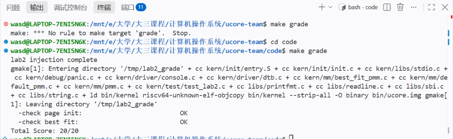
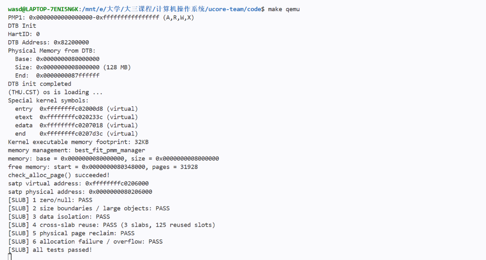

# 操作系统实验报告

## 实验基本信息

| 项目 | 内容 |
|------|------|
| **实验名称** | Lab X: [实验名称] |
| **小组成员** | 学号1-姓名1、学号2-姓名2、学号3-姓名3 |
| **完成日期** | YYYY-MM-DD |

### 小组分工

练习如何分工？

| 成员 | 负责的练习/模块 |
|------|----------------|
| 学号1-姓名1 | [练习或模块名称] |
| 学号2-姓名2 | [练习或模块名称] |
| 学号3-姓名3 | [练习或模块名称] |

实验报告如何分工？

---

## 一、实验目的

<!-- 说明本次实验的主要目标和预期成果 -->

本实验的主要目的是：

1. [目的1：例如，理解用户态进程如何通过系统调用进入内核]
2. [目的2：例如，掌握进程创建、执行、退出的完整生命周期]
3. [目的3：例如，学习使用 AI 辅助开发操作系统核心功能]

---

## 二、实验环境

你们使用的 AI 工具

| 成员 | AI 编程工具 | 底层模型 | 备注 |
|------|------------|---------|------|
| 学号1-姓名1 | [例如：Cline（VS Code插件） / Claude Code（终端 Agent） / DeepSeek Harness等] | [例如：Claude Sonnet 4.5 / GPT-5.5 / DeepSeek-V4-Flash等] | [可选：特殊配置等] |
| 学号2-姓名2 | | | |
| 学号3-姓名3 | | | |

**说明：**
- **AI 编程工具**：指具体使用的终端工具、编辑器插件、桌面应用或浏览器界面
- **底层模型**：指该工具使用的大语言模型及版本

---

## 三、实验整体逻辑分析

### 2.1 本章节的逻辑主线

[请用自己的话描述本章实验的核心主线，例如：
- 本章围绕哪个核心主题展开？（例如：用户进程管理、虚拟内存、文件系统等）
- 整个实验解决什么问题？（例如：如何让用户程序运行在操作系统之上）]

### 2.2 功能的逐步实现

[说明本章实验是按照什么顺序逐步实现各个功能的，以及为什么要按这个顺序，例如：

1. 首先实现**功能A** → 为什么首先实现这个？（例如：建立系统调用接口是后续所有用户态功能的基础）
2. 接着再完善**功能B** → 为什么接着实现这个？（例如：有了系统调用后，需要能够加载和启动第一个用户进程）
3. 然后完成**功能C** → 为什么然后实现这个？（例如：有了第一个进程后，需要实现进程复制功能）
4. 最后补充了**功能D** → 为什么最后实现这个？（例如：最后完善进程退出和清理机制，形成完整闭环）]

---

## 四、实验内容与实现

<!-- 
说明：本部分按照 exercises 文档中的练习顺序组织
每个功能模块或者练习中可能包含多项任务，请根据实际情况调整
-->

### 功能模块二：[物理内存分配功能]

#### 模块功能描述

**需要实现/修改的函数：**

```c
// 列出本模块涉及的所有函数签名
void example_function(void);
int another_function(int arg);
```

**功能说明：**

[简要描述该模块的功能，包括：
- 该模块在整个系统中的作用
- 需要处理的主要场景
- 与其他模块的交互关系]


### 模块二任务一：理解first-fit 连续物理内存分配算法（思考题）
**负责人：** [2413497-姚嘉乐]

First-Fit 分配器将空闲物理页组织成按地址递增排列的空闲块链表，每个节点只代表一个连续空闲块的首页。首页的 `property` 记录块内页数，`PG_property` 标志表明它是空闲块首页，`nr_free` 记录所有空闲块的总页数。

**初始化空闲页：** `pmm_init()` 先选择 `default_pmm_manager`，调用 `default_init()` 建立空链表并将 `nr_free` 清零。随后，`page_init()` 排除固件、内核和页描述符数组占用的空间，把可用的完整页面交给 `default_init_memmap(base, n)`。该函数确认传入页处于保留状态后，清除其标志和 `property`，将引用计数置零，再设置首页的 `property = n` 和 `PG_property`，把这个空闲块按地址插入链表，并增加空闲页计数。

**分配连续物理页：** `default_alloc_pages(n)` 从链表头开始查找，选中第一个页数不少于 `n` 的空闲块。如果总空闲页数不足，或者找不到足够大的连续块，就返回 `NULL`。找到合适的块后，从其起始位置分配 `n` 页；若有剩余，就以 `page + n` 为新的空闲块首页，设置剩余页数并放回原链表位置。最后减少 `nr_free`，清除已分配块首页的 `PG_property`，返回对应的 `Page` 描述符指针。

**回收页面：** `default_free_pages(base, n)` 检查待释放页面的状态，重置其标志和引用计数，把这段区域登记为长度为 `n` 的空闲块，增加 `nr_free`，再按地址找到它在空闲链表中的插入位置。按地址排列便于随后判断它是否与前后空闲块连续。

**合并相邻空闲块：** 释放函数先检查前块是否满足 `前块首页 + 前块页数 == base`，满足则合并，并把 `base` 更新为前块首页；接着检查后块是否满足 `base + 当前块页数 == 后块首页`，满足则继续合并。被合并块的节点会从链表移除，其空闲块首页标志也会清除。这样可以将左右相邻的空闲区域重新连成大块。

分析后我认为原有 First-Fit 算法还有以下两点改进空间：

1. **降低空闲块的查找开销。** 当前使用链表顺序查找，若有 `k` 个空闲块，最坏需要检查全部节点，时间复杂度为 `O(k)`。可以改用按地址组织的平衡树，并维护每棵子树中的最大空闲块长度，跳过不可能满足请求的区域，在保留“选择地址最低的合格块”规则的同时，可以将查找开销降低到 `O(log k)`。不过，这也会增加算法的实现难度和数据结构的维护成本，需要根据空闲块数量权衡。

2. **修复尾部插入后重复操作节点的问题。** 阅读代码发现，原有的算法实现存在BUG，`default_init_memmap()` 和 `default_free_pages()` 的尾插分支在执行 `list_add(le, &(base->page_link))` 后没有退出循环。下一轮会访问刚插入的节点，并再次把同一节点插到自身后面，破坏其 `prev` 链接，并进一步影响后续前后块的合并。可以在尾插成功后补充 `break`，保证每个空闲块只插入一次，维持双向链表结构的正确性。

### 模块二任务二：实现 Best-Fit 连续物理内存分配算法（设计提示词借助 AI 完成）

#### 最终提示词

以下是经过迭代优化后，最终成功实现该功能的提示词：

````markdown
[PROMPT]

**任务**：
为当前内核实现并接入完整的 Best-Fit 连续物理页分配模块，使内核能够从所有满足请求的空闲块中，选择大小最小的一块分配连续物理页，并支持页面回收与相邻空闲块合并。

目标文件：
1. ucore-team/code/kern/mm/best_fit_pmm.c
   补全 Best-Fit 的内部状态、管理函数及 best_fit_pmm_manager 注册结构。
2. ucore-team/code/kern/mm/pmm.c
   仅修改 init_pmm_manager() 中的分配器选择，使内核使用 best_fit_pmm_manager。

**操作要求**：
- 必须修改项目中的实际文件，完成整个模块及其接入。
- 不允许修改 basic_check() 和 best_fit_check() 两个现有测试函数的全部内容。
- 允许替换 Best-Fit 文件中的临时编译脚手架，并添加模块内部的静态辅助函数、宏和变量。
- 保留现有代码，只在标记位置补全，不要删除既有逻辑。

**输出要求**：
- 使用下述 [RELY]、[GUARANTEE] 和 [SPECIFICATION] 完成真实文件修改，以工程真实代码为准，不要引入无关功能。
- 注意保持程序代码的可读性，合理使用注释。

[RELY]

请先读取两个目标文件，以及以下参考文件中的真实定义：

- ucore-team/code/kern/mm/pmm.h
- ucore-team/code/kern/mm/memlayout.h
- ucore-team/code/kern/mm/default_pmm.c
- ucore-team/code/kern/mm/best_fit_pmm.h
- ucore-team/code/libs/list.h

关键数据结构如下，使用工程中已有定义，不要重复定义：

```c
struct Page {
    int ref;
    uint64_t flags;
    unsigned int property;
    list_entry_t page_link;
};

struct pmm_manager {
    const char *name;
    void (*init)(void);
    void (*init_memmap)(struct Page *base, size_t n);
    struct Page *(*alloc_pages)(size_t n);
    void (*free_pages)(struct Page *base, size_t n);
    size_t (*nr_free_pages)(void);
    void (*check)(void);
};
```

[GUARANTEE]

必须实现以下模块内部接口：

```c
static void best_fit_init(void);
static void best_fit_init_memmap(struct Page *base, size_t n);
static struct Page *best_fit_alloc_pages(size_t n);
static void best_fit_free_pages(struct Page *base, size_t n);
static size_t best_fit_nr_free_pages(void);
```

必须在 Best-Fit 模块中定义具有外部链接的注册对象：

```c
const struct pmm_manager best_fit_pmm_manager;
```

注册对象的五个管理回调必须对应上述接口，check 回调必须绑定已有且未经修改的 best_fit_check()。

必须修改现有接口：

```c
static void init_pmm_manager(void);
```

修改目标是选择并初始化 best_fit_pmm_manager，保留原有的管理器名称输出和初始化调用。可以添加 static 辅助函数、模块内部宏及必要的内部状态，不改变公共接口和 Page 的结构定义。

[SPECIFICATION]

## best_fit_init

**Pre-Condition**：
- 内核处于物理内存管理器初始化阶段，尚未向本模块登记可用页面。

**Post-Condition**：
- 空闲链表处于合法的空链表状态。
- 空闲页计数为零。
- 模块可以接收后续的空闲区域登记。

## best_fit_init_memmap

**Pre-Condition**：
- 模块已经初始化。
- n > 0，base 指向描述符数组中的合法连续区间。
- 该区间内的页面均处于保留状态，且未被登记为空闲区域。

**Post-Condition**：
- 恰好新增 n 个可分配页面，空闲页计数增加 n。
- 新登记页面不再处于保留状态，引用计数为零。
- 页面被组织为符合模块状态约束的空闲块。

  **Case 1：没有相邻空闲块**
  - 新区域作为独立空闲块参与管理，其他空闲区域保持不变。

  **Case 2：存在相邻空闲块**
  - 新区域与实际连续的前后空闲块合并，形成完整的连续空闲区域。

**Requirements**：
- 新区域位于链表头部、中间或尾部时，均应正确维护双向链接。
- 每个空闲块节点只能挂接一次。
- 对 n == 0 的非法调用，沿用参考实现的断言检查。

## best_fit_alloc_pages

**Pre-Condition**：
- 模块已经初始化，n > 0。
- 当前链表中的空闲块具有合法的描述符和块长度。

**Post-Condition**：
- 成功时返回恰好 n 个连续物理页的首页描述符。
- 失败时返回 NULL，链表、标志和空闲页计数均保持调用前的状态。
- 所选块的页数是所有页数不少于 n 的空闲块中的最小值。
- 若有多个同样大小的最佳候选块，选择物理地址最低的一块。
- 分配区域从所选块的起始位置开始，空闲页计数减少 n。
- 返回区域不再属于空闲块，不具有空闲块首页标志；
- 页面引用计数保持为零，也不被标记为保留页。

  **Case 1：所选块恰好包含 n 页**
  - 整个块被分配，不留下该块对应的空闲节点。

  **Case 2：所选块大于 n 页**
  - 未分配的剩余部分继续作为连续空闲块参与管理，
    其首页、长度、标志和链表位置均正确。

  **Case 3：不存在足够大的连续空闲块**
  - 返回 NULL，包括总空闲页数不足，以及总量足够但分散在多个小块中的情况。

## best_fit_free_pages

**Pre-Condition**：
- 模块已经初始化，n > 0。
- base 指向合法的连续已分配页面区间。
- 待释放页面不属于保留区，也不属于当前空闲区域。

**Post-Condition**：
- 恰好归还 n 个页面，空闲页计数增加 n。
- 归还页面的引用计数为零。
- 释放后的空闲区域满足模块状态约束。

  **Case 1：前后均无相邻空闲块**
  - 释放区域成为独立空闲块。

  **Case 2：仅前侧或仅后侧存在相邻空闲块**
  - 释放区域与该相邻块合并，首页和块长度准确。

  **Case 3：前后均存在相邻空闲块**
  - 三段区域合并为一个连续空闲块，只保留最终块的首页节点与标志。

## best_fit_nr_free_pages

**Pre-Condition**：
- 模块已经初始化。

**Post-Condition**：
- 返回当前维护的空闲页计数。

## best_fit_pmm_manager 注册对象

**Pre-Condition**：
- 各管理接口已经实现，现有 best_fit_check() 保持原样。

**Post-Condition**：
- name 为 "best_fit_pmm_manager"。
- 五个管理回调准确绑定本模块对应接口。
- check 绑定现有 best_fit_check()。
- 对象与头文件中的 extern 声明一致，可以被通用层引用。

## init_pmm_manager

**Pre-Condition**：
- 由 pmm_init() 在登记空闲页面之前调用。

**Post-Condition**：
- pmm_manager 指向 best_fit_pmm_manager。
- 输出当前管理器名称，并通过其 init 回调完成初始化。
- 后续空闲页登记、分配、释放及检查均进入 Best-Fit 模块。

````


**最终结果：**

经过 [0] 次迭代，Best-Fit 算法最终：
- ✅ 编译通过
- ✅ 所有相关测试通过
- ✅ 功能符合预期

#### 改进空间说明
Best-Fit 算法仍有进一步的改进空间。当前实现已经具备相邻空闲块合并和精确匹配时提前结束查找的处理，但是还可以继续从以下两个方面改进：

1. **降低空闲块查找开销。** 当前通过链表比较候选块，若有 `k` 个空闲块，最坏查找复杂度为 `O(k)`。可以保留按地址排序的空闲链表，并额外建立按“块大小、起始地址”排序的平衡树索引，分别支持相邻块合并和最佳适配查找，可以将选块查找降低到 `O(log k)`。但是这样会增加索引的存储和维护成本，所以还是要综合考虑。

2. **增强释放操作的合法性检查。** 当前主要检查页面是否保留、是否带有空闲块首页标志，但空闲块内部页面不一定具有 `PG_property` 标志，因此不能完整识别所有重复释放。可以进一步检查释放区间是否越界、是否与已有空闲块重叠，这样可以预防非法释放操作。


### 模块二扩展任务Challenge：任意大小的内存单元 slub 分配算法（设计提示词借助 AI 完成）
**负责人：** [2413497-姚嘉乐]

#### 最终模块生成提示词：

````markdown
[PROMPT]

**任务**：
为当前 ucore Lab2 内核实现简化的 SLUB 内存对象分配模块，体现两层架构：底层使用现有物理页分配器，上层将页面组织为对象池，提供按字节申请和释放内存的接口。

目标文件：
- 新增 code/kern/mm/slub.h，声明公开接口。
- 新增 code/kern/mm/slub.c，实现对象分配与释放。
- 修改 code/kern/init/init.c，在物理内存初始化完成后初始化 SLUB。

**操作要求**：
- 必须修改项目中的实际文件，完成模块及其接入。
- 仅修改上述文件，保留已有实现，不修改物理页分配器、公共数据结构、构建规则和现有测试。
- 本次只实现模块，不新增测试函数；测试由后续独立任务完成。
- 可以自行设计对象大小类别、内部管理结构及 static 辅助函数。
- 在新增实现处添加 lab2 任务注释，注明学号 2413497。

**输出要求**：
以工程真实定义和下述规格为准。不要引入无关功能。注意维护代码的可读性，多使用注释。


[RELY]

请先读取以下文件的相关定义，直接使用已有接口，不重复实现：

- code/kern/mm/pmm.h：
  物理页分配、释放、空闲页统计及地址转换接口。
- code/kern/mm/mmu.h：
  PGSIZE 等页面大小定义。
- code/libs/defs.h：
  基础类型、ROUNDUP、ROUNDDOWN 和 to_struct 等宏。
- code/libs/list.h：
  list_entry_t 及双向循环链表操作。
- code/libs/string.h：
  memset、memcpy 等内存操作接口。
- code/kern/debug/assert.h：
  assert、panic 等检查接口。

主要物理页接口：

```c
struct Page *alloc_pages(size_t n);
void free_pages(struct Page *base, size_t n);
size_t nr_free_pages(void);
```

接入与构建条件：
- kern_init() 已调用 pmm_init()；SLUB 应在该调用完成后、进入主循环前初始化。
- 现有构建规则会自动收集 code/kern/mm/ 下的 C 文件，


[GUARANTEE]

必须实现以下公开接口，并在头文件中声明：

```c
void slub_init(void);
void *slub_alloc(size_t size);
void slub_free(void *ptr);
```

必须修改现有函数：

```c
int kern_init(void);
```

修改目标：在 pmm_init() 完成后调用 slub_init()，保留原有启动流程。

允许添加模块内部的 static 辅助函数、宏和管理状态，不改变现有物理内存管理接口。


[SPECIFICATION]

## 模块整体要求

- 小对象按大小分类，将 slab 中的数据空间组织为固定尺寸的对象槽位。
- 优先复用已有 slab 中的空闲对象，没有可用对象时再申请物理页。
- 超过小对象类别上限的请求，通过足够数量的连续物理页满足。
- 不同的存活分配区域不得重叠，分配和释放不得破坏其他存活对象的数据。
- 返回给调用者的有效区域，不得包含仍需保留的管理信息。
- 内部布局和辅助函数由实现自行设计，时空复杂度不作额外要求。


## slub_init

**Pre-Condition**：
- 物理内存管理已经初始化，本模块尚未初始化。

**Post-Condition**：
- 内部管理状态初始化完成，可以接受后续分配和释放请求。
- 此时没有存活对象，不预先占用物理页。


## slub_alloc

**Pre-Condition**：
- 本模块已经初始化。

**Post-Condition**：
- 成功时返回至少包含 size 个可用字节、满足 16 字节对齐的内核虚拟地址。
- 失败时返回 NULL，不泄漏本次申请的资源，不破坏已有分配及管理状态。

  **Case 1：size 为 0**
  - 返回 NULL，状态不变。

  **Case 2：请求能够满足**
  - 小对象通过对应大小类别的 slab 分配，较大对象通过整页分配路径取得。
  - 调用者可以在请求长度范围内正常读写，之后通过 slub_free() 释放。
  - 不要求返回的数据已经清零。

  **Case 3：内存不足或长度计算溢出**
  - 返回 NULL，已有对象保持有效，管理状态保持正确。


## slub_free

**Pre-Condition**：
- 本模块已经初始化。
- ptr 为 NULL，或本模块返回且尚未释放的原始指针。

**Post-Condition**：
- ptr 为 NULL 时不进行操作。
- 小对象释放后可以再次用于分配；所属 slab 全部空闲时，立即将其物理页归还底层。
- 大对象释放时，归还本次分配占用的全部物理页。
- 释放所需的归属和大小信息由模块维护，不要求调用者额外传入长度。
- 其他存活对象保持有效，空闲对象、使用计数及链表状态一致。
- 所有对象释放后，模块不保留动态申请的物理页。


## kern_init

**Pre-Condition**：
- 内核正在执行启动初始化。

**Post-Condition**：
- 先完成现有 pmm_init()，再初始化 SLUB。
- 不改动其他内容，保留原有物理页检查、信息输出及启动流程。

````
#### 最终模块测试提示词
````markdown
[PROMPT]

**任务**：
为当前已实现的简化 SLUB 分配器编写独立测试，验证不同大小对象的分配、读写、释放、复用和物理页回收。

项目根目录为 ucore-team，以下路径均相对于该目录。

目标文件：
- 新增 code/kern/mm/slub_test.h，声明测试入口。
- 新增 code/kern/mm/slub_test.c，实现测试。
- 修改 code/kern/init/init.c，在现有 slub_init() 调用后执行测试。

**操作要求**：
- 必须修改项目中的实际文件，完成测试及其接入。
- 仅修改上述文件，不修改 SLUB 实现、物理页分配器、已有测试和构建规则。
- 测试依据接口规格判断结果，不将实现中的错误作为预期行为。
- 发现问题时保留失败并报告触发条件，不擅自修复被测模块。
- 允许添加 static 辅助测试函数和有界的静态记录数组。
- 新增测试注明 lab2 和学号 2413497。

**输出要求**：
参考真实工程实现和下述规格。说明各组测试覆盖的行为及其检验依据，编译并运行，报告实际结果；未执行的验证如实说明。维护代码可读性，多使用注释。


[RELY]

请先阅读：
- code/kern/mm/slub.h
- code/kern/mm/slub.c
- code/kern/mm/pmm.h
- code/kern/init/init.c

可使用工程现有的基础类型、页面大小定义、内存操作、assert 和 cprintf，相关定义位于：
- code/libs/defs.h
- code/kern/mm/mmu.h
- code/libs/string.h
- code/kern/debug/assert.h
- code/libs/stdio.h

主要接口：

```c
void *slub_alloc(size_t size);
void slub_free(void *ptr);
size_t nr_free_pages(void);
```

当前约定：
- 小对象类别为 16、32、64、128、256、512、1024、2048 字节，
  较大对象通过连续物理页分配。
- 返回地址至少满足 16 字节对齐，数据不保证初始为零。
- slub_alloc(0) 返回 NULL，slub_free(NULL) 不进行操作。
- 空 slab 立即归还物理页，大对象释放时归还其全部物理页。
- kern_init() 已调用 slub_init()，测试不得再次初始化 SLUB。
- 测试开始时没有存活的 SLUB 对象，也没有其他并发分配者。


[GUARANTEE]

必须实现并在测试头文件中声明：

```c
void slub_check(void);
```

必须修改现有函数：

```c
int kern_init(void);
```

接入要求：保留已有初始化流程，在 slub_init() 之后调用 slub_check()。

可以添加模块内部的 static 辅助函数和测试记录，不访问或复制分配器的私有管理结构。


[SPECIFICATION]

## slub_check

**Pre-Condition**：
- 物理页分配器和 SLUB 已初始化。
- 当前没有存活的 SLUB 对象。

**Post-Condition**：
- 所有检查成功后返回，测试申请的对象全部释放。
- 结束时 nr_free_pages() 恢复到测试入口记录的值。
- 任一检查失败时通过断言定位，不输出整体通过标记。

  **Case 1：零长度与空指针**
  - 验证零长度申请返回 NULL，释放 NULL 不改变空闲页数。
  - 随后正常分配和释放仍可进行。

  **Case 2：大小边界与大对象**
  - 覆盖最小正长度、各大小类别边界前后的请求，
    以及超过 2048 字节和需要跨页的请求，例如 5000 字节。
  - 验证返回值非空、地址对齐，并能完整读写请求长度内的数据。

  **Case 3：对象之间的数据隔离**
  - 同时申请多个相同大小和不同大小的对象，检查有效区域不重叠。
  - 写入可区分的数据，在继续分配、释放其他对象后重新校验，
    确认存活对象的数据未被破坏。

  **Case 4：跨 slab 分配与对象复用**
  - 对同一类别进行有界批量分配，确保使用不止一个 slab。
  - 保留部分对象，释放另一部分，再申请同类对象。
  - 验证已有空位能够复用，存活对象保持有效；
    对应空位足够时，不应额外消耗物理页。
  - 不要求返回某个固定地址。

  **Case 5：物理页回收**
  - 混合申请、释放小对象和大对象，验证部分释放不影响其他对象。
  - 每组对象全部释放后，空闲页数恢复到该组开始时的值。
  - 基准值动态记录，不写死空闲页数、私有管理头大小或 slab 容量。

  **Case 6：分配失败与长度溢出**
  - 构造计算本身不溢出、但超过当前空闲页容量的大对象请求，
    验证返回 NULL。
  - 使用接近 size_t 上限的请求，验证长度溢出处理。
  - 失败前后空闲页数不变，已有对象的数据保持正确，
    随后仍能正常分配和释放。

**Requirements**：
- 只读写各对象请求长度内的空间，只释放合法且尚未释放的原始指针。
- 测试规模有界，避免大数组导致内核栈溢出；
  辅助记录不依赖被测 SLUB 分配器。
- 每组检查成功后输出对应的 PASS 标记。
- 仅在全部检查完成后输出：
  [SLUB] all tests passed!


## kern_init

**Pre-Condition**：
- 内核正在执行启动初始化。

**Post-Condition**：
- 保持 pmm_init()、slub_init()、slub_check() 的调用顺序。
- 保留原有物理页检查、启动输出和主循环。

````

**最终结果：**

经过 [0] 次迭代， slub 分配算法最终：
- ✅ 编译通过
- ✅ 所有相关测试通过
- ✅ 功能符合预期
#### 简要说明

本次 SLUB 测试覆盖了以下核心行为和边界情况：

| 测试内容 | 检验作用 |
|---|---|
| 零长度申请与释放空指针 | 检查特殊输入是否按约定处理，且不改变空闲页数、不影响后续分配。 |
| 大小类别边界与大对象 | 覆盖各类别边界前后的长度、2048/2049 字节及跨页请求，检查分配空间是否足够、返回地址是否满足 16 字节对齐。 |
| 多对象数据隔离 | 同时分配不同大小的对象，检查地址区间不重叠，并在交错分配、释放后逐字节校验存活对象，发现数据串扰或错误覆盖。 |
| 跨 slab 分配与对象复用 | 批量申请同类对象，使其占用多个 slab；释放部分对象后重新申请，检查已有空位能否复用，以及空位足够时是否仍额外申请物理页。 |
| 物理页回收 | 混合释放小对象和大对象，检查空 slab 是否立即回收、大对象是否完整归还页面，并确认全部释放后空闲页数恢复。 |
| 内存不足与长度溢出 | 构造超过可用容量和接近 `size_t` 上限的请求，检查失败返回值、空闲页数及存活对象数据，并验证失败后仍能正常分配。 |

这些测试通过公开接口，将**返回地址、有效区间、逐字节数据和物理页统计**结合起来验证，能够发现仅检查返回值非空时难以发现的对象重叠、数据破坏、槽位未复用、页面泄漏及失败后状态损坏。测试动态记录空闲页基准和大对象的实际页开销，不依赖固定地址或私有管理头大小，因而能有效检验当前 SLUB 实现的核心功能。

---

## 五、测试与验证

<!-- 根据该实验的具体情况，提供完整的测试运行截图，应包含：
- 编译及运行成功的输出（make qemu），可能有多个
- 测试通过的结果（make grade），只有一个
-->

**测试截图：**


### 模块二任务二 Bestfit算法测试通过截图（make grade）

### 模块二扩展任务SLUB分配算法测试通过截图

---

## 六、实验总结与收获

### 对操作系统的理解

1. 列出你们认为本实验中重要的知识点，以及与对应的 OS 原理中的知识点，并简要说明二者的含义、关系和差异
2. 列出你们认为 OS 原理中很重要、但在本实验中没有对应上的知识点

### AI 协作开发的经验

[写出你们在与 AI 协作过程中实际收获的经验或者感悟]

---

