# 操作系统实验报告

## 实验基本信息

| 项目 | 内容 |
|------|------|
| **实验名称** | Lab2：物理内存管理与分页机制 |
| **小组成员** | 2411333-吴卓彦、2413497-姚嘉乐、2410690-王睿瑜 |
| **完成日期** |  |


### 小组分工

| 成员 | 负责的练习/模块 |
|------|----------------|
| 2413497-姚嘉乐（A） | First-Fit 理解、Best-Fit 实现与注册，SLUB 选做任务 |
| 2410690-王睿瑜（B） | 分页机制、entry.S 解读、QEMU 源码与 TLB 调试、内存容量思考题，最终报告整合 |
| 2411333-吴卓彦（C） | page_init()、Buddy System、构建与启动文件调查 |


---

## 一、实验目的

1. 理解物理页管理的基本流程，区分 RAM 总量、保留内存和可分配页面。
2. 理解 Sv39 页表结构、页表项权限、satp 和启动时的虚实地址切换。
3. 通过阅读 QEMU 源码和双 GDB 调试，观察页表查询、软件 TLB 填充与命中。
4. 结合实际源码和输出核验 AI 给出的分析，形成可复现的实验记录。

---

## 二、实验环境

### AI 工具

| 成员 | AI 编程工具 | 底层模型 | 备注 |
|------|------------|---------|------|
| 王睿瑜（B） | |
| 姚嘉乐（A） |  |
| 吴卓彦（C） |  |

### 编译与调试环境

| 项目 | 配置 |
|---|---|
| 操作系统 | Windows + WSL Ubuntu 22.04 |
| 项目分支 | `lab2` |
| QEMU | 自行编译的 QEMU 4.1.1 |
| QEMU 调试信息 | `with debug_info, not stripped` |
| 客体调试器 | `riscv64-unknown-elf-gdb`，版本 `16.3.90.20250610-git` |
| 宿主调试器 | GNU GDB 12.1 |
| 客体架构 | RISC-V 64 位 |
| 宿主架构 | x86-64 |
| 远程调试地址 | `localhost:1234` |

### 双 GDB 调试方法

| 终端 | 运行内容 | 作用 |
|---|---|---|
| 终端一 | QEMU | 运行模拟机器和 ucore |
| 终端二 | 客体 GDB：`ucore-gdb` | 控制内核执行，观察 RISC-V 指令和寄存器 |
| 终端三 | 宿主 GDB：`QEMU-gdb` | 调试 QEMU 源码与生成的宿主指令 |

启动调试版 QEMU：

```bash
make debug QEMU=/home/wangr/os-tools/qemu-4.1.1/riscv64-softmmu/qemu-system-riscv64
```

`-s` 开启 GDB 服务，`-S` 使客体 CPU 在启动后暂停。另开终端执行：

```bash
make gdb
```

该命令加载 `bin/kernel` 的符号信息并连接客体。

宿主调试时，通过 `pgrep -af qemu-system-riscv64` 获取 QEMU 进程号，再使用本机 GDB 附加。宿主暂停整个 QEMU 后，客体的执行请求会等待其恢复。

---

## 三、实验整体逻辑分析

### 3.1 本章节的逻辑主线

Lab2 围绕物理内存的发现、初始化和分配展开。启动代码先建立内核可用的地址映射，C 初始化代码再解析设备树、建立物理页描述符，并将空闲页面交给分配器管理。

物理内存管理的主要调用关系为：

```text
pmm_init()
→ init_pmm_manager()
→ page_init()
→ init_memmap()
→ alloc_pages()/free_pages()
```

启动分页与物理页分配解决不同问题：分页决定地址如何映射，分配器决定哪些物理页面可以分配及回收。


### 3.2 功能的逐步实现

1. 启动汇编保存 hartid 和设备树地址，配置根页表与 satp，进入高地址内核。
2. 内核清零 BSS、解析设备树，获得物理内存信息。
3. page_init() 初始化物理页描述符，保留内核和元数据占用的页面，把可用范围交给分配器。这是后续分配算法检查的基础。
4. 在统一物理页接口下实现并选择分配算法，运行对应检查。A、C 分别负责相关代码和测试。
5. B 用客体与宿主 GDB 观察上述启动与访存过程，验证分页和 TLB 的实际执行路径。

该顺序同时区分了启动时序和团队开发依赖：实际启动先建立必要映射，再执行 C 内存初始化；团队开发则需要优先交付 page_init()，使分配器工作具备基础。

---

## 四、实验内容与实现

### 练习

本实验围绕物理内存的发现、初始化和分配展开。设备树由启动代码传递并在 C 初始化阶段解析；pmm_init() 选择和初始化管理器，page_init() 使用已解析的内存信息建立描述符并注册空闲页面。管理接口的调用链为 `pmm_init() → init_pmm_manager() → page_init() → init_memmap()`，后续通过 `alloc_pages()/free_pages()` 分配与回收。

本节严格区分两个功能模块、四项必做任务与两项选做 Challenge。代码状态以本次上传仓库为准；算法说明和建议测试方案不等于已完成实现或已运行测试。

#### 功能模块：[物理内存初始化功能]

##### 任务一：实现物理内存探测与页描述符初始化功能

**负责人：** 

#### 模块功能描述

**需要实现/修改的函数：**

```c
static void page_init(void);  // kern/mm/pmm.c
```


##### 扩展任务 Challenge：硬件的可用物理内存范围的获取方法（思考题）

**负责人：** [2410690-王睿瑜]

OS 可以通过固件或引导程序提供的硬件信息，获取可用物理内存范围。 例如，RISC-V 平台可以使用设备树，其他平台可以使用 UEFI 内存映射或 BIOS E820 信息。

本实验采用设备树，具体过程如下：
1. 获取设备树地址： 启动时，a1 寄存器传入设备树的物理地址，由 entry.S 保存。
2. 读取内存范围： dtb_init() 解析设备树中 memory 节点的 reg 属性，取得 RAM 的起始地址和大小。本次 RAM 起点为 0x80000000，大小为 128 MiB，范围为 [0x80000000, 0x88000000)。
3. 确定可分配区域： page_init() 根据内存范围和平台上限，排除 OpenSBI、内核及物理页描述符数组占用的空间，将剩余完整页面交给物理内存管理器。

因此，获取 RAM 范围只是第一步，扣除已占用和保留区域后，才能得到真正可分配的内存。 不宜通过逐地址试读来探测，因为部分地址对应设备或无效区域，读取可能产生副作用或触发异常。

#### 功能模块二：物理内存分配功能

##### 任务一：理解 First-Fit 连续物理内存分配算法

**负责人：**

**核心函数与分配流程：**


##### 任务二：实现 Best-Fit 连续物理内存分配算法


##### 任务三：Buddy System 伙伴系统分配算法


##### 扩展任务 Challenge：任意大小的内存单元 SLUB 分配算法


### 功能模块：启动分页机制分析

**负责人：** [2410690—王睿瑜]

#### 模块功能描述

**需要实现/修改的函数：**

本部分不新增或修改内核函数，主要分析汇编入口 `kern_entry`、C 入口 `kern_init` 和启动页表 `boot_page_table_sv39`。

**功能说明：**

启动页表将内核高虚拟地址映射到实际物理内存，使后续 C 代码能够使用链接时的高地址符号。

#### Spec（分析与验证依据）

1. 在物理入口读取启动参数和分页前状态。
2. 根据汇编计算根页表物理页号与 `satp`。
3. 读取启动页表，解释叶子项和映射大小。
4. 在高地址 `kern_init` 暂停，核对分页配置与执行地址。
5. 不修改内核代码，以实际寄存器和内存输出作为验证依据。

#### 核心代码与结果分析

##### 1. 分页前状态

在 `0x80200000` 设置硬件断点，观察到：

| 项目 | 实际值 | 含义 |
|---|---|---|
| `pc` | `0x80200000` | 内核物理入口 |
| `a0` | `0` | hart ID |
| `a1` | `0x82200000` | 设备树物理地址 |
| `satp` | `0` | Bare 模式，分页关闭 |

`entry.S` 将 `a0`、`a1` 分别保存到 `boot_hartid`、`boot_dtb`，供后续初始化使用。

##### 2. 物理入口与链接地址

| 项目 | 地址 |
|---|---|
| 内核物理入口 | `0x80200000` |
| `kern_entry` 链接地址 | `0xffffffffc0200000` |
| 虚实映射偏移 | `0xffffffff40000000` |

内核加载到低物理地址，但按高虚拟地址链接。两者对应同一份代码，分页建立映射，无需搬移代码。

##### 3. 设置 satp

启动代码将根页表虚拟地址减去映射偏移，得到物理地址，再右移 12 位取得物理页号：

| 项目 | 数值 |
|---|---|
| 根页表虚拟地址 | `0xffffffffc0205000` |
| 根页表物理地址 | `0x80205000` |
| 根页表物理页号 | `0x80205` |

随后设置 MODE=8，选择 Sv39：

```text
0x8000000000000000 | 0x80205
= 0x8000000000080205
```

执行后读取 `satp`，实际结果与计算一致。ASID 为 0，PPN 指向根页表。

`sfence.vma` 同步地址翻译，使相应旧缓存失效；映射本身由预设页表提供。

##### 4. 根级叶子项

根页表共有 512 项，每项 8 字节。前 511 项为零，最后一项为：

```asm
.quad (0x80000 << 10) | 0xcf
```

实际读取结果为 `0x200000cf`。其 PPN 为 `0x80000`，V、R、W、X、A、D 为 1，U 为 0。

该项是根级叶子项，直接建立 1 GiB 映射：

```text
0xffffffffc0000000 → 0x80000000
```

Sv39 最多查询三级页表，但遇到合法叶子项即可结束。本次无需访问完整三级页表。映射覆盖范围也不等于实际 RAM 容量。

##### 5. 高地址执行

启动代码设置高地址栈顶，再跳转到 `kern_init`。断点处观察到：

```text
pc   = 0xffffffffc02000d6
satp = 0x8000000000080205
```

说明本次运行已进入高虚拟地址执行阶段。

根据源码，`kern_init` 清零 BSS 后依次调用设备树、控制台和物理内存管理初始化函数。

#### 实现迭代过程

本部分没有功能代码生成，采用“解释—计算—调试核对”的分析过程。

| 阶段 | 主要问题 | 处理方式 | 结果 |
|---|---|---|---|
| 地址关系分析 | 不理解高地址代码与低地址代码的联系 | 对照入口 PC、链接符号和固定偏移 | 明确二者对应同一份物理代码 |
| 启动汇编分析 | 不理解根页表和 `satp` 的计算 | 逐条计算并读取实际寄存器 | 计算结果与观察一致 |
| 运行验证 | 需要确认已进入高地址执行 | 在 `kern_init` 设置断点 | 成功命中高地址入口 |

---

### 分支任务：GDB 调试页表查询过程

**负责人：** [2410690—王睿瑜]

#### 模块功能描述

**需要实现/修改的函数：**

本部分不修改 QEMU 源码，跟踪的核心函数包括：

```c
static int get_physical_address(CPURISCVState *env, hwaddr *physical,
                                int *prot, target_ulong addr,
                                int access_type, int mmu_idx);
```

另分析 `store_helper()`、`tlb_fill()`、`riscv_cpu_tlb_fill()`、`tlb_set_page()` 和 `cpu_tb_exec()`，接口以本次 QEMU 4.1.1 源码为准。

**功能说明：**

通过一次明确的客体写访问，观察软件 TLB 未命中、页表查询和缓存填充；再通过同页访问验证命中路径，最后与 Bare 模式比较。

#### Spec（调试验证依据）

1. 核对客体访存指令的地址、长度和值。
2. 使用条件断点捕获相同地址的 QEMU 处理过程。
3. 记录页表参数、索引、表项和翻译结果。
4. 记录 TLB 填充参数。
5. 通过标签比较和实际分支验证 TLB 命中，不能仅以未命中断点推断。
6. 在 Bare 模式重复地址处理观察，比较是否查表及是否填充 TLB。

#### 核心函数与执行路径

##### 1. 选定首次写访问

`kern_init` 首先执行：

```c
memset(edata, 0, end - edata);
```

本次 `edata=0xffffffffc0206018`、`end=0xffffffffc0206078`，清零长度为 96 字节。

第一条写指令为：

```asm
0xffffffffc020170e: sb a1,-1(a5)
```

执行前 `a1=0`、`a5=0xffffffffc0206019`，因此向 `0xffffffffc0206018` 写入一个零字节。

宿主条件断点为：

```gdb
break get_physical_address if addr == 0xffffffffc0206018 && access_type == 1
```

客体单步执行后，宿主捕获到的地址、`size=1`、`val=0` 均与该指令一致。

##### 2. 调用路径与 TLB 的 C 实现

调用顺序为：

```text
helper_ret_stb_mmu()
→ store_helper()
→ tlb_fill()
→ riscv_cpu_tlb_fill()
→ get_physical_address()
```

`store_helper()` 中包含：

```c
if (!tlb_hit(tlb_addr, addr)) {
    if (!victim_tlb_hit(env, mmu_idx, index, tlb_off,
                       addr & TARGET_PAGE_MASK)) {
        tlb_fill(env_cpu(env), addr, size, MMU_DATA_STORE,
                 mmu_idx, retaddr);
        index = tlb_index(env, mmu_idx, addr);
        entry = tlb_entry(env, mmu_idx, addr);
    }
    tlb_addr = tlb_addr_write(entry) & ~TLB_INVALID_MASK;
}
```

主 TLB 未命中后检查备用 TLB，两者均未命中时调用 `tlb_fill()`。TLB 未命中只是需要取得映射，本身不等于缺页异常。

QEMU 也会把 TLB 检查生成为宿主机器码，因此命中访问不一定经过该 C 辅助函数。

##### 3. Sv39 页表查询

实际分页参数为：

| 项目 | 实际值 |
|---|---|
| `mode` | `1`，S 态 |
| `vm` | `8`，Sv39 |
| `levels` | `3` |
| `ptidxbits` | `9` |
| `ptesize` | `8` |
| 根页表物理基址 | `0x80205000` |

QEMU 使用以下公式定位页表项：

```c
idx = (addr >> (PGSHIFT + ptshift)) & ((1 << ptidxbits) - 1);
pte_addr = base + idx * ptesize;
```

根级查询中 `PGSHIFT=12`、`ptshift=18`，提取虚拟地址第 38～30 位，即 VPN[2]。

| 项目 | 实际值 |
|---|---|
| 循环编号 `i` | `0`，根级 |
| 索引 `idx` | `511` |
| 表项物理地址 | `0x80205ff8` |
| 表项内容 | `0x200000cf` |
| PPN | `0x80000` |

表项地址符合：

```text
0x80205000 + 511 × 8 = 0x80205ff8
```

读取结果与启动页表一致。

##### 4. 关键分支

| 判断 | 作用及本次情况 |
|---|---|
| M 态或不支持 MMU | 满足时直接处理地址；本次为 S 态 Sv39 |
| Bare 模式 | 满足时不查页表；本次继续查询 |
| 虚拟地址规范性 | 不满足时翻译失败；本次通过 |
| V 是否为 0 | 无效项导致失败；本次 V=1 |
| R、W、X 是否均为 0 | 均为 0 时查询下一级；本次为叶子项 |
| 权限、特权级和大页对齐 | 不满足时失败；本次通过 |
| A、D 是否需要更新 | 本次已预置，无需更新 |

本次在根级找到合法叶子项，因此没有继续访问下一级页表。

##### 5. 翻译结果与 TLB 填充

本版本通过以下代码计算本次访问所在的 4 KiB 物理页基址：

```c
vpn = addr >> PGSHIFT;
*physical = (ppn | (vpn & ((1L << ptshift) - 1))) << PGSHIFT;
```

实际返回值为 0，输出物理页基址为 `0x80206000`，权限为 7。加上页内偏移 `0x18`，实际客体物理地址为 `0x80206018`。

`physical`、`prot` 是输出指针，其自身的宿主地址不能当作输出结果。

随后捕获到 `tlb_set_page()`：

| 参数 | 实际值 |
|---|---|
| `vaddr` | `0xffffffffc0206000` |
| `paddr` | `0x80206000` |
| `prot` | `7` |
| `mmu_idx` | `1` |
| `size` | `4096` |

客体使用 1 GiB 大页，而该 QEMU 路径按 4 KiB 粒度缓存映射。

##### 6. 同页访问与 TLB 命中

第二次写入地址为 `0xffffffffc0206019`，与首次访问位于同一页。

在 `cpu_tb_exec()` 中确认翻译块对应客体地址 `0xffffffffc020170e`。生成的关键 x86-64 指令为：

```asm
and $0xfffffffffffff000,%rsi
cmp 0x8(%rdi),%rsi
mov %rbx,%rsi
jne 慢路径入口
add 0x18(%rdi),%rsi
mov %r12b,(%rsi)
```

目标虚拟页与 TLB 写标签均为 `0xffffffffc0206000`。比较后 ZF=1，单步确认 `jne` 未跳转，直接进入快速路径。

此后使用缓存的 `addend` 计算宿主 RAM 指针：

```text
客体虚拟地址 = 0xffffffffc0206019
addend       = 0x000074cd27e00000
宿主地址     = 0x74cce8006019
```

计算采用宿主机器字长运算。单步执行 `mov %r12b,(%rsi)` 后，宿主 PC 前进到下一条指令，确认零字节已经写入。

| 地址类型 | 本次地址 |
|---|---|
| 客体虚拟地址 | `0xffffffffc0206019` |
| 客体物理地址 | `0x80206019` |
| 宿主虚拟地址 | `0x74cce8006019` |

宿主地址随进程布局变化。恢复 QEMU 后，客体 PC 为 `0xffffffffc0201712`，两个目标字节均为零。

##### 7. Bare 模式对比

选择分页开启前的指令：

```asm
0x80200008: sd a0,0(t0)
```

执行前 `satp=0`、`a0=0`、`t0=0x80206000`，向目标地址写入 8 字节。

宿主捕获到：

```text
helper_le_stq_mmu()
→ store_helper()
→ tlb_fill()
→ riscv_cpu_tlb_fill()
→ get_physical_address()
```

此时 `mode=1`、`vm=0`，单步确认进入 Bare 分支：

```c
*physical = addr;
*prot = PAGE_READ | PAGE_WRITE | PAGE_EXEC;
return TRANSLATE_SUCCESS;
```

输出物理地址为 `0x80206000`，与输入相同，没有进入页表遍历。随后捕获到 `tlb_set_page()`：

| 参数 | 实际值 |
|---|---|
| `vaddr` | `0x80206000` |
| `paddr` | `0x80206000` |
| `prot` | `7` |
| `mmu_idx` | `1` |
| `size` | `4096` |

因此，Bare 模式不查页表，但 QEMU 仍调用软件 TLB 填充函数。`vaddr` 是通用接口参数名，不代表客体已开启分页。

##### 8. 软件 TLB 与真实 CPU TLB 的区别

| 比较项 | 真实 CPU 分页 TLB | QEMU 软件 TLB |
|---|---|---|
| 实现方式 | 硬件电路 | 软件结构与生成代码 |
| 主要职责 | 缓存地址翻译及权限 | 加速客体访存，并辅助定位宿主 RAM 或访问处理路径 |
| 命中后 | 使用缓存结果完成物理访问 | 可用 `addend` 直接计算宿主 RAM 指针 |
| Bare 模式 | 不需要分页翻译 | 仍可使用软件 TLB 加速访存 |

QEMU 软件 TLB 不只是硬件分页 TLB 的简单复制。即使客体分页关闭，模拟器仍需将客体内存访问落实为宿主访问，因此软件 TLB 还承担内部访存加速职责。

#### 实现迭代过程

本部分没有 AI 生成内核代码的 bug，迭代主要围绕调试方案和源码版本适配展开。

| 阶段 | 问题或目标 | 解决策略 | 实际结果 |
|---|---|---|---|
| 双 GDB 配合 | 不理解三个终端的执行顺序 | 区分客体暂停与宿主暂停，明确恢复顺序 | 成功关联内核指令与宿主处理 |
| 精确捕获访存 | 无条件断点会被大量访问干扰 | 以目标地址和访问类型设置条件断点 | 捕获指定写操作 |
| 地址含义分析 | 混淆页基址、完整地址和输出指针 | 对照源码与输出，分别核对 | 明确物理页基址与页内偏移 |
| 命中路径验证 | C 辅助函数不能覆盖生成代码快速路径 | 从 `cpu_tb_exec()` 定位翻译块 | 直接观察标签相等、ZF=1 和快速写入 |
| 版本适配 | 当前上下文不存在 `tb` | 使用 `info args`，确认参数名为 `itb` | 成功读取翻译块信息 |
| Bare 对比 | 需要解释分页关闭时的软件 TLB | 跟踪 Bare 分支及填充调用 | 验证不查页表但仍填充软件 TLB |

**最终结果：**

- 已验证 Sv39 页表查询和地址翻译。
- 已捕获软件 TLB 填充。
- 已直接验证 TLB 命中和快速写入。
- 已完成 Bare 与 Sv39 的访存对比。

---

## 五、测试与验证

**测试截图：**
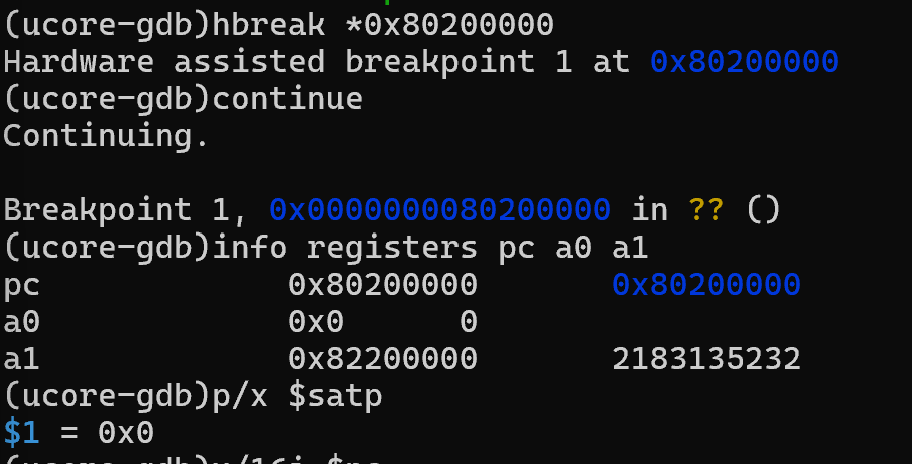 
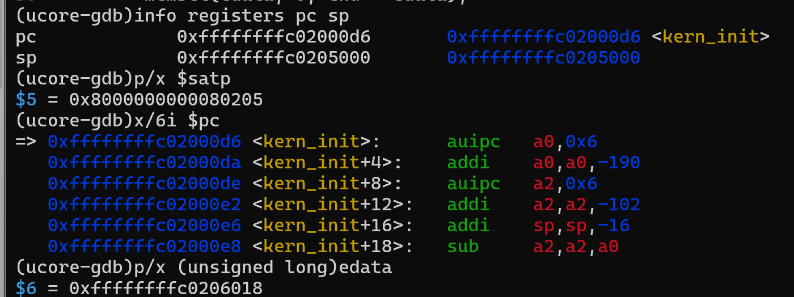
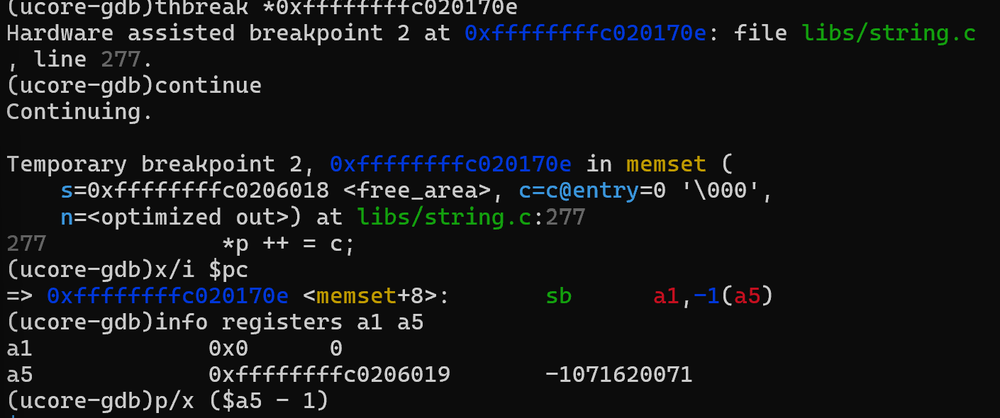
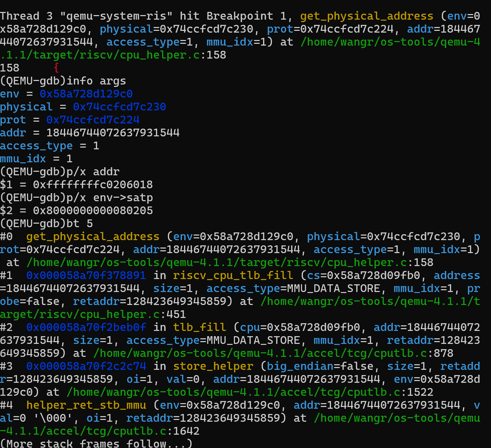
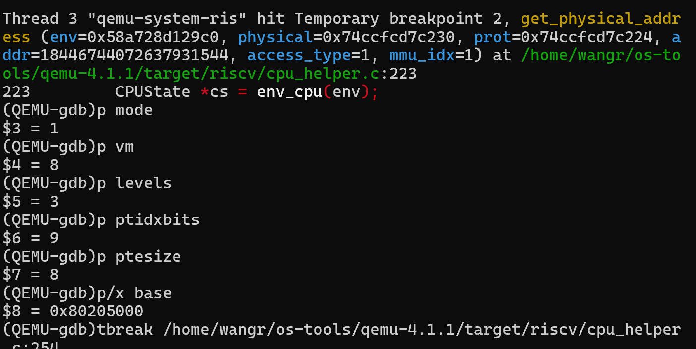
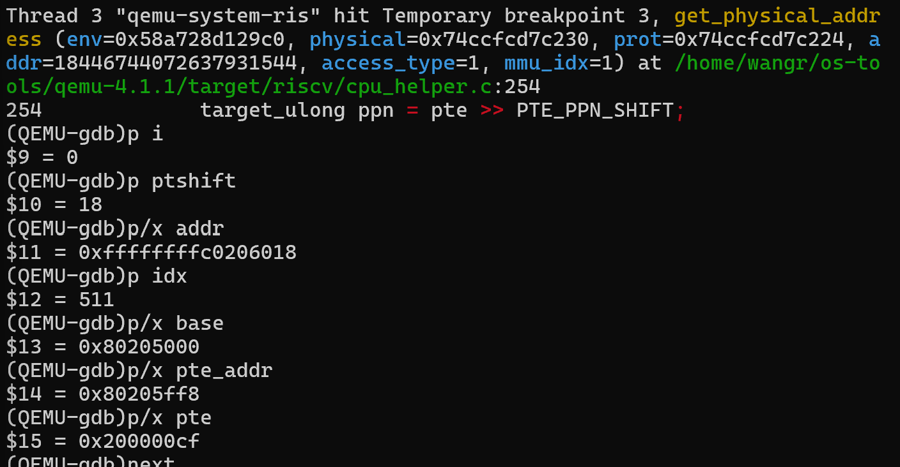
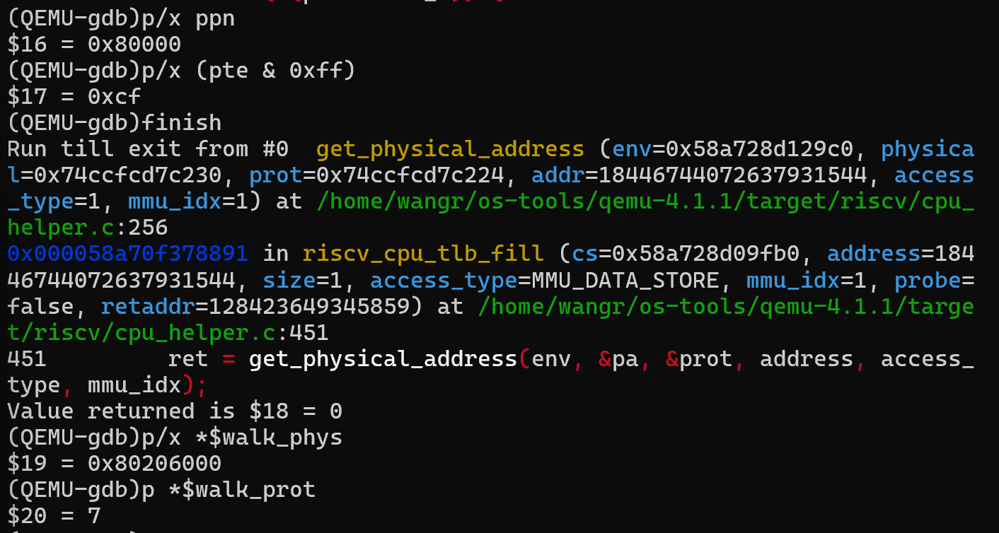
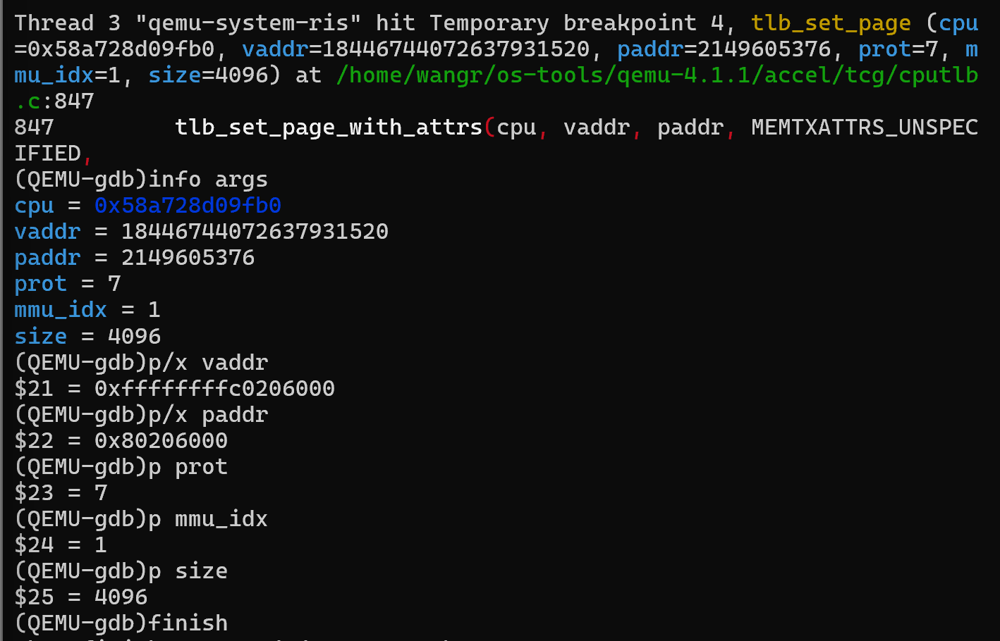
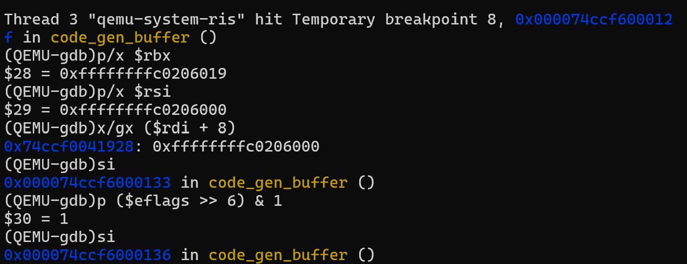
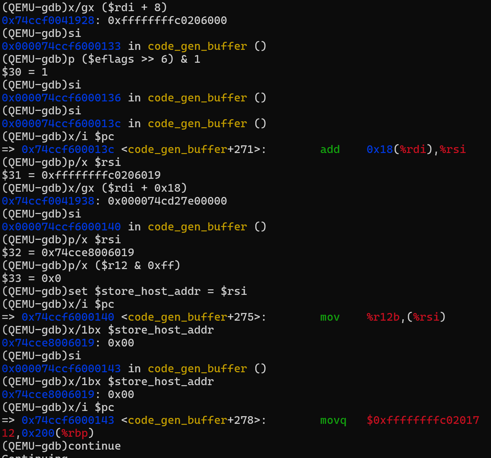
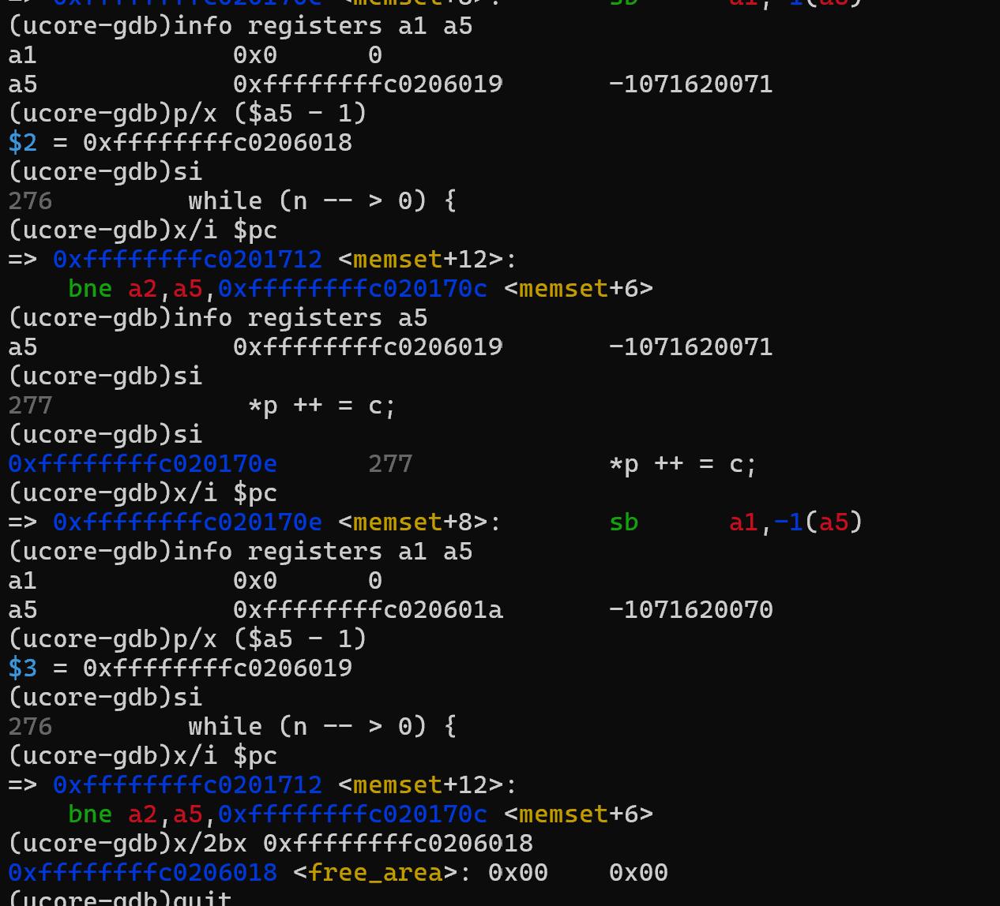
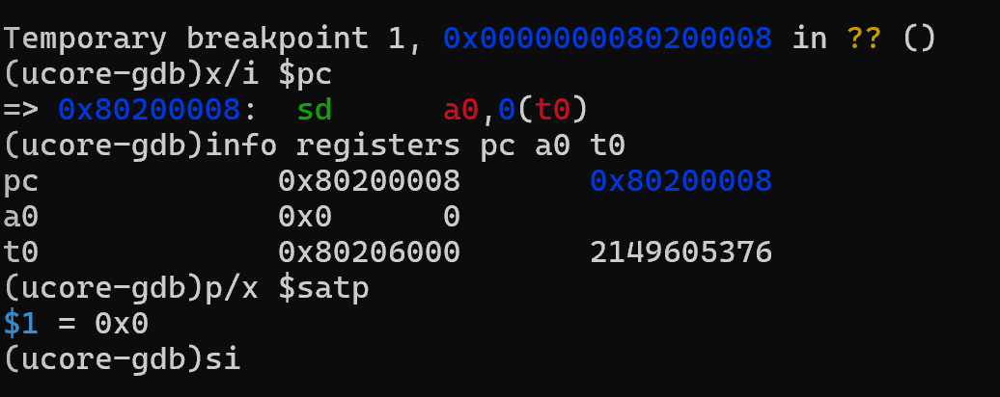
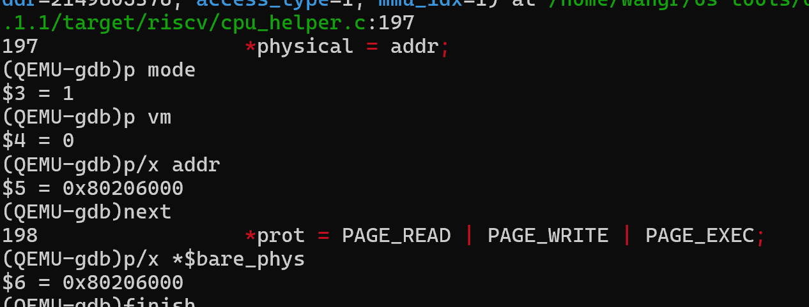
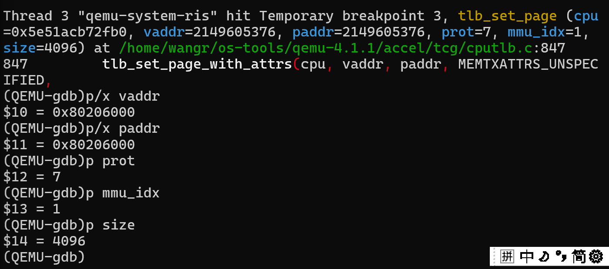
### 调试问题与处理

| 现象 | 分析与处理 |
|---|---|
| 客体 GDB 等待无响应 | 宿主 GDB 暂停了 QEMU；协调两侧继续/暂停顺序 |
| 打印 physical 与预期字节地址差 0x18 | 核对源码发现返回页基址；页内偏移在实际访存中保留 |
| 同页后续访问没触发原宿主断点 | 检查其他翻译块，在新的 TLB 检查位置设置断点 |
| 看到 x86 指令，误以为客体架构变化 | 当前调试对象是宿主 QEMU 的 JIT 代码；客体仍是 RISC-V |
| 分页切换附近单步取指异常 | 记录低地址无映射问题；重启后连续运行对照，未声称完成启动代码修复 |

---

## 六、实验总结与收获

### 对操作系统的理解

#### 实验知识点与 OS 原理的对应

| 知识点 | 实验体现及关系 |
|---|---|
| 虚拟地址与物理地址 | 高虚拟地址映射到物理内存，代码无需搬移 |
| 页表基址与分页模式 | `satp` 指定 Sv39 和根页表物理页号 |
| 多级页表与大页 | 根级叶子项直接建立 1 GiB 映射 |
| 访问权限 | 查询过程检查表项有效性、权限、特权级和对齐 |
| TLB | 未命中时取得映射，命中时复用缓存 |
| 缓存同步 | `sfence.vma` 同步地址翻译 |
| 模拟器访存 | 软件 TLB 还服务于客体地址到宿主访问的处理，与硬件分页 TLB 职责不同 |
| 物理内存发现 | 由设备树等信息获取 RAM 布局，再扣除保留区 |

#### 本部分未覆盖的重要知识

| 知识点 | 含义及未覆盖原因 |
|---|---|
| 按需分页与缺页处理 | 页面缺失时分配或调入；本次使用有效启动映射 |
| 进程地址空间隔离 | 不同进程使用不同映射；本次主要观察启动地址空间 |
| 页面置换与交换 | 内存不足时换出并按需调入；本次没有换页过程 |
| 写时复制 | 共享页面在写入时复制；本次没有相关进程操作 |
| 多核 TLB 一致性 | 修改映射后协调各 hart 缓存；本次仅观察单 hart |

### AI 协作开发的经验


