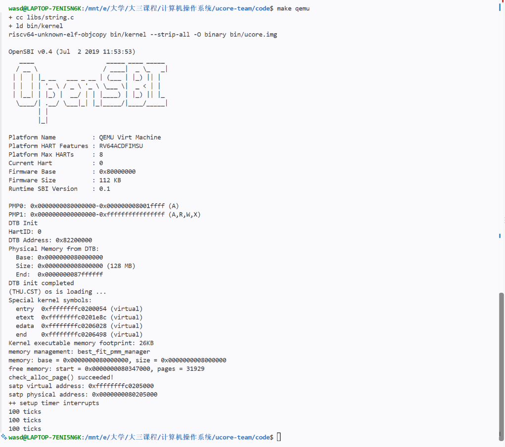
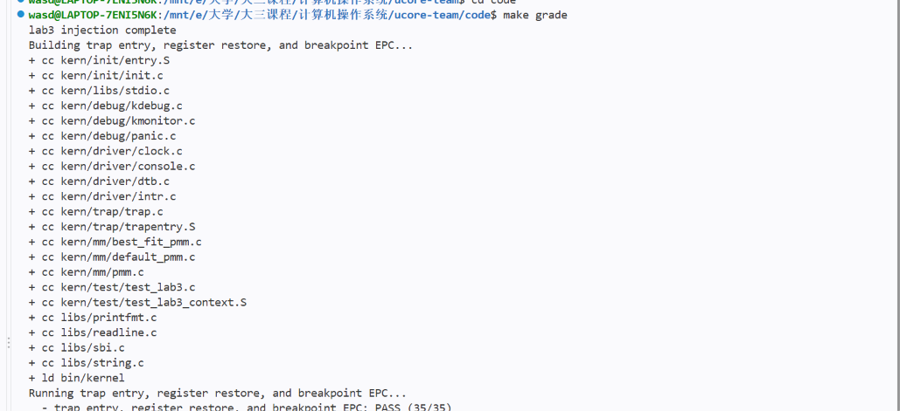
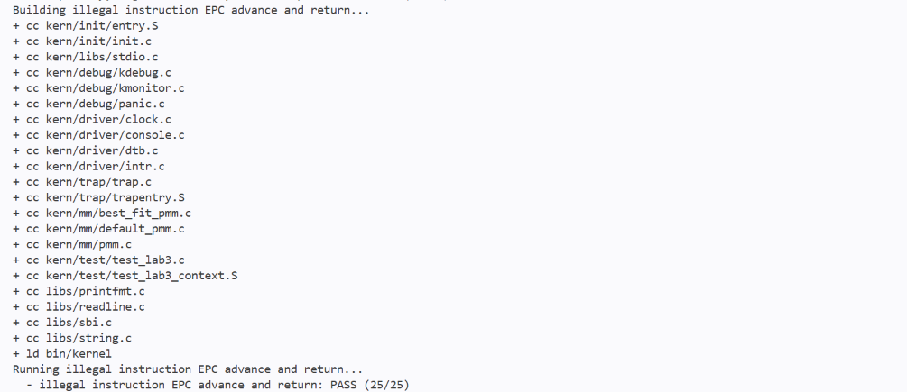
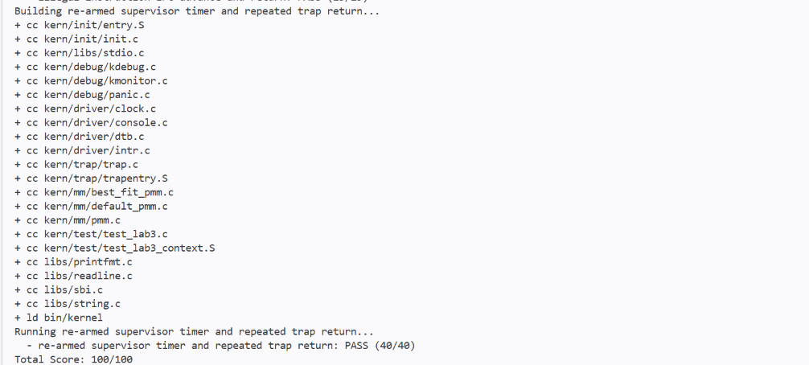

# 操作系统实验报告

## 实验基本信息

| 项目 | 内容 |
|------|------|
| **实验名称** | Lab 3: 断，都可以断 |
| **小组成员** | 2411333-吴卓彦、2410690-王睿瑜、2413497-姚嘉乐 |
| **完成日期** | 2026-11-05 |

### 小组分工

| 成员 | 负责的练习/模块 |
|------|----------------|
| 2413497-姚嘉乐 | 功能模块一：Trap 上下文恢复与 Trap 入口功能 |
| 2411333-吴卓彦 | 功能模块二：中断与异常处理功能（中断） |
| 2410690-王睿瑜 | 功能模块二：中断与异常处理功能（异常） |

- 实验报告中的“四、实验内容与实现”由各自完成自己负责的模块内容，2411333-吴卓彦主笔了报告中“实验原理”的相关内容，包括实验与OS原理对照，以及“重要但未对应“知识点清单等，2410690-王睿瑜总结了AI协作开发的经验，2413497-姚嘉乐最终整合了报告。
---

## 一、实验目的

1. 理解 RISC-V 中断与异常的区别，掌握 Trap 相关 CSR、特权级和事件分发机制。
2. 掌握 Trap frame 的布局及上下文保存、恢复方法，理解汇编入口、C 语言调用约定和 `sret` 返回之间的衔接。
3. 实现时钟中断、非法指令异常和断点异常的处理，验证周期性计时、异常后的 EPC 更新，以及现场恢复后继续执行的过程。
4. 学习如何设计完善的提示词，借助 AI 完成代码生成，并通过代码审查、编译、QEMU 运行和评分测试检验实现。

---

## 二、实验环境
| 成员 | AI 编程工具 | 底层模型 | 备注 |
|------|------------|---------|------|
| 2413497-姚嘉乐 | Codex（VS Code 插件） | GPT-6.1-sol | — |
| 2411333-吴卓彦 | Claude Code（VS Code 插件） | GLM-5.3 | — |
| 2410690-王睿瑜 | Codex（VS Code 插件） | GPT-6.1-sol | — |

**说明：**
- **AI 编程工具**：指具体使用的终端工具、编辑器插件、桌面应用或浏览器界面
- **底层模型**：指该工具使用的大语言模型及版本

---

## 三、实验整体逻辑分析

### 3.1 本章节的逻辑主线

本实验围绕“保存现场—识别与处理事件—恢复现场并返回”展开。在 Lab2 内存管理的基础上，为内核建立完整的 Trap 处理路径，使其能够响应时钟中断，以及执行指令时产生的非法指令和断点异常。

这一过程由硬件、汇编和 C 语言代码共同完成：硬件记录 Trap 原因、返回位置和相关状态，并跳转到 `stvec` 指定的入口；汇编将寄存器保存为 Trap frame，再调用 C 函数分类处理；处理完成后，依据更新后的 Trap frame 恢复现场，通过 `sret` 继续执行。

```text
Trap 发生 → __alltraps → SAVE_ALL → trap() → trap_dispatch()
         → interrupt_handler() / exception_handler()
         → __trapret → RESTORE_ALL → sret
```

### 3.2 功能的逐步实现

按照功能依赖，实验分为以下几个步骤。小组成员分别实现汇编入口、中断处理和异常处理，再进行集成验证。

1. **补齐内存管理基础。** 将 Lab2 的 `page_init()` 和 Best-Fit 实现迁入当前框架，完成分配器注册，并保留 Lab3 新增的中断保护，保证内核能够完成内存初始化和分配自检。
2. **建立 Trap 入口与返回路径。** 通过 `idt_init()` 设置统一入口，依据已有 `SAVE_ALL` 和 Trap frame 布局，补全 `__alltraps` 的传参调用与 `RESTORE_ALL` 的恢复逻辑。只有现场能够正确保存和恢复，具体处理函数才能安全执行并返回。
3. **实现事件分类与处理。** 由 `trap_dispatch()` 根据原因值最高位区分中断和异常。中断分支完成类型识别、时钟计数及输出；异常分支处理非法指令和断点，并按指令长度更新 EPC。时钟中断保持 EPC 不变，未知类型通过现场输出辅助诊断。
4. **启动并持续产生时钟中断。** `clock_init()` 允许时钟中断并设置第一次事件，随后 `intr_enable()` 打开 S 模式全局中断。每次时钟处理时预约下一次事件，使计时持续进行；本组每 100 次中断输出一次，第三次输出后关机。
5. **验证完整执行路径。** 使用 `make grade` 检查寄存器恢复、异常返回和持续时钟中断，再通过 `make qemu` 检查普通启动与关机行为，确认各模块集成后能够完成多次 Trap 进入和返回。

在实际实现时，为了小组成员能够并行处理，将这些实验任务尽量拆分为互不干扰的部分，并最终整合验证

---

## 四、实验内容与实现

### 功能模块一：Trap 上下文恢复与 Trap 入口功能

**负责人：** 2413497-姚嘉乐

#### 模块功能描述

**需要实现/修改的汇编单元：**

```asm
RESTORE_ALL    # 汇编宏：恢复 Trap frame 中保存的执行现场
__alltraps:   # 入口标签：保存现场并调用 C 语言处理函数
```

**所在文件：** `code/kern/trap/trapentry.S`。与其衔接的已有 C 接口为 `void trap(struct trapframe *tf)`。

**功能说明：**

本模块负责连接 Trap 的进入、处理与返回。硬件记录 Trap 原因和返回位置后，跳转到 `stvec` 指定的 `__alltraps`。已有的 `SAVE_ALL` 将通用寄存器和相关 CSR 保存到当前内核栈，形成 `struct trapframe`；新增入口代码将当前 `sp` 作为 Trap frame 地址传入 `a0`，再调用 `trap()`，由队友实现的中断或异常处理函数完成具体处理。

`trap()` 返回后，`RESTORE_ALL` 从对应槽位恢复 `sstatus`、`sepc` 和通用寄存器，最后恢复原始 `sp`，由已有的 `sret` 返回执行流。

```text
__alltraps → SAVE_ALL → trap(tf) → 中断/异常处理
          → __trapret → RESTORE_ALL → sret
```

#### 最终提示词

以下为实际使用的完整最终提示词：

```text
[PROMPT]
任务：
完成 Trap 上下文恢复与 Trap 入口功能。
目标文件为 code/kern/trap/trapentry.S。

操作要求：
只补全 RESTORE_ALL 和 __alltraps 中的两处待实现代码。
不得修改 SAVE_ALL、Trap frame 布局、现有接口及其他文件。
保持代码可读，在关键步骤添加必要注释。

输出要求：
依据下面的依赖和规格，在项目中修改实际文件。
将两处标记改为“#lab3 function1 2413497”。

[RELY]
先阅读：
code/kern/trap/trapentry.S
code/kern/trap/trap.h
code/kern/trap/trap.c
code/libs/riscv.h

Trap frame 的结构为：

struct trapframe {
    struct pushregs gpr;
    uintptr_t status;
    uintptr_t epc;
    uintptr_t badvaddr;
    uintptr_t cause;
};

已有 SAVE_ALL 在当前内核栈上建立 Trap frame。
执行完成后，sp 指向该 Trap frame；
gpr.sp 保存的是分配 Trap frame 之前的原始 sp。

C 语言处理接口为：
void trap(struct trapframe *tf);

RISC-V 调用约定使用 a0 传递第一个参数。
trap() 可能修改 Trap frame 中的 epc。

[GUARANTEE]

1. 完成已有汇编宏 RESTORE_ALL。
2. 完成 __alltraps 中 SAVE_ALL 之后的调用衔接代码。

[SPECIFICATION]
实现单元：__alltraps

Pre-Condition：
处理器已经进入 S 模式 Trap 入口，相关 CSR 已由硬件设置。
当前 sp 指向有效且满足调用约定对齐要求的内核栈。

Post-Condition：
建立完整的 Trap frame，将其交给 trap() 处理；
trap() 返回后，进入现有的 __trapret 恢复流程。

实现单元：RESTORE_ALL

Pre-Condition：
trap() 已返回，当前 sp 指向完整且布局正确的 Trap frame。
其中的 epc 等状态可能已经被处理函数更新。

Post-Condition：
根据当前 Trap frame 恢复通用寄存器、sstatus 和 sepc，
恢复原始 sp，使后续已有的 sret 能够正确返回。
```

#### 实现迭代过程

使用该提示词完成一版实现后，未发现需要修正的实现问题。

---

### 功能模块二：中断与异常处理功能（中断处理）

**负责人：** 吴卓彦 2411333

#### 模块功能描述

**需要实现/修改的函数：**

```c
void interrupt_handler(struct trapframe *tf); // 本节负责
void exception_handler(struct trapframe *tf); // 同一功能模块，由其他成员负责
```

**功能说明：**

内核在 `kern_init()` 中设置 `stvec`、安排第一次时钟事件并打开 S 模式中断。Trap 进入 `__alltraps` 后，现场被保存到 Trap frame；`trap_dispatch()` 根据 `tf->cause` 最高位区分中断与异常。本模块新增 `interrupt_handler(struct trapframe *tf)`，继续依据原因编号处理具体中断。

#### 最终提示词

以下为第一次交给AI 的提示词。后续两次修正提示词分别记录在迭代过程中。

```text
你是 RISC-V RV64 教学内核的开发助手。
请先阅读指定代码，再严格按照以下 Spec 直接修改工作区文件，
完成时钟及其他中断处理函数。

项目目录：E:\大三上\OS\OS2026_Labs\code

【先阅读】
kern/trap/trap.c、kern/trap/trap.h
kern/driver/clock.c、kern/driver/clock.h
libs/riscv.h、libs/sbi.h

【目标和修改范围】
在 kern/trap/trap.c 的“lab3 function2 YOUR CODE”标记处，
新增并实现：

void interrupt_handler(struct trapframe *tf)

将该标记中的 YOUR CODE 改为实现者学号 2411333，保留 lab3 注释。
只修改此函数以及编译所必需的头文件和宏。不要修改已有函数、
Trap frame 结构、汇编入口或测试文件；不要实现异常处理函数。

【Spec：原因识别】
tf->cause 是 scause 保存到 Trap frame 中的值。RV64 的最高位表示中断，其余位是原因编号。现有 trap_dispatch() 已经区分中断与异常。请在 interrupt_handler() 中正确取得原因编号；
不能直接将包含最高位的完整 tf->cause 与 IRQ_S_TIMER 比较。
提取方式也应能处理测试代码直接传入原因编号的情况。

【Spec：时钟中断】
原因编号为 IRQ_S_TIMER 时：
1. 先调用 clock_set_next_event() 预约下一次时钟事件；
2. 再让 ticks 加一；
3. 每当 ticks 为 TICK_NUM 的正整数倍时，调用已有的 print_ticks()；
4. 本组自行选定 SHUTDOWN_AFTER=3，表示第 3 次统计输出后调用 sbi_shutdown()。第 100、200 次中断后必须继续运行，第 300 次输出后才关机。

trap.c 已定义 TICK_NUM=100。不要改动 print_ticks()。
如需使用 sbi_shutdown()，可添加必要的 sbi.h 头文件。

【Spec：其他中断】
依据 libs/riscv.h 中已有的中断编号，对已知的非时钟中断
进行基本类型区分并输出对应提示。非时钟中断不修改 ticks，
也不预约时钟事件。

Supervisor 软件中断的输出必须包含：
Supervisor software interrupt

对未知中断，先输出原因编号，再调用 print_trapframe(tf)
输出完整 Trap frame。未知编号 15 的输出必须包含：
Unknown interrupt: cause 15

不要在中断处理函数中修改 tf->epc。

【交付】
直接修改指定代码文件，并说明修改了哪些位置、为什么这样实现。
不要在 WSL 编译，不要运行 QEMU 或评分脚本，也不要声称代码已通过测试。
不要自行提交或推送 Git。编译、运行和截图由我亲自完成；
我会把真实结果反馈给你，再根据结果迭代。
```

#### 实现迭代过程

##### 第一次迭代

AI 在 `trap.c` 加入 `#include <sbi.h>`，把注释改为 `//lab3 function2 2411333`，定义 `SHUTDOWN_AFTER 3` 并新增 `interrupt_handler()`。静态审查确认了时钟分支的顺序、第三次打印后关机、已知中断分类和未知中断的 Trap frame 兜底。发现未知中断使用 `cprintf("Unknown interrupt: cause %d\n", cause)`，而 `cause` 为 `uintptr_t`，格式符与实参类型不匹配。AI 未运行编译或测试。

为修正这一处格式问题，第二次发送的提示词为：

```text
请只修正 `interrupt_handler()` 中未知中断的 
`cause` 打印格式，使格式符与实参类型匹配，并保持编
号 15 的输出文字不变。不要修改异常处理或其他函数。完
成后说明实际改动；不要运行验证。
```

##### 第二次迭代

AI 把 `%d` 改成 `%lu`。再次查阅 `libs/defs.h` 后发
现，本项目 `uint64_t` 明确是 `unsigned long 
long`，`uintptr_t` 又是 `uint64_t`；`printfmt.c`
 的 `%lu` 按 `unsigned long` 取参，类型仍不匹配。于
 是将项目中的 typedef 链和格式化器实现反馈给AI。

第三次发送的提示词为：

```text
请核对本项目 `libs/defs.h` 中 `uintptr_t` 的完整
 typedef 链，以及 `libs/printfmt.c` 对 `%llu` 的处
 理。只修正 `trap.c` 未知中断输出这一行，使格式符与
  `cause` 的实际类型匹配；保持 `Unknown 
  interrupt: cause 15` 输出不变。不要修改其他代码，
  也不要运行验证。
```

##### 第三次迭代

AI 将该行改为 `cprintf("Unknown interrupt: cause %llu\n", cause)`。`printfmt.c` 在两个 `l` 后按 `unsigned long long` 取参，与 `cause` 的声明类型匹配。静态复核确认该行已写入文件，编号 15 的目标文字仍为 `Unknown interrupt: cause 15`。

AI 曾预测当前完整构建会在链接阶段因缺少 `exception_handler()` 失败；但 `trap.c` 当前还没有该函数声明，Makefile 又使用 `-Werror`，因此也可能先在编译阶段报隐式函数声明错误。这是静态推断，不能写成实际测试现象。

### 功能模块二：中断与异常处理功能（异常处理）

**负责人：** 王睿瑜 2410690

#### 模块功能描述

**需要实现/修改的函数：**
```c
void exception_handler(struct trapframe *tf);
```

**所在文件：** `code/kern/trap/trap.c`。

**功能说明：**

本实验通过“Trap 进入 → 上下文保存 → C 语言处理 → 上下文恢复 → Trap 返回”形成完整处理流程。`trap_dispatch()` 根据 `tf->cause` 的最高位区分中断与异常，随后将异常交给 `exception_handler()` 处理。

本部分主要完成以下功能：

1. 使用 `CAUSE_ILLEGAL_INSTRUCTION` 和 `CAUSE_BREAKPOINT` 识别非法指令异常与断点异常，输出异常类型及异常指令地址。
2. 根据异常指令的长度更新 `tf->epc`，使处理器返回后能够继续执行，避免反复触发同一条异常指令。
3. 对其他异常调用已有的 `print_trapframe(tf)` 输出现场信息，保留 EPC，不擅自执行恢复操作。
4. 保持函数签名和 Trap frame 布局不变，不修改保存的异常原因、状态和通用寄存器。

本函数修改的是 Trap frame 中的 EPC 副本，后续还需要由汇编恢复代码将其写回 `sepc`，再通过 `sret` 返回。因此，异常处理函数需要与上下文恢复模块配合，才能完成真实的异常返回。

#### 最终提示词

```text
你是 RISC-V RV64 教学内核的开发助手。
请先阅读指定代码，再按照以下 Spec 实现异常处理函数。

【先阅读】
code/kern/trap/trap.c
code/kern/trap/trap.h
code/libs/riscv.h
code/libs/defs.h

必要时查阅格式化输出实现和测试汇编，核对地址输出方式、
异常原因编号和指令编码，不要根据其他项目猜测当前接口。

【目标和修改范围】
在 code/kern/trap/trap.c 的 lab3 function2 对应位置，
新增并实现：

void exception_handler(struct trapframe *tf)

保留 lab3 注释，填写学号 2410690。
只实现异常处理函数，不覆盖队友的 interrupt_handler()，
不修改其他已有函数、汇编入口、Trap frame 布局和函数签名。

【Spec：异常分类与输出】
现有 trap_dispatch() 已经区分中断与异常。
请根据 tf->cause，使用框架已有的宏进行分类：

CAUSE_ILLEGAL_INSTRUCTION
CAUSE_BREAKPOINT

非法指令异常输出：
Illegal instruction at %p\n

断点异常输出：
Breakpoint at %p\n

地址取自更新前的 tf->epc。
将地址参数转换为 void *，与 %p 对应。

【Spec：更新返回位置】
对非法指令和断点异常，读取 tf->epc 指向的指令低 16 位。

在本实验的 16/32 位指令范围内：
低两位不为二进制 11 时，tf->epc 增加 2；
否则，tf->epc 增加 4。

不要把所有异常指令一律按 4 字节跳过。
使用半字读取，避免为判断压缩指令而直接读取完整 32 位数据。

【Spec：其他异常】
调用已有的 print_trapframe(tf) 输出现场。
保持 EPC 不变，不读取未知异常对应的指令地址。
不要修改保存的 cause、status 和通用寄存器。

【边界说明】
该实现依赖异常指令所在内存可读。
长度判断仅适用于本实验涉及的 16/32 位指令，
不代表完整的 RISC-V 变长指令解码。
跳过非法指令只是实验规定的处理策略，
不能视为真实操作系统处理所有非法指令的通用方法。

【验证要求】
通过交叉编译检查函数是否能够编译，
通过反汇编核对测试断点的实际长度，
通过函数级测试检查 EPC 推进和未知异常回退行为。

明确区分函数级测试与真实 Trap 返回验证。
没有实际运行的 QEMU 和评分测试不得写成通过。
```

#### 核心实现

```c
//lab3 function2 2410690: exception classification and EPC advance
void exception_handler(struct trapframe *tf) {
    switch (tf->cause) {
    case CAUSE_ILLEGAL_INSTRUCTION:
    case CAUSE_BREAKPOINT: {
        if (tf->cause == CAUSE_ILLEGAL_INSTRUCTION) {
            cprintf("Illegal instruction at %p\n", (void *)tf->epc);
        } else {
            cprintf("Breakpoint at %p\n", (void *)tf->epc);
        }

        /*
         * Lab scope: readable instruction memory,
         * 16/32-bit instructions.
         */
        uint16_t insn = *(const volatile uint16_t *)tf->epc;
        tf->epc += ((insn & 0x3) == 0x3) ? 4 : 2;
        break;
    }
    default:
        print_trapframe(tf);
        break;
    }
}
```

**实现说明：**

非法指令和断点的异常原因编号分别为 2 和 3，代码使用框架中的宏进行判断，避免直接使用数字表达异常类型。

两类异常共用指令长度判断逻辑，只在输出内容上进行区分。读取类型选择 `uint16_t`，因为压缩指令仅占 2 字节，32 位指令也可能从仅按 2 字节对齐的地址开始。在本实验的 16/32 位指令范围内，通过低两位即可选择推进 2 字节或 4 字节。

其他异常只输出 Trap frame，不修改 EPC。这有助于保留故障位置，但不意味着异常已经修复；如果故障条件未消除，直接返回仍可能再次触发同一异常。

#### 实现迭代过程

本部分完成了一版异常处理实现，随后进行了交叉编译、反汇编核对、函数级测试和代码集成。现有验证中未发现异常处理算法本身的实际错误。

---
## 五、测试与验证

### 模块二阶段性测试（当时的阶段结果，不是最终记录）
#### 第一阶段：异常处理实现与编译检查

首先核对 `struct trapframe` 的字段定义、异常原因宏以及 `trap_dispatch()` 的分类方式，在不改变现有接口的前提下实现异常处理函数。

设计时已考虑压缩指令的情况，没有采用固定的 `tf->epc += 4`。对于未要求具体处理的异常，保留框架的现场输出方式，不增加额外的恢复逻辑。

由于当时中断处理尚未接入，在临时提供 `interrupt_handler()` 声明后，对 `trap.c` 进行 RISC-V 交叉编译检查，结果通过。该检查验证了函数的编译情况，不代表完整内核已经能够运行。

#### 第二阶段：反汇编与函数级测试

对 `test_lab3_context.S` 进行反汇编，发现测试断点的机器码为 `9002`，位于偏移 `0x6a`，下一条指令位于 `0x6c`，说明该断点占 2 字节。

这一结果确认了指令长度判断的必要性：如果在该位置统一增加 4 字节，就会越过正确的下一条指令地址。压缩指令长度是在设计和验证阶段提前确认的问题，不记为已经发生的程序错误。

随后，从实际 `trap.c` 提取异常处理函数，构造主机端测试，覆盖以下五种情况：

- 16 位断点，EPC 增加 2。
- 32 位断点，EPC 增加 4。
- 16 位非法指令，EPC 增加 2。
- 32 位非法指令，EPC 增加 4。
- 未知异常，调用回退函数且 EPC 不变。

测试结果为 `5/5 passed`，同时检查了 cause、status 和 a0 的代表值未被修改。

#### 第三阶段：与队友代码集成

合并公共 `Lab3` 分支时，由于双方都补充过同名框架文件，出现了 `add/add` 冲突。解决时以公共框架为基础，保留队友的 `interrupt_handler()`，再加入个人已测试的 `exception_handler()`，避免整份覆盖 `trap.c` 导致任一方实现丢失。

集成后，`trap.c` 编译通过。继续编译时，实际发现汇编中的旧 CSR 名称 `sbadaddr` 不被当前工具链识别，将其改为 `stval` 后，对应汇编文件编译通过。这属于框架与工具链的兼容问题，不是异常处理函数的算法错误。

后续完整构建在 `best_fit_pmm.c` 处因缺少 Lab2 实现而停止。本次按照分工只合并 Lab3 内容，未补写内存管理代码。

最近一次已反馈的检查中，Trap 上下文恢复与入口位置仍存在待实现标记，因此尚未完成真实异常进入、现场恢复和 `sret` 返回验证。

**阶段结果：**

- 异常处理函数通过交叉编译检查。
- 五项主机端函数级测试通过。
- 中断处理与异常处理已完成本地集成，合并提交为 `330e2cd`。
- 完整构建、QEMU 运行及评分验证尚未完成。

### 总体测试（最终结果）
在 `code` 目录下分别执行 `make qemu` 和 `make grade`，检查普通启动及三组评分测试，结果如下。

**1. 普通启动与时钟中断**



执行 `make qemu` 后，内核完成 DTB 解析和物理内存初始化，输出 `check_alloc_page() succeeded!`。随后成功设置时钟中断，连续输出三次 `100 ticks` 后返回命令行，符合累计 300 次中断后关机的设定。

**2. Trap 入口、寄存器恢复与断点返回**



第一组评分测试通过，得分为 `35/35`。该测试在设置寄存器值后触发断点，再检查返回后的寄存器值，验证 Trap 入口、现场恢复和断点 EPC 更新能够正确衔接。

**3. 非法指令处理与返回**



第二组评分测试通过，得分为 `25/25`。测试验证非法指令异常处理后能够推进 EPC 并继续执行，同时检查软件中断、未知中断和未知异常的回退输出。

**4. 持续时钟中断与评分汇总**



第三组持续时钟中断测试通过，得分为 `40/40`，说明下一次时钟事件能够持续设置，且多次 Trap 返回后内核仍可继续计时。三组测试总分为 `100/100`。


---

## 六、实验总结与收获

### 对操作系统的理解

**1. 实验知识点与 OS 原理的对应关系**

- **中断与异常的分类和分发。** 实验中，`scause` 记录 Trap 的原因，`tf->cause` 是它保存在 Trap frame 中的副本。RV64 的最高位区分中断与异常，其余位表示具体原因编号。这让我理解了内核如何识别事件并交给不同的处理函数：最高位只能说明发生了中断，还需要根据原因编号判断是否为时钟中断。

- **现场保护和恢复。** OS 原理中要求处理中断后能够继续执行原程序，实验中则通过硬件保存部分控制信息、汇编入口保存通用寄存器、Trap frame 向 C 函数传递现场来实现。我由此理解了现场保护在代码中的具体形式，也认识到保存 Trap 现场并不意味着一定会切换进程。

- **时钟中断和系统计时。** 实验通过 `clock_set_next_event()` 预约下一次时钟事件，在中断发生后累加 `ticks`，每累计 100 次输出统计信息。这对应了 OS 利用周期性中断进行计时的原理。`ticks` 记录的是中断次数，换算为实际时间还需要知道中断间隔，不能把它当成中断处理程序消耗的时钟周期数。

- **中断频率与系统开销。** 中断越频繁，现场保存、恢复和处理占用的时间就越多，因此设置时钟间隔时需要考虑处理开销。我也区分了中断间隔与一次中断处理耗时这两个概念。本次实现了计数、输出和关机，时钟中断如何进一步触发时间片调度，还需要在后续实验中学习。

- **Trap 控制寄存器与特权级返回。** `stvec` 指定处理入口，`sepc` 记录返回位置，`scause` 和 `stval` 提供原因与附加信息；`sstatus` 中的 `SPP`、`SPIE` 保存先前特权级和中断使能状态，供 `sret` 返回时使用。这对应 OS 原理中的异常入口和状态恢复。本实验主要验证 S 模式进入并返回 S 模式，Trap 不一定发生特权级切换。

- **中断屏蔽与临界区保护。** 内存分配接口通过 `local_intr_save/restore` 保存原中断状态、关闭本地中断，并在操作完成后按原状态恢复，避免空闲链表更新到一半时被本地中断处理代码访问。这对应临界区保护，但关中断不能阻止其他 CPU 核访问共享数据，多核场景还需要锁等同步机制。

**2. 当前实现尚未覆盖的重要知识点**

- **进程调度与进程上下文切换：** 我了解到时钟中断可以触发抢占式调度，但这次负责的函数只进行了计数、输出和关机，没有涉及就绪队列和时间片管理。因此，我还需要在后续实验中进一步理解内核如何从处理时钟中断走到真正切换进程。
- **完整的系统调用与用户态返回路径：** 阅读手册时，我接触到了 U 模式陷入 S 模式的过程，但这次中断处理任务没有涉及系统调用的参数传递、返回值处理和用户进程管理，对这条完整执行路径还需要继续学习。
- **并发与中断同步：** 这次实现没有涉及嵌套中断和多核竞争。如果多个执行流同时访问计数器等共享数据，该怎样保证数据正确，也是我后续需要了解的问题。

### AI 协作开发的经验

使用 AI 前需要先理解任务，再把功能要求、接口和修改范围写清楚，提示词中的要求也要保持一致。
比如在实现功能模块二的异常处理时，仅要求“实现异常处理”容易遗漏指令长度、未知异常策略以及与队友模块的边界；把这些约束写入提示词后，生成结果才更便于检查和集成。

对于 AI 生成的代码和解释，需要结合项目中的实际定义进行核对，不能直接相信它的结论。例如，在实现模块二的中断处理时输出格式经过两次修正才与本项目的类型匹配。本次实验汲取经验，在完成异常处理部分时通过反汇编确认压缩断点长度，再通过函数级测试检查 EPC 更新与回退行为，而不是只依据 AI 的解释判断正确。

同时，需要区分不同层次的验证。单文件编译通过说明代码能够编译，主机端测试通过说明特定输入下的函数行为符合预期，最终通过make grade和make qemu执行完整测试才能说明真实 Trap 入口、现场恢复和返回链路已经完整正确。

  
---

