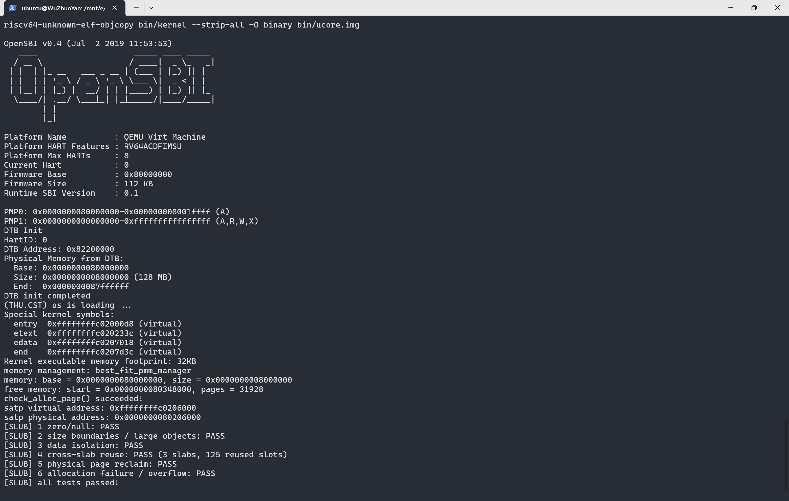
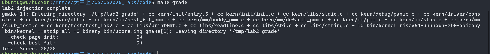
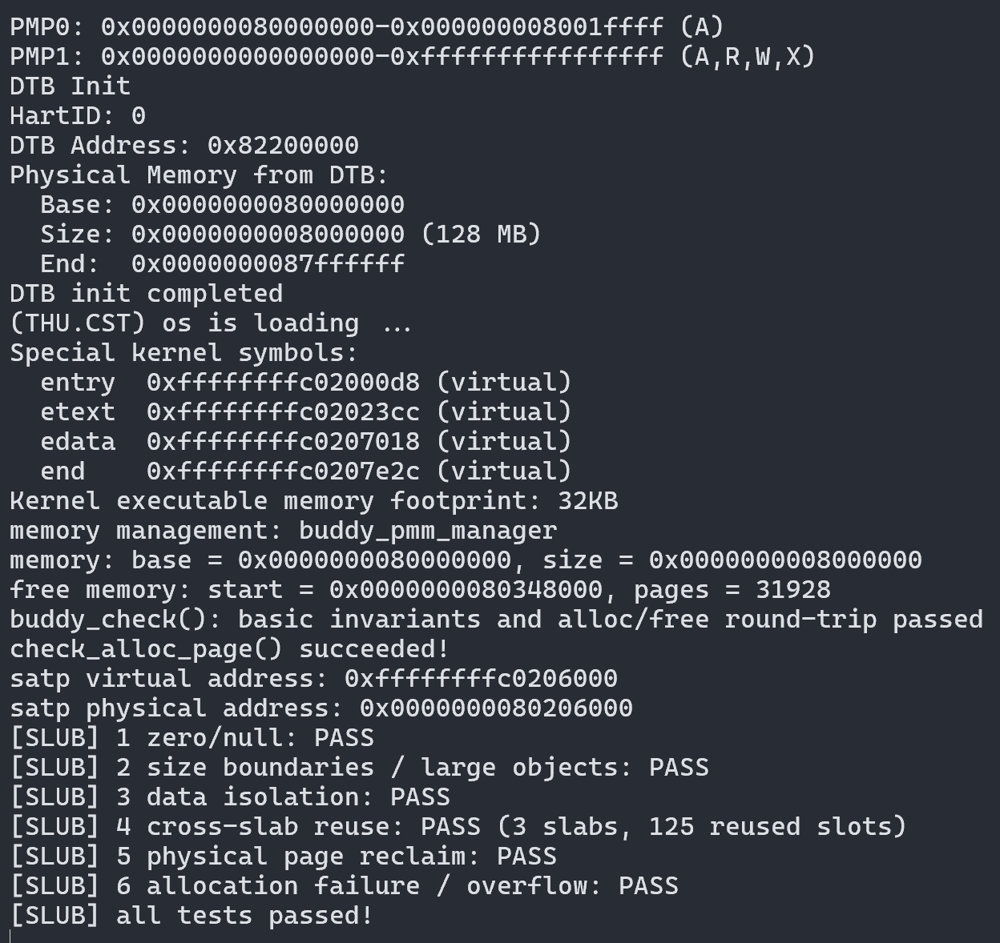
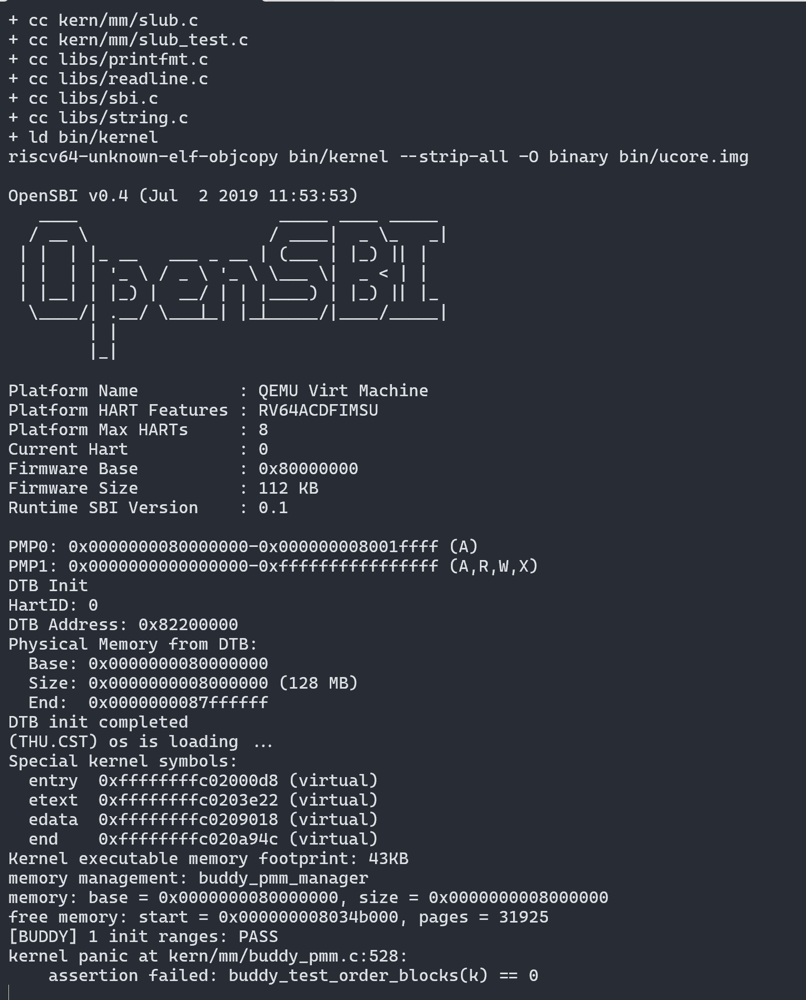
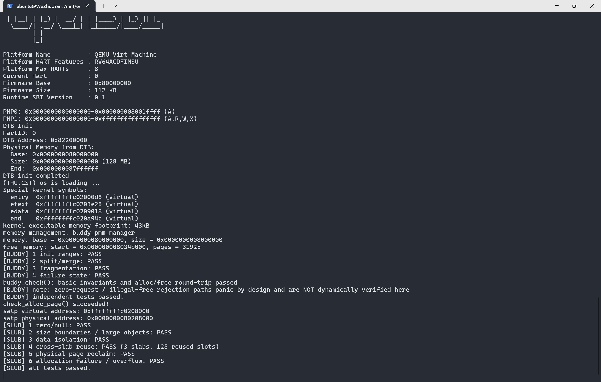

# 操作系统实验报告

## 实验基本信息

| 项目 | 内容 |
|------|------|
| **实验名称** | Lab2：物理内存管理与分页机制 |
| **小组成员** | 2411333-吴卓彦、2413497-姚嘉乐、2410690-王睿瑜 |
| **完成日期** | 2026-10-23 |


### 小组分工

| 成员 | 负责的练习/模块 |
|------|----------------|
| 2413497-姚嘉乐 | First-Fit 理解、Best-Fit 实现与注册，SLUB 选做任务 |
| 2410690-王睿瑜 | 分页机制、entry.S 解读、QEMU 源码与 TLB 调试、内存容量思考题|
| 2411333-吴卓彦| page_init()、Buddy System、构建与启动文件调查，最终报告整合 |


---

## 一、实验目的

1. 理解物理页管理的基本流程，区分 RAM 总量、保留内存和可分配页面。
2. 理解 Sv39 页表结构、页表项权限、satp 和启动时的虚实地址切换。
3. 通过阅读 QEMU 源码和双 GDB 调试，观察页表查询、软件 TLB 填充与命中。
4. 结合实际源码和输出核验 AI 给出的分析，形成可复现的实验记录。

---

## 二、实验环境

### AI 工具

| 成员 | AI 编程工具 | 底层模型 | 备注 |
|------|------------|---------|------|
| 王睿瑜 |vscode codex插件 | gpt6.1sol| -|
| 姚嘉乐 |vscode codex插件 |gpt6.1sol | -|
| 吴卓彦 |vscode codex插件 |glm-5.3 | -|

### 编译与调试环境

| 项目 | 配置 |
|---|---|
| 操作系统 | Windows + WSL Ubuntu 22.04 |
| 项目分支 | `lab2` |
| QEMU | 自行编译的 QEMU 4.1.1 |
| QEMU 调试信息 | `with debug_info, not stripped` |
| 客体调试器 | `riscv64-unknown-elf-gdb`，版本 `16.3.90.20250610-git` |
| 宿主调试器 | GNU GDB 12.1 |
| 客体架构 | RISC-V 64 位 |
| 宿主架构 | x86-64 |
| 远程调试地址 | `localhost:1234` |

### 双 GDB 调试方法

| 终端 | 运行内容 | 作用 |
|---|---|---|
| 终端一 | QEMU | 运行模拟机器和 ucore |
| 终端二 | 客体 GDB：`ucore-gdb` | 控制内核执行，观察 RISC-V 指令和寄存器 |
| 终端三 | 宿主 GDB：`QEMU-gdb` | 调试 QEMU 源码与生成的宿主指令 |

启动调试版 QEMU：

```bash
make debug QEMU=/home/wangr/os-tools/qemu-4.1.1/riscv64-softmmu/qemu-system-riscv64
```

`-s` 开启 GDB 服务，`-S` 使客体 CPU 在启动后暂停。另开终端执行：

```bash
make gdb
```

该命令加载 `bin/kernel` 的符号信息并连接客体。

宿主调试时，通过 `pgrep -af qemu-system-riscv64` 获取 QEMU 进程号，再使用本机 GDB 附加。宿主暂停整个 QEMU 后，客体的执行请求会等待其恢复。

---

## 三、实验整体逻辑分析

### 3.1 本章节的逻辑主线

Lab2 围绕物理内存的发现、初始化和分配展开。启动代码先建立内核可用的地址映射，C 初始化代码再解析设备树、建立物理页描述符，并将空闲页面交给分配器管理。

物理内存管理的主要调用关系为：

```text
pmm_init()
→ init_pmm_manager()
→ page_init()
→ init_memmap()
→ alloc_pages()/free_pages()
```

启动分页与物理页分配解决不同问题：分页决定地址如何映射，分配器决定哪些物理页面可以分配及回收。


### 3.2 功能的逐步实现

1. 启动汇编保存 hartid 和设备树地址，配置根页表与 satp，进入高地址内核。
2. 内核清零 BSS、解析设备树，获得物理内存信息。
3. page_init() 初始化物理页描述符，保留内核和元数据占用的页面，把可用范围交给分配器。这是后续分配算法检查的基础。
4. 在统一物理页接口下实现并选择分配算法，运行对应检查。A、C 分别负责相关代码和测试。
5. B 用客体与宿主 GDB 观察上述启动与访存过程，验证分页和 TLB 的实际执行路径。

该顺序同时区分了启动时序和团队开发依赖：实际启动先建立必要映射，再执行 C 内存初始化；团队开发则需要优先交付 page_init()，使分配器工作具备基础。

---

## 四、实验内容与实现

### 练习

本实验围绕物理内存的发现、初始化和分配展开。设备树由启动代码传递并在 C 初始化阶段解析；pmm_init() 选择和初始化管理器，page_init() 使用已解析的内存信息建立描述符并注册空闲页面。管理接口的调用链为 `pmm_init() → init_pmm_manager() → page_init() → init_memmap()`，后续通过 `alloc_pages()/free_pages()` 分配与回收。

本节严格区分两个功能模块、四项必做任务与两项选做 Challenge。代码状态以本次上传仓库为准；算法说明和建议测试方案不等于已完成实现或已运行测试。

### 功能模块一：[物理内存初始化功能]

#### 任务一：实现物理内存探测与页描述符初始化功能

**负责人：** 2411333-吴卓彦

##### 模块功能描述

**需要实现/修改的函数：**

```c
static void page_init(void);  // kern/mm/pmm.c
```

**功能说明：**

本函数建立物理页的管理信息，并把可用页交给当前分配器。启动页表已经由 `entry.S` 建立并写入 `satp`，因此这里处理物理内存初始化，不重新建立页表。输入来自设备树解析结果、链接符号 `end` 及框架常量；输出体现为全局变量和页描述符状态更新，不需要显式函数参数或返回值。它连接设备树探测与分配器初始化，为后续 Best-Fit、Buddy 和 SLUB 提供可用物理页。

##### 核心处理流程

1. **读取设备树结果。** `kern_init()` 先清零 BSS，再调用 `dtb_init()`。`page_init()` 经 `get_memory_base()`、`get_memory_size()` 取得 RAM 范围；本实现对 base 或 size 为 0 的情况调用 `panic()`，停止继续初始化。
2. **设置地址换算与管理范围。** 令 `va_pa_offset = KERNBASE - KERNEL_BEGIN_PADDR`，得到内核虚实映射偏移；令 `npage = PPN(min(base + size, PHYSICAL_MEMORY_END))`，限制管理上界。这里 `npage` 是结束位置对应的绝对物理页号上界，实际描述符数量是 `npage - nbase`，不能把 `npage` 当作 RAM 总页数。
3. **安排描述符数组。** `pages = ROUNDUP(end, PGSIZE)`，使数组位于内核镜像之后并按页对齐。每个 `struct Page` 记录一张物理页的引用计数、标志和链表信息。先对全部 `npage-nbase` 个描述符设置 `PG_reserved`，再只将真正可用的部分交接给管理器。
4. **计算空闲区。** `pages + (npage - nbase)` 是描述符数组末端的虚拟地址，经 `PADDR()` 换成物理地址，再向上按页对齐得到 `freemem`。这样固件、内核、描述符数组和不足一页的边界空间不会被作为空闲页交出。
5. **登记完整空闲页。** 当 `PPN(freemem) < npage` 时，可用页数为 `npage - PPN(freemem)`；仅在数量大于 0 时调用 `init_memmap(pa2page(freemem), nfree)`。第一个参数是空闲首页的描述符指针，第二个参数才是连续页数。随后输出实际探测与计算结果。

平台 RAM 为 128 MiB，对应 32768 张 4 KiB 页；`nbase=0x80000`、`npage=0x88000`。RISC-V 64 位构建中 `struct Page` 为 40 字节，因此描述符数组占 1310720 字节，即 1.25 MiB。数组本身也占物理内存，不能再次分配给调用者。

##### Spec 与最终提示词

**Spec 要点：** 内核及描述符数组不进入空闲区；页号上界、描述符数量与地址转换分别计算；零内存信息终止初始化；没有完整空闲页时不调用 `init_memmap()`。地址与页数由实际布局推导，不照抄参考输出。

最终提示词如下。

原始提示词和更正经过仍保留在 `prompt.md` 练习 1。

````text
[PROMPT]
实现 RISC-V uCore Lab2 的 page_init()，根据设备树报告的物理内存范围，
建立页描述符数组，排除已占用区域并登记可分配的完整物理页。
只修改 code/kern/mm/pmm.c 中 //lab2 function1 2411333 标记处的函数体，
保留标记，不修改其他文件和既有测试，不硬编码观测得到的地址或空闲页数。
交付完整函数及必要说明，由我在 WSL 编译运行并反馈真实输出。

[RELY]
先读取 code/kern/mm/ 下的 pmm.c、pmm.h、memlayout.h、mmu.h、
default_pmm.c，以及 code/kern/driver/dtb.h 中的实际定义。
- entry.S 已建立启动映射并启用 Sv39，内核运行在高虚拟地址空间。
- kern_init() 已先清零 BSS，再执行 dtb_init()。
- 通过 get_memory_base()/get_memory_size() 取得 base 和 size。
- 链接符号 end 给出内核镜像末端的虚拟地址。
- pmm_init() 依次调用 init_pmm_manager()、page_init()、check_alloc_page()；
  本任务首次运行时选择的是 default_pmm_manager。
- 框架提供 pages、npage、nbase、va_pa_offset、struct Page，以及页大小、
  物理上界、地址转换、对齐和页状态宏。
- init_memmap() 将连续可用页交给当前管理器；交接前页面必须标记为 Reserved。
可以使用 panic、cprintf、init_memmap、pa2page、PADDR 和框架已有宏，
不得重复定义这些接口或假设 end 与空闲区位置永远不变。

[GUARANTEE]
实现以下现有函数，不改变其签名：
static void page_init(void);
正确设置 va_pa_offset、npage、pages，初始化页保留状态，
仅将排除固件、内核和描述符数组之后的完整可用页交给管理器。

[SPECIFICATION]
Pre-Condition：
- 启动映射已建立，设备树解析已执行，物理页管理器已选择并初始化。
- end 和相关常量、宏采用当前框架的真实定义。

Post-Condition：
1. 若 base 或 size 为 0，调用 panic 终止初始化。
2. va_pa_offset = KERNBASE - KERNEL_BEGIN_PADDR，等于当前启动映射偏移。
   VA 与 PA 必须采用同一映射的对应端点，不能用 KERNBASE - base。
3. npage = PPN(min(base + size, PHYSICAL_MEMORY_END))；
   npage 为物理页号上界，管理描述符数为 npage - nbase。
4. pages = (struct Page *)ROUNDUP((uintptr_t)end, PGSIZE)，
   数组位于内核镜像之后并按页对齐。
5. 先对 [nbase,npage) 覆盖的全部描述符设置 Reserved。
6. 数组末端为 pages + (npage-nbase)，转换为物理地址并向上按页对齐，
   得到 freemem；当 PPN(freemem)<npage 时计算 nfree=npage-PPN(freemem)，
   否则 nfree 为 0。
7. 仅在 nfree>0 时调用 init_memmap(pa2page(freemem), nfree)。
8. 用 cprintf 输出 base、size、freemem 和 nfree，供实际运行核对。

验收与限制：
- 不修改 default_pmm.c、best_fit_pmm.c 中的既有测试。
- 首次基线应输出 memory management: default_pmm_manager 及
  check_alloc_page() succeeded!。
- 页表虚拟地址与物理地址之差应为 0xFFFFFFFF40000000；
  该基线中页表物理地址位于 0x8020xxxx 且按页对齐。
- 不将内核、描述符数组等占用页登记为空闲，不固定使用参考输出中的页数。
- 未运行的结果只能作为预期；实际输出由我编译运行后提供。
````

##### 实现迭代过程

本模块经历一次规格审查修正；更正后的实现首次编译运行即通过该阶段验收，未根据运行报错再次修改函数。

###### 第一次迭代：审查并修正规格

**遇到的问题：** 原 Spec 将 `va_pa_offset` 写成 `KERNBASE - get_memory_base()`，得到 `0xffffffff40200000`，与启动映射及验收要求的 `0xffffffff40000000` 矛盾。

**原因分析：** `KERNBASE` 对应内核物理装载地址 `0x80200000`，而设备树的 base 是 RAM 起点 `0x80000000`；两者交叉配对，多减了 2 MiB，会使后续虚拟地址转物理地址的结果偏低。

**问题解决策略：** 实现 AI 对照 entry.S、memlayout.h、Makefile 装载位置及 test_lab2.c 的偏移检查，提出改用 `KERNBASE - KERNEL_BEGIN_PADDR`；将这一修正同步回填 Spec 和提示词。没有修改测试来迎合错误公式。

###### 第二次迭代：实现生成与首次运行

**实际结果：** `make qemu` 编译并启动成功，出现 `check_alloc_page() succeeded!`；空闲区起点为 `0x80347000`、空闲页数 31929，页表地址为 `0xffffffffc0205000 / 0x80205000`，差值正确。与原空壳参考值相差一页，是内核增长后 end 跨页造成的布局变化，公式自动适应，无需修改代码。

**最终结果与关键改进：** 完成物理页初始化；后续默认模式评分中的 `check page init` 为 OK，与 Best-Fit 项共同得到 20/20。通过独立验收条件发现 Spec 的配对错误，并保留真实计算结果，而不是硬编码参考地址和页数。

##### 测试与验证

默认 Best-Fit 模式运行和课程评分截图：





##### 与 OS 原理的对应

评分中的初始化检查覆盖偏移、设备树非零信息、页号上界、数组对齐与位置、可用页数、内核尾页及数组起始页保留状态、页描述符换算往返。

该实现把原理课中的物理页帧管理、元数据开销、保留区保护和页边界对齐落实到代码中；页表负责地址映射，`Page` 数组和分配器负责页面占用状态，二者职责不同。实验还表明，验收条件可以反过来发现 Spec 本身的错误。

#### 扩展任务 Challenge：硬件的可用物理内存范围的获取方法（思考题）

**负责人：** 2410690-王睿瑜

OS 可以通过固件或引导程序提供的硬件信息，获取可用物理内存范围。 例如，RISC-V 平台可以使用设备树，其他平台可以使用 UEFI 内存映射或 BIOS E820 信息。

本实验采用设备树，具体过程如下：

1. 获取设备树地址： 启动时，a1 寄存器传入设备树的物理地址，由 entry.S 保存。
2. 读取内存范围： dtb_init() 解析设备树中 memory 节点的 reg 属性，取得 RAM 的起始地址和大小。本次 RAM 起点为 0x80000000，大小为 128 MiB，范围为 [0x80000000, 0x88000000)。
3. 确定可分配区域： page_init() 根据内存范围和平台上限，排除 OpenSBI、内核及物理页描述符数组占用的空间，将剩余完整页面交给物理内存管理器。

因此，获取 RAM 范围只是第一步，扣除已占用和保留区域后，才能得到真正可分配的内存。 不宜通过逐地址试读来探测，因为部分地址对应设备或无效区域，读取可能产生副作用或触发异常。

### 功能模块二：[物理内存分配功能]

#### 模块功能描述

**需要实现/修改的函数：**

```c
// Best-Fit：初始化、登记空闲页、分配、释放和统计
static void best_fit_init(void);
static void best_fit_init_memmap(struct Page *base, size_t n);
static struct Page *best_fit_alloc_pages(size_t n);
static void best_fit_free_pages(struct Page *base, size_t n);
static size_t best_fit_nr_free_pages(void);

// Best-Fit：空闲块插入与相邻块合并
static void best_fit_insert_block(struct Page *base, size_t n);

// SLUB：对象级内存分配接口
void slub_init(void);
void *slub_alloc(size_t size);
void slub_free(void *ptr);

// SLUB：页面地址转换与新 slab 建立
static struct slub_slab *slub_page_address(struct Page *page);
static struct slub_slab *slub_new_slab(struct slub_cache *cache);

// SLUB：独立测试入口
void slub_check(void);

// 修改：选择物理页分配器并接入 SLUB 初始化与测试
static void init_pmm_manager(void);
int kern_init(void);
```

此外，需要定义 `best_fit_pmm_manager` 注册结构。First-Fit 的相关函数以及 `basic_check()`、`best_fit_check()` 为框架已有内容，分别用于阅读分析和固定测试，不作为新增实现。

**功能说明：**

1. **在系统中的作用。** 本模块负责管理初始化后交付的空闲物理页，为内核提供连续物理页分配、释放和空闲页统计功能。通过阅读 First-Fit 理解空闲块的组织与管理，再实现 Best-Fit 选块策略，并在页分配器之上建立 SLUB 对象分配层，使内核既能按页申请连续内存，也能按字节申请不同大小的对象。

2. **需要处理的主要场景。** 页级分配需要完成空闲区域登记、最佳适配选块、剩余块拆分、页面回收及相邻空闲块合并，并在找不到足够大的连续块时正确返回失败。对象级分配将小对象按大小类别组织，通过 slab 内部的空闲对象链表完成分配和复用；较大对象直接申请连续物理页。释放时需要正确识别对象归属，回收空 slab 或大对象占用的全部页面，同时处理零长度、空指针、内存不足和长度溢出等边界情况。

3. **与其他模块的交互关系。** 物理内存初始化模块通过 `page_init()` 确定可用区域，再经当前 `pmm_manager` 的接口登记空闲页。上层统一调用 `alloc_pages()`、`free_pages()` 和 `nr_free_pages()`，由注册的分配器处理，当前选择 Best-Fit。SLUB 使用这些页接口取得和归还物理页，再向调用者提供 `slub_alloc()` 和 `slub_free()`。内核在 `pmm_init()` 完成后初始化 SLUB，并调用独立测试检查对象分配、数据隔离、复用和页面回收。

#### 模块二任务一：理解first-fit 连续物理内存分配算法（思考题）
**负责人：** 2413497-姚嘉乐

First-Fit 分配器将空闲物理页组织成按地址递增排列的空闲块链表，每个节点只代表一个连续空闲块的首页。首页的 `property` 记录块内页数，`PG_property` 标志表明它是空闲块首页，`nr_free` 记录所有空闲块的总页数。

**初始化空闲页：** `pmm_init()` 先选择 `default_pmm_manager`，调用 `default_init()` 建立空链表并将 `nr_free` 清零。随后，`page_init()` 排除固件、内核和页描述符数组占用的空间，把可用的完整页面交给 `default_init_memmap(base, n)`。该函数确认传入页处于保留状态后，清除其标志和 `property`，将引用计数置零，再设置首页的 `property = n` 和 `PG_property`，把这个空闲块按地址插入链表，并增加空闲页计数。

**分配连续物理页：** `default_alloc_pages(n)` 从链表头开始查找，选中第一个页数不少于 `n` 的空闲块。如果总空闲页数不足，或者找不到足够大的连续块，就返回 `NULL`。找到合适的块后，从其起始位置分配 `n` 页；若有剩余，就以 `page + n` 为新的空闲块首页，设置剩余页数并放回原链表位置。最后减少 `nr_free`，清除已分配块首页的 `PG_property`，返回对应的 `Page` 描述符指针。

**回收页面：** `default_free_pages(base, n)` 检查待释放页面的状态，重置其标志和引用计数，把这段区域登记为长度为 `n` 的空闲块，增加 `nr_free`，再按地址找到它在空闲链表中的插入位置。按地址排列便于随后判断它是否与前后空闲块连续。

**合并相邻空闲块：** 释放函数先检查前块是否满足 `前块首页 + 前块页数 == base`，满足则合并，并把 `base` 更新为前块首页；接着检查后块是否满足 `base + 当前块页数 == 后块首页`，满足则继续合并。被合并块的节点会从链表移除，其空闲块首页标志也会清除。这样可以将左右相邻的空闲区域重新连成大块。

分析后我认为原有 First-Fit 算法还有以下两点改进空间：

1. **降低空闲块的查找开销。** 当前使用链表顺序查找，若有 `k` 个空闲块，最坏需要检查全部节点，时间复杂度为 `O(k)`。可以改用按地址组织的平衡树，并维护每棵子树中的最大空闲块长度，跳过不可能满足请求的区域，在保留“选择地址最低的合格块”规则的同时，可以将查找开销降低到 `O(log k)`。不过，这也会增加算法的实现难度和数据结构的维护成本，需要根据空闲块数量权衡。

2. **修复尾部插入后重复操作节点的问题。** 阅读代码发现，原有的算法实现存在BUG，`default_init_memmap()` 和 `default_free_pages()` 的尾插分支在执行 `list_add(le, &(base->page_link))` 后没有退出循环。下一轮会访问刚插入的节点，并再次把同一节点插到自身后面，破坏其 `prev` 链接，并进一步影响后续前后块的合并。可以在尾插成功后补充 `break`，保证每个空闲块只插入一次，维持双向链表结构的正确性。

#### 模块二任务二：实现 Best-Fit 连续物理内存分配算法（设计提示词借助 AI 完成）

##### 最终提示词
````markdown
[PROMPT]

**任务**：
为当前内核实现并接入完整的 Best-Fit 连续物理页分配模块，使内核能够从所有满足请求的空闲块中，选择大小最小的一块分配连续物理页，并支持页面回收与相邻空闲块合并。

目标文件：
1. ucore-team/code/kern/mm/best_fit_pmm.c
   补全 Best-Fit 的内部状态、管理函数及 best_fit_pmm_manager 注册结构。
2. ucore-team/code/kern/mm/pmm.c
   仅修改 init_pmm_manager() 中的分配器选择，使内核使用 best_fit_pmm_manager。

**操作要求**：
- 必须修改项目中的实际文件，完成整个模块及其接入。
- 不允许修改 basic_check() 和 best_fit_check() 两个现有测试函数的全部内容。
- 允许替换 Best-Fit 文件中的临时编译脚手架，并添加模块内部的静态辅助函数、宏和变量。
- 保留现有代码，只在标记位置补全，不要删除既有逻辑。

**输出要求**：
- 使用下述 [RELY]、[GUARANTEE] 和 [SPECIFICATION] 完成真实文件修改，以工程真实代码为准，不要引入无关功能。
- 注意保持程序代码的可读性，合理使用注释。

[RELY]

请先读取两个目标文件，以及以下参考文件中的真实定义：

- ucore-team/code/kern/mm/pmm.h
- ucore-team/code/kern/mm/memlayout.h
- ucore-team/code/kern/mm/default_pmm.c
- ucore-team/code/kern/mm/best_fit_pmm.h
- ucore-team/code/libs/list.h

关键数据结构如下，使用工程中已有定义，不要重复定义：

```c
struct Page {
    int ref;
    uint64_t flags;
    unsigned int property;
    list_entry_t page_link;
};

struct pmm_manager {
    const char *name;
    void (*init)(void);
    void (*init_memmap)(struct Page *base, size_t n);
    struct Page *(*alloc_pages)(size_t n);
    void (*free_pages)(struct Page *base, size_t n);
    size_t (*nr_free_pages)(void);
    void (*check)(void);
};
```

[GUARANTEE]

必须实现以下模块内部接口：

```c
static void best_fit_init(void);
static void best_fit_init_memmap(struct Page *base, size_t n);
static struct Page *best_fit_alloc_pages(size_t n);
static void best_fit_free_pages(struct Page *base, size_t n);
static size_t best_fit_nr_free_pages(void);
```

必须在 Best-Fit 模块中定义具有外部链接的注册对象：

```c
const struct pmm_manager best_fit_pmm_manager;
```

注册对象的五个管理回调必须对应上述接口，check 回调必须绑定已有且未经修改的 best_fit_check()。

必须修改现有接口：

```c
static void init_pmm_manager(void);
```

修改目标是选择并初始化 best_fit_pmm_manager，保留原有的管理器名称输出和初始化调用。可以添加 static 辅助函数、模块内部宏及必要的内部状态，不改变公共接口和 Page 的结构定义。

[SPECIFICATION]

## best_fit_init

**Pre-Condition**：
- 内核处于物理内存管理器初始化阶段，尚未向本模块登记可用页面。

**Post-Condition**：
- 空闲链表处于合法的空链表状态。
- 空闲页计数为零。
- 模块可以接收后续的空闲区域登记。

## best_fit_init_memmap

**Pre-Condition**：
- 模块已经初始化。
- n > 0，base 指向描述符数组中的合法连续区间。
- 该区间内的页面均处于保留状态，且未被登记为空闲区域。

**Post-Condition**：
- 恰好新增 n 个可分配页面，空闲页计数增加 n。
- 新登记页面不再处于保留状态，引用计数为零。
- 页面被组织为符合模块状态约束的空闲块。

  **Case 1：没有相邻空闲块**
  - 新区域作为独立空闲块参与管理，其他空闲区域保持不变。

  **Case 2：存在相邻空闲块**
  - 新区域与实际连续的前后空闲块合并，形成完整的连续空闲区域。

**Requirements**：
- 新区域位于链表头部、中间或尾部时，均应正确维护双向链接。
- 每个空闲块节点只能挂接一次。
- 对 n == 0 的非法调用，沿用参考实现的断言检查。

## best_fit_alloc_pages

**Pre-Condition**：
- 模块已经初始化，n > 0。
- 当前链表中的空闲块具有合法的描述符和块长度。

**Post-Condition**：
- 成功时返回恰好 n 个连续物理页的首页描述符。
- 失败时返回 NULL，链表、标志和空闲页计数均保持调用前的状态。
- 所选块的页数是所有页数不少于 n 的空闲块中的最小值。
- 若有多个同样大小的最佳候选块，选择物理地址最低的一块。
- 分配区域从所选块的起始位置开始，空闲页计数减少 n。
- 返回区域不再属于空闲块，不具有空闲块首页标志；
- 页面引用计数保持为零，也不被标记为保留页。

  **Case 1：所选块恰好包含 n 页**
  - 整个块被分配，不留下该块对应的空闲节点。

  **Case 2：所选块大于 n 页**
  - 未分配的剩余部分继续作为连续空闲块参与管理，
    其首页、长度、标志和链表位置均正确。

  **Case 3：不存在足够大的连续空闲块**
  - 返回 NULL，包括总空闲页数不足，以及总量足够但分散在多个小块中的情况。

## best_fit_free_pages

**Pre-Condition**：
- 模块已经初始化，n > 0。
- base 指向合法的连续已分配页面区间。
- 待释放页面不属于保留区，也不属于当前空闲区域。

**Post-Condition**：
- 恰好归还 n 个页面，空闲页计数增加 n。
- 归还页面的引用计数为零。
- 释放后的空闲区域满足模块状态约束。

  **Case 1：前后均无相邻空闲块**
  - 释放区域成为独立空闲块。

  **Case 2：仅前侧或仅后侧存在相邻空闲块**
  - 释放区域与该相邻块合并，首页和块长度准确。

  **Case 3：前后均存在相邻空闲块**
  - 三段区域合并为一个连续空闲块，只保留最终块的首页节点与标志。

## best_fit_nr_free_pages

**Pre-Condition**：
- 模块已经初始化。

**Post-Condition**：
- 返回当前维护的空闲页计数。

## best_fit_pmm_manager 注册对象

**Pre-Condition**：
- 各管理接口已经实现，现有 best_fit_check() 保持原样。

**Post-Condition**：
- name 为 "best_fit_pmm_manager"。
- 五个管理回调准确绑定本模块对应接口。
- check 绑定现有 best_fit_check()。
- 对象与头文件中的 extern 声明一致，可以被通用层引用。

## init_pmm_manager

**Pre-Condition**：
- 由 pmm_init() 在登记空闲页面之前调用。

**Post-Condition**：
- pmm_manager 指向 best_fit_pmm_manager。
- 输出当前管理器名称，并通过其 init 回调完成初始化。
- 后续空闲页登记、分配、释放及检查均进入 Best-Fit 模块。

````


**最终结果：**

经过 [0] 次迭代，Best-Fit 算法最终：
- ✅ 编译通过
- ✅ 所有相关测试通过
- ✅ 功能符合预期

##### 改进空间说明
Best-Fit 算法仍有进一步的改进空间。当前实现已经具备相邻空闲块合并和精确匹配时提前结束查找的处理，但是还可以继续从以下两个方面改进：

1. **降低空闲块查找开销。** 当前通过链表比较候选块，若有 `k` 个空闲块，最坏查找复杂度为 `O(k)`。可以保留按地址排序的空闲链表，并额外建立按“块大小、起始地址”排序的平衡树索引，分别支持相邻块合并和最佳适配查找，可以将选块查找降低到 `O(log k)`。但是这样会增加索引的存储和维护成本，所以还是要综合考虑。

2. **增强释放操作的合法性检查。** 当前主要检查页面是否保留、是否带有空闲块首页标志，但空闲块内部页面不一定具有 `PG_property` 标志，因此不能完整识别所有重复释放。可以进一步检查释放区间是否越界、是否与已有空闲块重叠，这样可以预防非法释放操作。


#### 模块二任务三：Buddy System 伙伴系统分配算法

**负责人：** 2411333-吴卓彦

##### 模块功能描述

本模块在 `kern/mm/buddy_pmm.c` 中实现 `buddy_pmm_manager`，通过 `buddy_pmm.h` 声明注册对象。沿用物理页管理框架的六个接口。

**需要实现/修改的函数：**

```c
static void buddy_init(void);
static void buddy_init_memmap(struct Page *base, size_t n);
static struct Page *buddy_alloc_pages(size_t n);
static void buddy_free_pages(struct Page *base, size_t n);
static size_t buddy_nr_free_pages(void);
static void buddy_check(void);
```

**功能说明：**

`page_init()` 负责排除固件、内核和描述符数组占用的页面，并把可用区域交给所选管理器；Buddy 负责组织这些页的分配与回收。Makefile 在 `BUDDY=1` 时定义 `USE_BUDDY_PMM`，`init_pmm_manager()` 据此选择 Buddy；未启用时保留原有 Best-Fit 选择。本模块还修改 `static void init_pmm_manager(void)` 的条件选择及 Makefile 编译开关。两种模式使用相同的 `alloc_pages/free_pages` 公共接口，SLUB 无需改变调用方式。切换模式前执行 `make clean`，避免复用按另一模式编译的目标文件。

##### 核心函数与设计依据

- **初始化。** `buddy_init()` 建立 order 0～15 的空闲链表并将计数清零。`buddy_init_memmap(base, n)` 在确认交接页为保留页后重置其状态，从起点逐步选择同时满足绝对物理页号对齐和剩余长度限制的最大块，登记全部页面。例如，对齐起点后的 19 页可拆成 16、2、1 页，不丢弃尾部小块。
- **分配。** `buddy_alloc_pages(n)` 用整数运算求最小的 order，使 `2^order >= n`；从该阶向高阶寻找非空链表，取出块后逐级对半拆分，每次把另一半加入相应链表。成功返回块首页的 `Page` 描述符指针，空闲数按实际块页数扣除；失败返回 `NULL`。申请 3 页实际占 4 页，块内暂未使用的 1 页属于内部碎片。
- **元数据。** 空闲块首页的 `PG_property` 为 1，`property` 记录实际块页数，只有首页挂链。分配块首页清除 `PG_property`，将原请求量和实际块大小分别存入 `property` 的高、低 16 位；本平台最大块为 32768 页，两部分能够表示。这样释放时可核对原始请求，且不改变公共 `Page` 布局或额外申请管理内存。
- **释放与合并。** `buddy_free_pages(base, n)` 要求使用原返回指针和原请求量，校验分配记录后归还整个块。以绝对物理页号计算 `伙伴页号 = 当前起始页号 ^ (1UL << order)`；在访问描述符前检查候选块范围，并确认它为非保留、同阶完整空闲块。合并时摘除伙伴节点，以较低页号为新起点并升阶，直到不能继续合并。空闲数仅增加本次实际归还页数，合并不重复计数。
- **统计与检查。** `buddy_nr_free_pages()` 返回实际空闲页总数；`buddy_check()` 先检查真实空闲链表，再运行受控独立测试，恢复真实状态后执行真实页分配/释放回环和一致性复查。

阶数上限根据本框架可管理的 128 MiB 物理内存确定，并在编译期核对覆盖能力。请求超出支持范围或无法满足连续块需求时安全失败；零请求和非法释放按断言拒绝。

##### 最终提示词

实现与测试使用两份独立提示词；以下完整列出已发送版本，不以外部链接代替提示词正文。对应 Spec 为：按绝对物理页号组织各阶空闲块，分配和释放使用一致的向上取整约定，失败保持状态不变，测试按规格构造预期并恢复真实环境。

###### 提示词一：生成 Buddy 模块及编译接入

````text
[PROMPT]

任务：
在当前 RISC-V uCore Lab2 框架中，从零实现并接入 Buddy System 物理页
分配器，支持按 2 的整数次幂分配连续物理页、逐级拆分和伙伴合并。
项目根目录为 E:\大三上\OS\OS2026_Labs，以下路径均相对于该目录。

修改范围：
- 新建 code/kern/mm/buddy_pmm.c 和 buddy_pmm.h。
- code/kern/mm/pmm.c 仅增加必要头文件和 init_pmm_manager 的条件选择。
- code/Makefile 增加 BUDDY=1 时定义 USE_BUDDY_PMM 的编译开关。
- 未启用开关时保留真实代码中现有的管理器选择，不预设它一定是 First-Fit；
  Buddy 的加入不得覆盖队友已接入或后续接入的 Best-Fit。

操作与交付要求：
- 先阅读真实代码并审查规格；发现矛盾时说明证据和修正理由。
- 修改实际文件，不修改 page_init、公共 Page 布局、其他分配器、既有测试、
  评分脚本或报告；保留原有初始化流程和 lab2 注释，新增任务代码注明 2411333。
- 可以添加模块内部 static 辅助函数、宏和状态，不使用 malloc 或依赖
  尚未初始化的分配器来分配元数据。
- 说明修改文件、元数据含义、对齐与伙伴算法、分配和释放约定。
- 本轮提供基础 check；完整验收测试由下一份独立提示词生成。
- 给出先 make clean、再 make BUDDY=1 qemu 的步骤与预期检查点；恢复默认
  构建前也需 make clean。不要替我运行 make、QEMU、GDB 或提交 Git。
- 未运行的检查明确标为预期，不编造编译或测试通过记录。

[RELY]

请先读取以下文件的真实定义：
- code/kern/mm/pmm.h、pmm.c、memlayout.h、mmu.h、default_pmm.c。
- code/kern/mm/best_fit_pmm.h，及 pmm.c 当前实际使用的其他管理器头文件。
- code/libs/list.h、defs.h，code/Makefile、code/tools/function.mk。

框架已有 struct Page 和 struct pmm_manager，直接复用，不重复定义或改变布局。
可以使用现有链表接口、页状态宏、page2ppn/page2pa、引用计数接口、assert
和 cprintf；以实际声明为准。

环境与调用约定：
- page_init 已实现；pmm_init 依次选择并初始化管理器、调用 page_init 登记
  可用页、调用管理器 check。此时尚无其他并发分配者。
- init_memmap(base, n) 的 base 是起始页的描述符指针，n 是连续可用页数。
  页面交接时带有 PG_reserved；模块登记后才解除相应可用页的保留状态。
- nbase 和 npage 界定描述符覆盖的物理页号区间，pages 是描述符数组地址。
  描述符存在不代表对应物理页可以分配，仍须检查该页是否已登记为可用。
- page2ppn 返回绝对物理页号，page2pa 返回页起始物理地址；伙伴计算和
  对齐统一使用绝对物理页号，不混用数组下标或区域相对编号。
- 分配失败返回 NULL，依据现有分配器实现及框架失败测试。

[GUARANTEE]

必须实现以下模块内部接口：
static void buddy_init(void);
static void buddy_init_memmap(struct Page *base, size_t n);
static struct Page *buddy_alloc_pages(size_t n);
static void buddy_free_pages(struct Page *base, size_t n);
static size_t buddy_nr_free_pages(void);
static void buddy_check(void);

必须在 buddy_pmm.c 定义具有外部链接的注册对象：
const struct pmm_manager buddy_pmm_manager;

在 buddy_pmm.h 声明：
extern const struct pmm_manager buddy_pmm_manager;

注册对象的六个回调绑定上述对应函数。保留现有公共分配/释放接口不变。
init_pmm_manager 在 USE_BUDDY_PMM 启用时选择 buddy_pmm_manager，
否则沿用原选择；保留管理器名称输出和 init 调用。

[SPECIFICATION]

全局不变量：
- order=k 的空闲链表只包含完整、空闲、按绝对物理页号对齐的 2^k 页块。
- 每个空闲块只登记其首页节点；空闲块互不重叠，且全部属于已登记可用页。
- 空闲页总数等于各阶空闲块实际页数之和；分配块与空闲块不重叠。
- 所有移位、向上取整与范围计算避免溢出；检查范围后才访问描述符。

buddy_init
Pre-Condition：管理器初始化阶段，尚无待保留的存活分配。
Post-Condition：各阶空闲链表合法且为空，计数为 0，内部状态可接收区域登记。

buddy_init_memmap
Pre-Condition：模块已初始化；n>0，base 指向合法的连续 n 个页描述符；
这些页尚未登记且全部为框架交接的保留页，不含内核或描述符数组占用页。
Post-Condition：
- 恰好登记这 n 页，空闲数增加 n，正确设置标志、引用计数和块元数据。
- 从起点逐步选择同时满足物理页号对齐和剩余长度限制的最大合法块，
  不越界、不丢弃非 2 的整数次幂区域的尾页。
- 对可合并的同阶空闲伙伴进行必要合并，不跨越保留或未登记的页。

buddy_alloc_pages
Pre-Condition：模块已初始化且可用区域已登记；n>0，零请求以 assert 拒绝。
Post-Condition：
- 用整数运算求满足 2^order>=n 的最小阶数。
- 从目标阶向更高阶查找首个非空链表，取一块并逐级对半拆分；每次将另一半
  放入相应低阶链表，直到取得目标阶块。
- 成功返回该块首页描述符，记录原请求及实际块大小，空闲数减少 2^order。
- 无合适块、超出支持阶数或请求取整无法安全表示时返回 NULL；失败时
  空闲链表、计数和已有分配不变。总空闲数足够不代表连续块足够。

buddy_free_pages
Pre-Condition：base 是尚未释放的原分配首页，n 等于原申请页数且 n>0。
Post-Condition：
- 与分配时相同地向上取整，归还整个块，空闲数只增加实际归还页数一次。
- 按 伙伴物理页号=当前起始物理页号^(1UL<<order) 计算候选位置。
- 确认候选整块在已登记范围内，且首页代表同阶完整空闲块，才能合并。
- 移除伙伴旧链表节点，以较低起始物理页号作为新起点，order 加 1，继续
  尝试；不能再合并时将结果加入对应链表。合并不再次增加空闲数。
Requirements：释放前核验原分配记录；重复释放、错误起点、请求量不匹配
等错误按 assert/panic 风格拒绝，必须在破坏链表或计数之前拒绝。

buddy_nr_free_pages
Pre-Condition：模块已初始化。
Post-Condition：准确返回空闲物理页总数，不修改分配器状态。

buddy_check
Pre-Condition：真实可用内存已登记，没有并发分配者。
Post-Condition：检查各阶块大小、对齐、范围、标志和计数等基础不变量；
如进行分配/释放检查，须回收所有测试分配并恢复入口空闲数及分配能力。
检查失败以断言定位；基础检查成功不得冒充尚未生成的完整测试已通过。

init_pmm_manager 与编译接入
Pre-Condition：内核处于管理器选择阶段。
Post-Condition：BUDDY=1 定义 USE_BUDDY_PMM 并选择 Buddy，其余情况保留
原管理器；两个模式均保留名称输出和 init 调用。使用已有目录编译机制
构建新模块，不污染课程评分注入点。
````

###### 提示词二：生成 Buddy 独立测试

````text
[PROMPT]

任务：
为已经实现的 RISC-V uCore Lab2 Buddy 分配器生成独立的针对性测试，
检验初始化、对齐、取整、拆分、合并、碎片化失败及状态恢复。
项目根目录为 E:\大三上\OS\OS2026_Labs，以下路径均相对于该目录。

修改范围与操作要求：
- 仅在 code/kern/mm/buddy_pmm.c 中增加 static 测试辅助函数，并在原有
  buddy_check() 中接入；保留已有基础检查和真实内存分配/释放检查。
- 不修改分配算法、元数据语义、公共接口、其他分配器、SLUB、评分脚本或报告。
- 测试按规格独立构造预期值，不复制错误实现作为预期；若发现实现问题，
  保留失败并报告最小触发场景、期望与实际表现，交由后续独立修正。
- 新增测试注释说明每组测试的检验依据及局限。
- 不替我运行 make、QEMU、GDB 或提交 Git；给出用户执行步骤和预期输出。
  不编造运行结果，也不要把已有基础自检通过写成新增测试通过。

[RELY]

先读取：
- code/kern/mm/buddy_pmm.c、buddy_pmm.h、pmm.c、pmm.h、memlayout.h、mmu.h。
- code/libs/list.h、defs.h，code/kern/debug/assert.h、code/libs/stdio.h。
- code/kern/init/init.c，确认 Buddy check 发生在 SLUB 初始化之前。
- report/prompt.md 中练习 3 的 Spec 与第一轮真实运行记录。

已确定的行为：
- order=k 的块实际占用 2^k 页；alloc(n) 向上取整，free(p,n) 使用原请求。
- 以绝对物理页号判断对齐和计算异或伙伴，失败返回 NULL 且不改变状态。
- Buddy 私有链表和计数在同一源文件内可供 static 测试函数检查；框架现有
  assert/cprintf 可用，不需要导出这些私有状态。
- 正常启动无并发分配者，但不能损坏真实内存分配器状态或后续 SLUB 测试。

测试隔离依据：
- 固定 16/19 页的情景不能直接用整机空闲池，否则其余内存会掩盖预期失败。
- 可在同一模块内建立有界 static struct Page 模拟数组，仅测试描述符算法。
  临时使用该数组作为 pages，并把 npage 设为 nbase+模拟页数；nbase 是 const，
  不得修改。先确认其实际值满足测试区域所需对齐，按绝对页号计算期望。
- 必须完整保存并恢复真实 pages、npage、各阶链表头和空闲计数。复制出的真实
  哨兵仅作为恢复快照，不可当作已迁移的可遍历链表使用；模拟测试期间只访问
  模拟描述符，不触及真实链表节点或其页状态。不临时改 va_pa_offset。
- 模拟页表述的是测试描述符，其 page2pa 计算值不能用来读写真实物理内存。
  若采用其他隔离方案，先说明其状态保存与恢复为何完整，再实现。

[GUARANTEE]

新增以下模块内测试入口，可以添加必要的 static 辅助函数和有界静态数组：
static void buddy_test_init_ranges(void);
static void buddy_test_split_merge(void);
static void buddy_test_fragmentation(void);
static void buddy_test_failure_state(void);

在现有 static void buddy_check(void) 中调用上述测试，确保其运行时管理器
为 Buddy，测试后恢复真实环境，再完成真实分配器基础一致性复查。
不重复初始化 SLUB，不删除原有 check 的有效检查。

[SPECIFICATION]

所有固定编号均指测试基准附近的相对偏移；实际对齐和伙伴断言使用绝对页号。
模拟环境每组开始前独立初始化，未登记的模拟页始终保持 Reserved。

buddy_test_init_ranges
Pre-Condition：受控模拟环境已建立，测试数组至少包含 32 个描述符。
Post-Condition：
- 对 16 页对齐的起点登记 19 页，验证形成 16+2+1 页，计数为 19，尾页可用。
- 重建空环境，只登记偏移 4～15 的 12 页，验证 4～7 是 order 2，
  8～15 是 order 3；其余页没有进入链表。
- 分两次登记相邻伙伴区域，例如先 0～3 再 4～7，验证最后可申请完整 8 页。
- 覆盖合法的单页范围尾部，候选伙伴越界或未登记时不可误合并或越界访问。

buddy_test_split_merge
Pre-Condition：模拟环境仅登记对齐的 16 页。
Post-Condition：
- 分配 3 页成功，实际扣除 4 页，物理页号按 4 页对齐；再申请 5 页成功，
  实际扣除 8 页，按 8 页对齐；两个实际分配区间不重叠，剩余 4 页。
- 按原请求量释放两块，空闲数恢复 16；随后申请 16 页成功，证明确实合并。
- 归还该块并验证完整状态恢复。申请返回地址不作无依据的固定顺序假设。

buddy_test_fragmentation
Pre-Condition：模拟环境仅登记对齐的 16 页。
Post-Condition：
- 分配四块各 4 页，通过返回块的物理地址排序确定实际空间顺序。
- 释放排序后的第一、第三块，计数为 8；申请 8 页返回 NULL，计数和各阶
  空闲块集合与失败前完全相同，仍存活的分配记录保持有效。
- 释放第二块，与第一块合成 8 页；申请 8 页成功，剩余空闲数为 4。
- 归还新块和仍存活的第四块，恢复完整 16 页，并再次成功申请和归还 16 页。

buddy_test_failure_state
Pre-Condition：受控模拟环境已登记对齐的 16 页。
Post-Condition：
- 申请 17 页、超过实现支持最大块的请求、接近 size_t 上限的请求均返回 NULL。
- 失败前后空闲数、各阶空闲块集合相同，不能只凭总计数判断无副作用。
- 保留一个合法存活分配时再次进行超大请求，确认其分配记录未改变且仍可
  正常按原请求释放；随后普通分配和释放仍成功。

测试输出与恢复要求：
- 每组全部检查完成后才输出对应 [BUDDY] ...: PASS；仅四组全部成功且真实
  分配器状态已恢复并复查后输出 [BUDDY] independent tests passed!。
- 不在这次正常启动路径中直接触发预期会 panic 的零请求或非法释放。
  输出说明这些拒绝路径尚未独立动态验证，不能声称已覆盖。
- 函数返回时无测试存活分配，恢复真实 pages/npage、链表和计数；确保后续
  SLUB 测试仍能使用真实物理页。
- 编译步骤为用户先 make clean，再 make BUDDY=1 qemu；说明预期标记，
  实际结果留待用户反馈。
````

##### 实现迭代过程

模块实现首次生成后通过基础运行；随后单独生成测试，经历一次审查补强和一次真实运行失败后的断言修正。完整过程如下。

###### 第一次迭代：模块生成与基础运行

**实现内容：** 新建 buddy_pmm.c/h，提供六个回调及注册对象，通过 BUDDY 编译开关接入，默认模式保留 Best-Fit。

**实际结果：** 用户执行 `make clean` 后运行 `make BUDDY=1 qemu`，出现 `buddy_check(): basic invariants and alloc/free round-trip passed` 和 `check_alloc_page() succeeded!`，后续 SLUB 六组也通过。本轮没有编译或运行错误驱动的算法修正，继续通过独立测试验证具体分配场景。



###### 第二次迭代：独立测试生成与失败状态快照补强

**遇到的问题：** 测试最初只比较各阶哨兵的头尾指针和空闲计数，不能证明中间节点及页描述符未变化。此问题在运行前审查发现，不虚构对应的运行报错。

**问题解决策略：** 发送下列补充提示词，要求保存并逐字段比较全部 32 个模拟页的 flags、property、ref 和链表指针；快照采用静态存储，避免增加内核栈压力。

````text
[PROMPT]
补强 Buddy 测试中“分配失败不改变状态”的检查，仅修改测试辅助代码。

[RELY]
读取 buddy_pmm.c 中 buddy_test_state_save 和
buddy_test_state_assert_same。当前只保存各阶哨兵指针和计数，
不足以验证模拟页描述符及链表内部节点未改变。

[GUARANTEE]
保留现有测试入口和分配算法，扩充状态快照与比较。
使用有界静态存储，避免扩大内核栈占用。

[SPECIFICATION]
保存并逐项比较：
1. 空闲页计数及各阶哨兵的 prev/next；
2. 全部模拟页的 flags、property、ref；
3. 全部模拟页 page_link 的 prev/next。
不要使用包含结构体填充字节的整块内存比较。
所有项目一致才判定失败无副作用，并修正原有过度概括的注释。
不要运行 make/QEMU，由我执行。
````

**修改结果：** 增加页状态快照结构及逐项断言，修正“哨兵相同即整个状态相同”的过度概括；未修改分配算法，随后由用户执行真实编译运行。

###### 第三次迭代：修正独立测试的矛盾断言

**遇到的问题：** 独立测试首次运行第 1 组通过，第 2 组在 `buddy_test_order_blocks(k) == 0` 处 panic，失败位置为当时的 buddy_pmm.c:528。

**原因分析：** 测试先要求 order 4 恰有一个 16 页块，随后却要求 k=0..14 各阶全部为空，把 order 4 也包括在内；循环同时遗漏了最高阶。失败源于测试预期自相矛盾。



**问题解决策略：** 将真实报错及正确的阶分布写入以下四段式补充提示词，仍由实现 AI 修改测试，保留原有有效检查。

````text
[PROMPT]
修正 Buddy 独立测试首次运行中发现的断言错误。
仅修改测试代码，不修改分配器算法。

[RELY]
用户实际运行 make clean 后执行 make BUDDY=1 qemu：
[BUDDY] 1 init ranges: PASS
随后在 buddy_pmm.c:528 触发：
assertion failed: buddy_test_order_blocks(k) == 0

请读取 code/kern/mm/buddy_pmm.c 中
buddy_test_split_merge() 的实际代码。

当前先断言 order 4 有一个块，随后又在 k=0..14
的循环中要求各阶均为空。循环包含 order 4，
导致测试条件相互矛盾。

[GUARANTEE]
修正 buddy_test_split_merge() 末尾的空闲链表状态检查。
保留现有测试入口、其他有效断言和分配器实现。
不得删除失败检查来绕过问题。

[SPECIFICATION]
前置条件：
受控区域只有对齐的16页，分配块已全部归还。

后置条件：
1. order 4 恰好有一个完整的16页空闲块。
2. 遍历 0 至 BUDDY_MAX_ORDER，包含最大阶；
   对所有 k != 4 的阶，断言空闲块数为0。
3. 保留区域起点、块大小及链表归属的现有检查。

说明修改位置及原因。
不要替我运行 make/QEMU，不提交 Git，不修改报告；
由我重新运行并反馈真实结果。
````

**实际结果：** 清理后重跑 Buddy 模式，四组独立测试均 PASS，真实页回环与一致性检查通过，后续 SLUB 六组均 PASS。随后切回默认 Best-Fit 模式运行，检查和 SLUB 测试通过，再运行 `make grade` 得到 20/20。

**最终结果与关键改进：** 完成模块及四组独立测试；补强分配失败的状态比较，并依据正确规格修复测试断言，未通过删除检查或修改分配算法来掩盖错误。

##### 测试覆盖与有效性

固定规模测试使用 32 个静态模拟页描述符，不让整机其他空闲页掩盖“连续块不足”的场景。进入测试前保存真实 `pages`、`npage`、各阶哨兵和空闲计数；模拟期间不修改真实页节点，结束后原样恢复，随后通过真实页回环及 SLUB 测试检查接入效果。模拟描述符的地址换算仅用于页号判断，不据此读写真实物理内存。

| 测试组 | 检查的行为及依据 |
|---|---|
| init ranges | 19 页拆为 16+2+1、偏移 4～15 的区域按对齐拆为 4+8、分次登记相邻区域后的合并、尾页可用和未登记页保护 |
| split/merge | 申请 3/5 页实际扣除 4/8 页，块起点满足对齐且互不重叠；全部归还后再次成功申请完整 16 页，验证真正合并而非仅计数恢复 |
| fragmentation | 四个 4 页块中仅释放空间序第 1、3 块，虽然共空闲 8 页，申请连续 8 页仍失败；再释放第 2 块后可申请 8 页，验证碎片化失败及伙伴合并 |
| failure state | 17 页、超出最大阶及接近 size_t 上限的请求失败；逐项检查计数、各阶哨兵和全部模拟页状态不变，存活分配可正常释放，随后普通分配仍成功 |

这些测试验证描述符层的受控场景，并结合真实页调用验证运行接入。零请求、重复释放、错误起点及请求量不匹配会触发预期 panic，本次正常启动未独立动态触发这些拒绝路径。

##### 测试与验证




##### 与 OS 原理的对应

Buddy 将连续内存管理限制为按阶组织的块，借助对半拆分和伙伴合并维护可用空间。它以块内未使用空间换取规则化的管理，体现内部碎片与管理代价的取舍；碎片化测试同时说明空闲总量与可用连续块大小是两个不同条件。SLUB 在其上进一步按对象大小组织内存，形成物理页管理与对象管理的分层。

#### 模块二扩展任务Challenge：任意大小的内存单元 slub 分配算法（设计提示词借助 AI 完成）
**负责人：** 2413497-姚嘉乐

##### 最终模块生成提示词：

````markdown
[PROMPT]

**任务**：
为当前 ucore Lab2 内核实现简化的 SLUB 内存对象分配模块，体现两层架构：底层使用现有物理页分配器，上层将页面组织为对象池，提供按字节申请和释放内存的接口。

目标文件：
- 新增 code/kern/mm/slub.h，声明公开接口。
- 新增 code/kern/mm/slub.c，实现对象分配与释放。
- 修改 code/kern/init/init.c，在物理内存初始化完成后初始化 SLUB。

**操作要求**：
- 必须修改项目中的实际文件，完成模块及其接入。
- 仅修改上述文件，保留已有实现，不修改物理页分配器、公共数据结构、构建规则和现有测试。
- 本次只实现模块，不新增测试函数；测试由后续独立任务完成。
- 可以自行设计对象大小类别、内部管理结构及 static 辅助函数。
- 在新增实现处添加 lab2 任务注释，注明学号 2413497。

**输出要求**：
以工程真实定义和下述规格为准。不要引入无关功能。注意维护代码的可读性，多使用注释。


[RELY]

请先读取以下文件的相关定义，直接使用已有接口，不重复实现：

- code/kern/mm/pmm.h：
  物理页分配、释放、空闲页统计及地址转换接口。
- code/kern/mm/mmu.h：
  PGSIZE 等页面大小定义。
- code/libs/defs.h：
  基础类型、ROUNDUP、ROUNDDOWN 和 to_struct 等宏。
- code/libs/list.h：
  list_entry_t 及双向循环链表操作。
- code/libs/string.h：
  memset、memcpy 等内存操作接口。
- code/kern/debug/assert.h：
  assert、panic 等检查接口。

主要物理页接口：

```c
struct Page *alloc_pages(size_t n);
void free_pages(struct Page *base, size_t n);
size_t nr_free_pages(void);
```

接入与构建条件：
- kern_init() 已调用 pmm_init()；SLUB 应在该调用完成后、进入主循环前初始化。
- 现有构建规则会自动收集 code/kern/mm/ 下的 C 文件，


[GUARANTEE]

必须实现以下公开接口，并在头文件中声明：

```c
void slub_init(void);
void *slub_alloc(size_t size);
void slub_free(void *ptr);
```

必须修改现有函数：

```c
int kern_init(void);
```

修改目标：在 pmm_init() 完成后调用 slub_init()，保留原有启动流程。

允许添加模块内部的 static 辅助函数、宏和管理状态，不改变现有物理内存管理接口。


[SPECIFICATION]

## 模块整体要求

- 小对象按大小分类，将 slab 中的数据空间组织为固定尺寸的对象槽位。
- 优先复用已有 slab 中的空闲对象，没有可用对象时再申请物理页。
- 超过小对象类别上限的请求，通过足够数量的连续物理页满足。
- 不同的存活分配区域不得重叠，分配和释放不得破坏其他存活对象的数据。
- 返回给调用者的有效区域，不得包含仍需保留的管理信息。
- 内部布局和辅助函数由实现自行设计，时空复杂度不作额外要求。


## slub_init

**Pre-Condition**：
- 物理内存管理已经初始化，本模块尚未初始化。

**Post-Condition**：
- 内部管理状态初始化完成，可以接受后续分配和释放请求。
- 此时没有存活对象，不预先占用物理页。


## slub_alloc

**Pre-Condition**：
- 本模块已经初始化。

**Post-Condition**：
- 成功时返回至少包含 size 个可用字节、满足 16 字节对齐的内核虚拟地址。
- 失败时返回 NULL，不泄漏本次申请的资源，不破坏已有分配及管理状态。

  **Case 1：size 为 0**
  - 返回 NULL，状态不变。

  **Case 2：请求能够满足**
  - 小对象通过对应大小类别的 slab 分配，较大对象通过整页分配路径取得。
  - 调用者可以在请求长度范围内正常读写，之后通过 slub_free() 释放。
  - 不要求返回的数据已经清零。

  **Case 3：内存不足或长度计算溢出**
  - 返回 NULL，已有对象保持有效，管理状态保持正确。


## slub_free

**Pre-Condition**：
- 本模块已经初始化。
- ptr 为 NULL，或本模块返回且尚未释放的原始指针。

**Post-Condition**：
- ptr 为 NULL 时不进行操作。
- 小对象释放后可以再次用于分配；所属 slab 全部空闲时，立即将其物理页归还底层。
- 大对象释放时，归还本次分配占用的全部物理页。
- 释放所需的归属和大小信息由模块维护，不要求调用者额外传入长度。
- 其他存活对象保持有效，空闲对象、使用计数及链表状态一致。
- 所有对象释放后，模块不保留动态申请的物理页。


## kern_init

**Pre-Condition**：
- 内核正在执行启动初始化。

**Post-Condition**：
- 先完成现有 pmm_init()，再初始化 SLUB。
- 不改动其他内容，保留原有物理页检查、信息输出及启动流程。

````
##### 最终模块测试提示词
````markdown
[PROMPT]

**任务**：
为当前已实现的简化 SLUB 分配器编写独立测试，验证不同大小对象的分配、读写、释放、复用和物理页回收。

项目根目录为 ucore-team，以下路径均相对于该目录。

目标文件：
- 新增 code/kern/mm/slub_test.h，声明测试入口。
- 新增 code/kern/mm/slub_test.c，实现测试。
- 修改 code/kern/init/init.c，在现有 slub_init() 调用后执行测试。

**操作要求**：
- 必须修改项目中的实际文件，完成测试及其接入。
- 仅修改上述文件，不修改 SLUB 实现、物理页分配器、已有测试和构建规则。
- 测试依据接口规格判断结果，不将实现中的错误作为预期行为。
- 发现问题时保留失败并报告触发条件，不擅自修复被测模块。
- 允许添加 static 辅助测试函数和有界的静态记录数组。
- 新增测试注明 lab2 和学号 2413497。

**输出要求**：
参考真实工程实现和下述规格。说明各组测试覆盖的行为及其检验依据，编译并运行，报告实际结果；未执行的验证如实说明。维护代码可读性，多使用注释。


[RELY]

请先阅读：
- code/kern/mm/slub.h
- code/kern/mm/slub.c
- code/kern/mm/pmm.h
- code/kern/init/init.c

可使用工程现有的基础类型、页面大小定义、内存操作、assert 和 cprintf，相关定义位于：
- code/libs/defs.h
- code/kern/mm/mmu.h
- code/libs/string.h
- code/kern/debug/assert.h
- code/libs/stdio.h

主要接口：

```c
void *slub_alloc(size_t size);
void slub_free(void *ptr);
size_t nr_free_pages(void);
```

当前约定：
- 小对象类别为 16、32、64、128、256、512、1024、2048 字节，
  较大对象通过连续物理页分配。
- 返回地址至少满足 16 字节对齐，数据不保证初始为零。
- slub_alloc(0) 返回 NULL，slub_free(NULL) 不进行操作。
- 空 slab 立即归还物理页，大对象释放时归还其全部物理页。
- kern_init() 已调用 slub_init()，测试不得再次初始化 SLUB。
- 测试开始时没有存活的 SLUB 对象，也没有其他并发分配者。


[GUARANTEE]

必须实现并在测试头文件中声明：

```c
void slub_check(void);
```

必须修改现有函数：

```c
int kern_init(void);
```

接入要求：保留已有初始化流程，在 slub_init() 之后调用 slub_check()。

可以添加模块内部的 static 辅助函数和测试记录，不访问或复制分配器的私有管理结构。


[SPECIFICATION]

## slub_check

**Pre-Condition**：
- 物理页分配器和 SLUB 已初始化。
- 当前没有存活的 SLUB 对象。

**Post-Condition**：
- 所有检查成功后返回，测试申请的对象全部释放。
- 结束时 nr_free_pages() 恢复到测试入口记录的值。
- 任一检查失败时通过断言定位，不输出整体通过标记。

  **Case 1：零长度与空指针**
  - 验证零长度申请返回 NULL，释放 NULL 不改变空闲页数。
  - 随后正常分配和释放仍可进行。

  **Case 2：大小边界与大对象**
  - 覆盖最小正长度、各大小类别边界前后的请求，
    以及超过 2048 字节和需要跨页的请求，例如 5000 字节。
  - 验证返回值非空、地址对齐，并能完整读写请求长度内的数据。

  **Case 3：对象之间的数据隔离**
  - 同时申请多个相同大小和不同大小的对象，检查有效区域不重叠。
  - 写入可区分的数据，在继续分配、释放其他对象后重新校验，
    确认存活对象的数据未被破坏。

  **Case 4：跨 slab 分配与对象复用**
  - 对同一类别进行有界批量分配，确保使用不止一个 slab。
  - 保留部分对象，释放另一部分，再申请同类对象。
  - 验证已有空位能够复用，存活对象保持有效；
    对应空位足够时，不应额外消耗物理页。
  - 不要求返回某个固定地址。

  **Case 5：物理页回收**
  - 混合申请、释放小对象和大对象，验证部分释放不影响其他对象。
  - 每组对象全部释放后，空闲页数恢复到该组开始时的值。
  - 基准值动态记录，不写死空闲页数、私有管理头大小或 slab 容量。

  **Case 6：分配失败与长度溢出**
  - 构造计算本身不溢出、但超过当前空闲页容量的大对象请求，
    验证返回 NULL。
  - 使用接近 size_t 上限的请求，验证长度溢出处理。
  - 失败前后空闲页数不变，已有对象的数据保持正确，
    随后仍能正常分配和释放。

**Requirements**：
- 只读写各对象请求长度内的空间，只释放合法且尚未释放的原始指针。
- 测试规模有界，避免大数组导致内核栈溢出；
  辅助记录不依赖被测 SLUB 分配器。
- 每组检查成功后输出对应的 PASS 标记。
- 仅在全部检查完成后输出：
  [SLUB] all tests passed!


## kern_init

**Pre-Condition**：
- 内核正在执行启动初始化。

**Post-Condition**：
- 保持 pmm_init()、slub_init()、slub_check() 的调用顺序。
- 保留原有物理页检查、启动输出和主循环。

````

**最终结果：**

经过 [0] 次迭代， slub 分配算法最终：
- ✅ 编译通过
- ✅ 所有相关测试通过
- ✅ 功能符合预期
##### 简要说明

本次 SLUB 测试覆盖了以下核心行为和边界情况：

| 测试内容 | 检验作用 |
|---|---|
| 零长度申请与释放空指针 | 检查特殊输入是否按约定处理，且不改变空闲页数、不影响后续分配。 |
| 大小类别边界与大对象 | 覆盖各类别边界前后的长度、2048/2049 字节及跨页请求，检查分配空间是否足够、返回地址是否满足 16 字节对齐。 |
| 多对象数据隔离 | 同时分配不同大小的对象，检查地址区间不重叠，并在交错分配、释放后逐字节校验存活对象，发现数据串扰或错误覆盖。 |
| 跨 slab 分配与对象复用 | 批量申请同类对象，使其占用多个 slab；释放部分对象后重新申请，检查已有空位能否复用，以及空位足够时是否仍额外申请物理页。 |
| 物理页回收 | 混合释放小对象和大对象，检查空 slab 是否立即回收、大对象是否完整归还页面，并确认全部释放后空闲页数恢复。 |
| 内存不足与长度溢出 | 构造超过可用容量和接近 `size_t` 上限的请求，检查失败返回值、空闲页数及存活对象数据，并验证失败后仍能正常分配。 |

这些测试通过公开接口，将**返回地址、有效区间、逐字节数据和物理页统计**结合起来验证，能够发现仅检查返回值非空时难以发现的对象重叠、数据破坏、槽位未复用、页面泄漏及失败后状态损坏。测试动态记录空闲页基准和大对象的实际页开销，不依赖固定地址或私有管理头大小，因而能有效检验当前 SLUB 实现的核心功能。

---

### 功能模块：构建、链接与评分流程调查

**负责人：** 2411333-吴卓彦

#### 模块功能描述

**需要实现/修改的函数：** 本调查不新增或修改函数，分析对象是 Makefile、function.mk、三个链接脚本、inject.py、test_lab2.c 和 grade.sh。重点调用包括 `test_page_init()`、`test_best_fit()`、`quick_check()`、`check_result()`、`check_regexps()`、`pass()`、`fail()` 和 `show_final()`。

**功能说明：** 本调查解释源码如何形成镜像，以及测试如何接入、执行和计分，为解释运行输出、评分结果和构建模式切换提供依据。

本部分通过阅读实际链接规则、对照本地 `lab1` 与 `lab2` 的 Makefile，并结合本次运行和评分输出，调查辅助文件的用途。

#### 链接脚本与实际构建路径

| 文件 | 架构与布局 | 当前用途 |
|---|---|---|
| `tools/kernel.ld` | `OUTPUT_ARCH(riscv)`，`ENTRY(kern_entry)`，布局从 `0xffffffffc0200000` 开始 | Makefile 的链接命令通过 `-T tools/kernel.ld` 实际使用 |
| `tools/kernel_nopage.ld` | `elf32-i386`、`OUTPUT_ARCH(i386)`、入口符号 `kern_entry`，布局从 `0x0100000` 开始 | 当前 Makefile 和 function.mk 未引用，不参与本次 RISC-V 内核链接 |
| `tools/boot.ld` | `elf32-i386`、`OUTPUT_ARCH(i386)`，布局从 `0x7c00` 开始，未显式写 `ENTRY` | 当前构建规则未引用；包含 `bootasm.o` 的启动节安排，面向另一套引导布局 |

结论以链接命令的真实引用为依据，脚本中位置计数器的初值是节的起始布局地址，`ENTRY` 指定入口符号，两者概念不同。

构建仍沿用 Lab1 的基本链路：源文件编译成 `.o`，`KOBJS = $(call read_packet,kernel libs)` 汇总内核与库的目标文件，链接为 ELF 格式的 `bin/kernel`，再由 `objcopy --strip-all -O binary` 生成裸镜像 `bin/ucore.img`。`$@` 指当前规则目标，因此链接命令的 `-o $@` 指定 `bin/kernel`；命令开头的 `$(V)` 在 `V := @` 时抑制命令回显，与自动变量 `$@` 的作用不同。

Lab2 链接脚本安排内核在高虚拟地址运行，而 QEMU 的 `-device loader` 仍把裸镜像放到物理地址 `0x80200000`。物理装载位置、链接后的运行地址和启动时建立的页表映射共同构成启动条件；`page_init()` 使用链接符号 `end` 定位内核之后的描述符数组。

#### Makefile 相比 Lab1 的变化

本地 `lab1` 与当前 `lab2` 的差异中，主要变化如下；Buddy 开关属于本组实现阶段加入的内容，其余列出的测试/评分规则在导入的 Lab2 框架中已有。

| 变化 | 作用 |
|---|---|
| `PROJ := lab2` | 更新实验标识，影响提交包等由 PROJ 派生的名称 |
| `CFLAGS2 = $(CFLAGS) -D ucore_test`、`add_files_cc2` 及目标判断 | 当 `MAKECMDGOALS` 恰为 `test` 时，内核源码使用带 `ucore_test` 的编译参数，启用相关条件代码；该模式不等于 grade 的临时测试注入 |
| 内核源码目录与头文件搜索目录调整 | 相比 Lab1 的列表移除 `kern/trap` 等路径并调整目录组织；当前页分配器及 SLUB 源码由已有 `kern/mm` 目录收集机制纳入构建 |
| `SPIKE` 变量与 `spike` 目标、`test` 目标 | 增加对应启动入口；本次实际运行和截图使用 QEMU，未据此声称验证了 Spike |
| `GRADE_TMP` 与重写的 `grade` 配方 | 将项目复制到 `/tmp/lab2_grade`，在临时副本注入测试，再运行评分脚本 |
| `BUDDY=1` 对应 `-DUSE_BUDDY_PMM` | 本组新增的管理器选择开关，默认保留 Best-Fit；开关定义放在 CFLAGS 读取 DEFS 之前 |

当前 `CFLAGS` 以 `:=` 定义，是立即展开变量；其后 `CFLAGS += ... $(DEFS)` 在读取这一行时展开 DEFS。因此 Buddy 对 DEFS 的追加必须在该行之前，才能进入这套参数。更换编译开关时先 `make clean`，防止仅改变命令参数却复用旧 `.o`。

#### 测试注入：inject.py 与 test_lab2.c

`make grade` 先清理构建产物，将工作树复制到临时目录，再以临时目录为目标调用 `tools/inject.py`。脚本复制 `test_lab2.c/h` 到临时 `kern/test/`，扩充临时 Makefile 的源码与头文件目录，为临时 `pmm.c` 加入测试头文件，并在 `pmm_init()` 末尾插入 `test_page_init(); test_best_fit();`。测试文件仅存在于 tools 目录不会自动执行，必须纳入编译、链接并建立调用关系。

注入脚本会检查重复注入等前置条件；例如 Makefile 已包含 `kern/test`、pmm.c 已包含测试头文件、定位函数或头文件锚点失败时，脚本通过 `die()` 报错退出。按当前 grade 配方，改写的是临时副本；原始源码不被修改，但本地原有构建产物会被 clean 清除。正常评分完成后清理临时目录。

`test_page_init()` 检查八类结果：虚实偏移、设备树非零信息、页号上界、描述符数组位置和对齐、空闲页数量、内核尾页保留、数组起始页保留、地址与描述符换算往返。评分期望的 npage 使用 `PPN(base+size)`，实现则还限制 `PHYSICAL_MEMORY_END`；本平台设备树报告的 128 MiB 恰好与管理上界一致，因此两者相符。

`test_best_fit()` 直接比较 `pmm_manager` 与 `&best_fit_pmm_manager`，检查选择的管理器是否正确。该函数在管理器初始化、空闲页登记和 `check_alloc_page()` 调用之后运行，无需重新初始化；算法的现有自检由前面的 `pmm_manager->check()` 执行。

#### grade.sh 的结果判定与计分

`grade.sh` 在临时目录编译内核、启动 QEMU，并把串口输出记录到 `.qemu.out`。文件末尾两次设置 `pts=10`，分别调用 `quick_check` 检查 `[Test 1] Page Init: PASS` 与 `[Test 2] Best-Fit: PASS`。调用链为 `quick_check → check_result → check_regexps → pass/fail`：匹配函数用 grep 查找标记，成功后 pass 输出 OK，同时增加已得分数和对应满分；失败只增加对应满分。最后 `show_final()` 汇总。

Shell 调用 `quick_check 'check page init' '[Test 1] Page Init: PASS'` 时，第一个参数作为显示名称，后续参数作为匹配条件。函数中的 `$1` 取第一个参数，`shift` 移除首参数，`"$@"` 将剩余参数按原边界传递。行末反斜杠只是续行，不引入额外参数。

本次实际评分显示 `lab2 injection complete`、两项 OK 和 `Total Score: 20/20`，证明测试成功接入并获得所需通过标记。评分证据见第五节；该总分仅覆盖这两项，Buddy 四组测试与 SLUB 六组测试的证据分别记录。


#### 提示词记录说明

本项为代码阅读和流程调查，不涉及新增功能代码。Buddy 编译开关属于上一模块的真实编码修改，其完整提示词与迭代已在 Buddy 章节列出。

#### 分析与验证过程

| 步骤 | 检查内容 | 依据与结果 |
|---|---|---|
| 链接规则核对 | 对比三个脚本的架构、入口设置和 Makefile 的 -T 参数 | 当前规则只使用 RISC-V 的 kernel.ld；另两个 i386 脚本未参与本次链接 |
| 构建差异调查 | 对照本地 lab1 与 lab2 分支 Makefile | 区分框架新增的测试模式与临时评分流程，以及本组新增的 Buddy 开关 |
| 评分链阅读 | 沿 grade 配方、inject.py、test_lab2.c、grade.sh 查找调用 | 明确脚本运行在 WSL，C 测试进入临时评分版内核；test 宏模式不等于 grade 注入 |
| 实际结果核对 | 结合默认模式启动截图和 make grade 输出 | Best-Fit 与 SLUB 检查通过，两项课程评分均 OK，总分 20/20；未为此修改评分规则 |

本项没有需要编造的代码生成迭代；分析过程的主要修正是区分布局起点与入口符号、Makefile 自动变量与 Shell 参数，以及“文件存在”“参与构建”“被调用执行”三个不同条件。

#### 测试与验证

评分截图见第五节“Buddy 接入后的默认模式回归与课程评分”。图中既包含 `lab2 injection complete`，也包含两项 OK 和 20/20。

#### 与 OS 原理的对应

交叉编译、静态链接和装载确定代码的目标架构及运行布局，启动分页连接高虚拟地址与实际物理装载位置；临时测试注入和串口结果检查则为内核功能提供可复现的验收路径。构建规则本身不承担页分配算法或页表查询的职责。

### 功能模块：启动分页机制分析

**负责人：** [2410690—王睿瑜]

#### 模块功能描述

**需要实现/修改的函数：**

本部分不新增或修改内核函数，主要分析汇编入口 `kern_entry`、C 入口 `kern_init` 和启动页表 `boot_page_table_sv39`。

**功能说明：**

启动页表将内核高虚拟地址映射到实际物理内存，使后续 C 代码能够使用链接时的高地址符号。

#### Spec（分析与验证依据）

1. 在物理入口读取启动参数和分页前状态。
2. 根据汇编计算根页表物理页号与 `satp`。
3. 读取启动页表，解释叶子项和映射大小。
4. 在高地址 `kern_init` 暂停，核对分页配置与执行地址。
5. 不修改内核代码，以实际寄存器和内存输出作为验证依据。

#### 核心代码与结果分析

##### 1. 分页前状态

在 `0x80200000` 设置硬件断点，观察到：

| 项目 | 实际值 | 含义 |
|---|---|---|
| `pc` | `0x80200000` | 内核物理入口 |
| `a0` | `0` | hart ID |
| `a1` | `0x82200000` | 设备树物理地址 |
| `satp` | `0` | Bare 模式，分页关闭 |

`entry.S` 将 `a0`、`a1` 分别保存到 `boot_hartid`、`boot_dtb`，供后续初始化使用。

##### 2. 物理入口与链接地址

| 项目 | 地址 |
|---|---|
| 内核物理入口 | `0x80200000` |
| `kern_entry` 链接地址 | `0xffffffffc0200000` |
| 虚实映射偏移 | `0xffffffff40000000` |

内核加载到低物理地址，但按高虚拟地址链接。两者对应同一份代码，分页建立映射，无需搬移代码。

##### 3. 设置 satp

启动代码将根页表虚拟地址减去映射偏移，得到物理地址，再右移 12 位取得物理页号：

| 项目 | 数值 |
|---|---|
| 根页表虚拟地址 | `0xffffffffc0205000` |
| 根页表物理地址 | `0x80205000` |
| 根页表物理页号 | `0x80205` |

随后设置 MODE=8，选择 Sv39：

```text
0x8000000000000000 | 0x80205
= 0x8000000000080205
```

执行后读取 `satp`，实际结果与计算一致。ASID 为 0，PPN 指向根页表。

`sfence.vma` 同步地址翻译，使相应旧缓存失效；映射本身由预设页表提供。

##### 4. 根级叶子项

根页表共有 512 项，每项 8 字节。前 511 项为零，最后一项为：

```asm
.quad (0x80000 << 10) | 0xcf
```

实际读取结果为 `0x200000cf`。其 PPN 为 `0x80000`，V、R、W、X、A、D 为 1，U 为 0。

该项是根级叶子项，直接建立 1 GiB 映射：

```text
0xffffffffc0000000 → 0x80000000
```

Sv39 最多查询三级页表，但遇到合法叶子项即可结束。本次无需访问完整三级页表。映射覆盖范围也不等于实际 RAM 容量。

##### 5. 高地址执行

启动代码设置高地址栈顶，再跳转到 `kern_init`。断点处观察到：

```text
pc   = 0xffffffffc02000d6
satp = 0x8000000000080205
```

说明本次运行已进入高虚拟地址执行阶段。

根据源码，`kern_init` 清零 BSS 后依次调用设备树、控制台和物理内存管理初始化函数。

#### 实现迭代过程

本部分没有功能代码生成，采用“解释—计算—调试核对”的分析过程。

| 阶段 | 主要问题 | 处理方式 | 结果 |
|---|---|---|---|
| 地址关系分析 | 不理解高地址代码与低地址代码的联系 | 对照入口 PC、链接符号和固定偏移 | 明确二者对应同一份物理代码 |
| 启动汇编分析 | 不理解根页表和 `satp` 的计算 | 逐条计算并读取实际寄存器 | 计算结果与观察一致 |
| 运行验证 | 需要确认已进入高地址执行 | 在 `kern_init` 设置断点 | 成功命中高地址入口 |

---

### 分支任务：GDB 调试页表查询过程

**负责人：** [2410690—王睿瑜]

#### 模块功能描述

**需要实现/修改的函数：**

本部分不修改 QEMU 源码，跟踪的核心函数包括：

```c
static int get_physical_address(CPURISCVState *env, hwaddr *physical,
                                int *prot, target_ulong addr,
                                int access_type, int mmu_idx);
```

另分析 `store_helper()`、`tlb_fill()`、`riscv_cpu_tlb_fill()`、`tlb_set_page()` 和 `cpu_tb_exec()`，接口以本次 QEMU 4.1.1 源码为准。

**功能说明：**

通过一次明确的客体写访问，观察软件 TLB 未命中、页表查询和缓存填充；再通过同页访问验证命中路径，最后与 Bare 模式比较。

#### Spec（调试验证依据）

1. 核对客体访存指令的地址、长度和值。
2. 使用条件断点捕获相同地址的 QEMU 处理过程。
3. 记录页表参数、索引、表项和翻译结果。
4. 记录 TLB 填充参数。
5. 通过标签比较和实际分支验证 TLB 命中，不能仅以未命中断点推断。
6. 在 Bare 模式重复地址处理观察，比较是否查表及是否填充 TLB。

#### 核心函数与执行路径

##### 1. 选定首次写访问

`kern_init` 首先执行：

```c
memset(edata, 0, end - edata);
```

本次 `edata=0xffffffffc0206018`、`end=0xffffffffc0206078`，清零长度为 96 字节。

第一条写指令为：

```asm
0xffffffffc020170e: sb a1,-1(a5)
```

执行前 `a1=0`、`a5=0xffffffffc0206019`，因此向 `0xffffffffc0206018` 写入一个零字节。

宿主条件断点为：

```gdb
break get_physical_address if addr == 0xffffffffc0206018 && access_type == 1
```

客体单步执行后，宿主捕获到的地址、`size=1`、`val=0` 均与该指令一致。

##### 2. 调用路径与 TLB 的 C 实现

调用顺序为：

```text
helper_ret_stb_mmu()
→ store_helper()
→ tlb_fill()
→ riscv_cpu_tlb_fill()
→ get_physical_address()
```

`store_helper()` 中包含：

```c
if (!tlb_hit(tlb_addr, addr)) {
    if (!victim_tlb_hit(env, mmu_idx, index, tlb_off,
                       addr & TARGET_PAGE_MASK)) {
        tlb_fill(env_cpu(env), addr, size, MMU_DATA_STORE,
                 mmu_idx, retaddr);
        index = tlb_index(env, mmu_idx, addr);
        entry = tlb_entry(env, mmu_idx, addr);
    }
    tlb_addr = tlb_addr_write(entry) & ~TLB_INVALID_MASK;
}
```

主 TLB 未命中后检查备用 TLB，两者均未命中时调用 `tlb_fill()`。TLB 未命中只是需要取得映射，本身不等于缺页异常。

QEMU 也会把 TLB 检查生成为宿主机器码，因此命中访问不一定经过该 C 辅助函数。

##### 3. Sv39 页表查询

实际分页参数为：

| 项目 | 实际值 |
|---|---|
| `mode` | `1`，S 态 |
| `vm` | `8`，Sv39 |
| `levels` | `3` |
| `ptidxbits` | `9` |
| `ptesize` | `8` |
| 根页表物理基址 | `0x80205000` |

QEMU 使用以下公式定位页表项：

```c
idx = (addr >> (PGSHIFT + ptshift)) & ((1 << ptidxbits) - 1);
pte_addr = base + idx * ptesize;
```

根级查询中 `PGSHIFT=12`、`ptshift=18`，提取虚拟地址第 38～30 位，即 VPN[2]。

| 项目 | 实际值 |
|---|---|
| 循环编号 `i` | `0`，根级 |
| 索引 `idx` | `511` |
| 表项物理地址 | `0x80205ff8` |
| 表项内容 | `0x200000cf` |
| PPN | `0x80000` |

表项地址符合：

```text
0x80205000 + 511 × 8 = 0x80205ff8
```

读取结果与启动页表一致。

##### 4. 关键分支

| 判断 | 作用及本次情况 |
|---|---|
| M 态或不支持 MMU | 满足时直接处理地址；本次为 S 态 Sv39 |
| Bare 模式 | 满足时不查页表；本次继续查询 |
| 虚拟地址规范性 | 不满足时翻译失败；本次通过 |
| V 是否为 0 | 无效项导致失败；本次 V=1 |
| R、W、X 是否均为 0 | 均为 0 时查询下一级；本次为叶子项 |
| 权限、特权级和大页对齐 | 不满足时失败；本次通过 |
| A、D 是否需要更新 | 本次已预置，无需更新 |

本次在根级找到合法叶子项，因此没有继续访问下一级页表。

##### 5. 翻译结果与 TLB 填充

本版本通过以下代码计算本次访问所在的 4 KiB 物理页基址：

```c
vpn = addr >> PGSHIFT;
*physical = (ppn | (vpn & ((1L << ptshift) - 1))) << PGSHIFT;
```

实际返回值为 0，输出物理页基址为 `0x80206000`，权限为 7。加上页内偏移 `0x18`，实际客体物理地址为 `0x80206018`。

`physical`、`prot` 是输出指针，其自身的宿主地址不能当作输出结果。

随后捕获到 `tlb_set_page()`：

| 参数 | 实际值 |
|---|---|
| `vaddr` | `0xffffffffc0206000` |
| `paddr` | `0x80206000` |
| `prot` | `7` |
| `mmu_idx` | `1` |
| `size` | `4096` |

客体使用 1 GiB 大页，而该 QEMU 路径按 4 KiB 粒度缓存映射。

##### 6. 同页访问与 TLB 命中

第二次写入地址为 `0xffffffffc0206019`，与首次访问位于同一页。

在 `cpu_tb_exec()` 中确认翻译块对应客体地址 `0xffffffffc020170e`。生成的关键 x86-64 指令为：

```asm
and $0xfffffffffffff000,%rsi
cmp 0x8(%rdi),%rsi
mov %rbx,%rsi
jne 慢路径入口
add 0x18(%rdi),%rsi
mov %r12b,(%rsi)
```

目标虚拟页与 TLB 写标签均为 `0xffffffffc0206000`。比较后 ZF=1，单步确认 `jne` 未跳转，直接进入快速路径。

此后使用缓存的 `addend` 计算宿主 RAM 指针：

```text
客体虚拟地址 = 0xffffffffc0206019
addend       = 0x000074cd27e00000
宿主地址     = 0x74cce8006019
```

计算采用宿主机器字长运算。单步执行 `mov %r12b,(%rsi)` 后，宿主 PC 前进到下一条指令，确认零字节已经写入。

| 地址类型 | 本次地址 |
|---|---|
| 客体虚拟地址 | `0xffffffffc0206019` |
| 客体物理地址 | `0x80206019` |
| 宿主虚拟地址 | `0x74cce8006019` |

宿主地址随进程布局变化。恢复 QEMU 后，客体 PC 为 `0xffffffffc0201712`，两个目标字节均为零。

##### 7. Bare 模式对比

选择分页开启前的指令：

```asm
0x80200008: sd a0,0(t0)
```

执行前 `satp=0`、`a0=0`、`t0=0x80206000`，向目标地址写入 8 字节。

宿主捕获到：

```text
helper_le_stq_mmu()
→ store_helper()
→ tlb_fill()
→ riscv_cpu_tlb_fill()
→ get_physical_address()
```

此时 `mode=1`、`vm=0`，单步确认进入 Bare 分支：

```c
*physical = addr;
*prot = PAGE_READ | PAGE_WRITE | PAGE_EXEC;
return TRANSLATE_SUCCESS;
```

输出物理地址为 `0x80206000`，与输入相同，没有进入页表遍历。随后捕获到 `tlb_set_page()`：

| 参数 | 实际值 |
|---|---|
| `vaddr` | `0x80206000` |
| `paddr` | `0x80206000` |
| `prot` | `7` |
| `mmu_idx` | `1` |
| `size` | `4096` |

因此，Bare 模式不查页表，但 QEMU 仍调用软件 TLB 填充函数。`vaddr` 是通用接口参数名，不代表客体已开启分页。

##### 8. 软件 TLB 与真实 CPU TLB 的区别

| 比较项 | 真实 CPU 分页 TLB | QEMU 软件 TLB |
|---|---|---|
| 实现方式 | 硬件电路 | 软件结构与生成代码 |
| 主要职责 | 缓存地址翻译及权限 | 加速客体访存，并辅助定位宿主 RAM 或访问处理路径 |
| 命中后 | 使用缓存结果完成物理访问 | 可用 `addend` 直接计算宿主 RAM 指针 |
| Bare 模式 | 不需要分页翻译 | 仍可使用软件 TLB 加速访存 |

QEMU 软件 TLB 不只是硬件分页 TLB 的简单复制。即使客体分页关闭，模拟器仍需将客体内存访问落实为宿主访问，因此软件 TLB 还承担内部访存加速职责。

#### 实现迭代过程

本部分没有 AI 生成内核代码的 bug，迭代主要围绕调试方案和源码版本适配展开。

| 阶段 | 问题或目标 | 解决策略 | 实际结果 |
|---|---|---|---|
| 双 GDB 配合 | 不理解三个终端的执行顺序 | 区分客体暂停与宿主暂停，明确恢复顺序 | 成功关联内核指令与宿主处理 |
| 精确捕获访存 | 无条件断点会被大量访问干扰 | 以目标地址和访问类型设置条件断点 | 捕获指定写操作 |
| 地址含义分析 | 混淆页基址、完整地址和输出指针 | 对照源码与输出，分别核对 | 明确物理页基址与页内偏移 |
| 命中路径验证 | C 辅助函数不能覆盖生成代码快速路径 | 从 `cpu_tb_exec()` 定位翻译块 | 直接观察标签相等、ZF=1 和快速写入 |
| 版本适配 | 当前上下文不存在 `tb` | 使用 `info args`，确认参数名为 `itb` | 成功读取翻译块信息 |
| Bare 对比 | 需要解释分页关闭时的软件 TLB | 跟踪 Bare 分支及填充调用 | 验证不查页表但仍填充软件 TLB |

**最终结果：**

- 已验证 Sv39 页表查询和地址翻译。
- 已捕获软件 TLB 填充。
- 已直接验证 TLB 命中和快速写入。
- 已完成 Bare 与 Sv39 的访存对比。

---

## 五、测试与验证

### 模块二任务二 Bestfit算法测试通过截图（make grade）


### 模块二扩展任务 SLUB分配算法测试通过截图


### 模块二任务三 Buddy 独立测试与 SLUB 接入验证

2026 年 10 月 23 日，在 WSL 的 `code/` 目录执行 `make clean` 后执行 `make BUDDY=1 qemu`。实际输出选择 `buddy_pmm_manager`，四组 Buddy 独立测试均为 PASS，随后输出 `[BUDDY] independent tests passed!` 和 `check_alloc_page() succeeded!`，接着 SLUB 六组测试均通过。

本轮空闲区起点为 `0x8034b000`，空闲页数为 31925；页表虚拟地址 `0xffffffffc0208000` 与物理地址 `0x80208000` 相差 `0xffffffff40000000`。这些数值随内核镜像及静态测试数据大小变化，不能写死为固定验收条件。本截图验证 Buddy 模式，默认 Best-Fit 模式的评分证据仍见前述独立截图。


### Buddy 接入后的默认模式回归与课程评分

完成 Buddy 模式验证后，先执行 `make clean`，再执行默认 `make qemu`。输出重新选择 `best_fit_pmm_manager`，`check_alloc_page()` 成功，后续 SLUB 六组测试全部 PASS，表明默认路径仍可正常运行。


退出 QEMU 后执行 `make grade`，临时副本测试注入完成，`check page init` 与 `check best fit` 均为 OK，最终 `Total Score: 20/20`。这是加入 Buddy 模块和测试后的回归结果；课程评分覆盖这两项，Buddy 的初始化、拆分合并及失败状态由前述独立测试验证。


### 启动分页与 QEMU 调试截图


### 调试问题与处理

| 现象 | 分析与处理 |
|---|---|
| 客体 GDB 等待无响应 | 宿主 GDB 暂停了 QEMU；协调两侧继续/暂停顺序 |
| 打印 physical 与预期字节地址差 0x18 | 核对源码发现返回页基址；页内偏移在实际访存中保留 |
| 同页后续访问没触发原宿主断点 | 检查其他翻译块，在新的 TLB 检查位置设置断点 |
| 看到 x86 指令，误以为客体架构变化 | 当前调试对象是宿主 QEMU 的 JIT 代码；客体仍是 RISC-V |
| 分页切换附近单步取指异常 | 记录低地址无映射问题；重启后连续运行对照，未声称完成启动代码修复 |

---

## 六、实验总结与收获

### 对操作系统的理解

#### 实验知识点与 OS 原理的对应

| 知识点 | 实验体现及关系 |
|---|---|
| 虚拟地址与物理地址 | 高虚拟地址映射到物理内存，代码无需搬移 |
| 页表基址与分页模式 | `satp` 指定 Sv39 和根页表物理页号 |
| 多级页表与大页 | 根级叶子项直接建立 1 GiB 映射 |
| 访问权限 | 查询过程检查表项有效性、权限、特权级和对齐 |
| TLB | 未命中时取得映射，命中时复用缓存 |
| 缓存同步 | `sfence.vma` 同步地址翻译 |
| 模拟器访存 | 软件 TLB 还服务于客体地址到宿主访问的处理，与硬件分页 TLB 职责不同 |
| 物理内存发现 | 由设备树等信息获取 RAM 布局，再扣除保留区 |
| 物理页与空闲空间管理 | `Page` 描述符记录页状态，空闲块按地址组织，便于分配、回收和判断相邻关系 |
| 连续内存分配策略 | First-Fit 选择首个足够块，Best-Fit 选择最小足够块，将连续分配的选块策略用于物理页管理 |
| 外部碎片与合并 | 分配时拆分大块，回收时合并相邻块；总空闲页数足够，也可能因缺少连续空间而申请失败 |
| 内核对象分配 | SLUB 在页分配器之上按大小分类并复用对象槽位，体现页级与对象级的两层分配 |
| Buddy 与内部碎片 | 块大小限制为 2 的整数次幂，申请量向上取整；同阶伙伴可逐级合并，用规则化拆分与回收换取块内未使用空间 |
| 内存资源回收 | 释放小对象后复用空位，空 slab 和大对象归还物理页，体现对象生命周期与底层资源回收的联系 |

#### 本部分未覆盖的重要知识

| 知识点 | 含义及未覆盖原因 |
|---|---|
| 按需分页与缺页处理 | 页面缺失时分配或调入；本次使用有效启动映射 |
| 进程地址空间隔离 | 不同进程使用不同映射；本次主要观察启动地址空间 |
| 页面置换与交换 | 内存不足时换出并按需调入；本次没有换页过程 |
| 写时复制 | 共享页面在写入时复制；本次没有相关进程操作 |
| 多核 TLB 一致性 | 修改映射后协调各 hart 缓存；本次仅观察单 hart |

### AI 协作开发的经验

**吴卓彦：物理内存初始化、Buddy 实现与构建调查。** 本次实验我先根据框架写 Spec，再分别让 AI 生成模块与独立测试，自己在 WSL 编译运行，用输出核验结果。在 page_init 的验收标准发现了偏移公式中的错误配对；Buddy 独立测试又暴露了测试自身互相矛盾的断言。我们在实践中不仅要审查生成代码，也要检查规格和测试预期是否一致。每次反馈都需要附实际报错、预期状态和允许修改范围，再由实现 AI 迭代；提示词和截图同步保存，能够还原问题与解决过程。构建调查则帮助区分源码接入、编译、链接、调用和输出计分，避免把注入完成或语法检查误认为运行验收通过。
